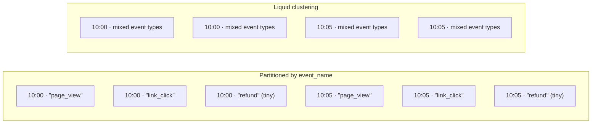

The table layout decides how the Lake Loader arranges your events table into files: which files a query has to open, and how many files the loader writes. The loader sets the layout when it creates the table, so you choose it before the loader first runs. For a short guide, see [Choose a layout](#choose-a-layout).

Every layout keeps the newest events together, so queries that filter on `load_tstamp`, including Snowplow's incremental data models, read only the files they need. The layouts differ in how they treat queries that also filter on `event_name` or `app_id`. Choose the layout that matches how you query your data. The difference to your total compute is a few percent either way, so it isn't a reason to migrate a table you already have.

## Available layouts

The Lake Loader offers three layouts for Delta and two for Iceberg:

| Layout | Delta | Iceberg | Suits |
| --- | --- | --- | --- |
| Partitioned by `event_name` (default) | Partitioned by `load_tstamp_date`¹ and `event_name` | Partitioned by `day(load_tstamp)` and `event_name` | Models and queries that target specific events |
| Partitioned by `app_id`² | Partitioned by `load_tstamp_date`¹ and `app_id` | Partitioned by `day(load_tstamp)` and `app_id` | Queries that target specific source applications, when you have only a few `app_id` values |
| Liquid clustering² | Not partitioned, with liquid clustering on `load_tstamp` | Not supported by Iceberg | Models that read every event type over a recent time range |

¹ On a partitioned Delta table, `load_tstamp_date` is a generated column, defined as `CAST(load_tstamp AS DATE)`. A liquid clustering table has no `load_tstamp_date` column.

² <AppliesTo feature="lake-loader-table-layout" />

A liquid clustering table starts out clustered by `load_tstamp` alone. It collects file statistics on `event_name` and `app_id` as well as on the timestamp columns. Delta can only cluster on a column it has statistics for, so collecting these statistics lets you add either column to the table's clustering keys later. See [Cluster by event type as well as time](/docs/api-reference/loaders-storage-targets/lake-loader/maintenance/index.md?lake-format=delta#cluster-by-event-type-as-well-as-time).

If Snowplow deploys your Lake Loader, choose the layout in Console when you create the loader. If you self-host the Lake Loader, choose the layout with the `output.good.partitionColumn` setting: `event_name`, `app_id`, or `null` for liquid clustering. See the [configuration reference](/docs/api-reference/loaders-storage-targets/lake-loader/configuration-reference/index.md).

:::note[Session timestamp]
If you use [Snowplow's dbt packages](/docs/modeling-your-data/modeling-your-data-with-dbt/dbt-models/index.md), set the `snowplow__session_timestamp` variable to `load_tstamp`, so that the models' incremental queries filter on the column every layout is arranged by.
:::

## How each layout arranges your files

The Lake Loader commits a batch of events to the lake every few minutes. Every file in a commit has the same `load_tstamp`. The layouts differ in how each commit is split into files.

A partitioned table gets a separate file for every event type in every commit, written into that event type's partition. A liquid clustering table gets roughly one file per CPU core of the loader in every commit, and each file holds a mix of event types. The diagram shows two commits, five minutes apart:

In text, the diagram shows:

1. On the partitioned table, every commit writes one file per event type, so rare events such as `refund` produce a tiny file in every commit.
2. On the liquid clustering table, every commit writes a few larger files, each holding a mix of event types.
3. On both tables, every file covers exactly one point in time, so a query on a recent `load_tstamp` range skips every older file.

This leads to different strengths:

- **Partitioning by `event_name` or `app_id`**: queries that look for specific event types, or specific source applications, are efficient. They go straight to the matching partitions and skip the rest. Queries that read every event in a time range, such as those in the [Snowplow Unified Digital](/docs/modeling-your-data/modeling-your-data-with-dbt/dbt-models/dbt-unified-data-model/index.md) dbt package, cost a few percent more in compute than on a liquid clustering table, because they open many small files: one for every event type, or every `app_id`, in every commit.
- **Liquid clustering**: queries that read every event in a time range are more efficient than on a partitioned table, because there are fewer files to open. Queries that look for specific event types or source applications are less efficient, because they can't skip files except by time range. Adding `event_name` or `app_id` as a second clustering key makes these queries much more efficient once the table is compacted. See [What you can change after the table is created](#what-you-can-change-after-the-table-is-created).

Every layout needs regular maintenance, because the Lake Loader writes new files every few minutes. Whichever layout you choose, schedule the jobs described in [Lake maintenance jobs](/docs/api-reference/loaders-storage-targets/lake-loader/maintenance/index.md).

## Choose a layout

Each layout suits a different way of querying your events table:

- **Partitioning by `event_name` (default)**: choose this if your queries mostly look for specific event types. This suits the [Snowplow Ecommerce](/docs/modeling-your-data/modeling-your-data-with-dbt/dbt-models/dbt-ecommerce-data-model/index.md) and [Snowplow Media Player](/docs/modeling-your-data/modeling-your-data-with-dbt/dbt-models/dbt-media-player-data-model/index.md) dbt packages, your own event-specific models, and analysis of particular events.
- **Partitioning by `app_id`**: choose this if your queries mostly look at specific source applications. This suits reporting on each website or mobile app separately, and [Snowplow's dbt packages](/docs/modeling-your-data/modeling-your-data-with-dbt/dbt-models/index.md) with the `snowplow__app_id` variable set. Efficiency degrades with hundreds of distinct `app_id` values, as in some multi-tenant or multi-brand setups.
- **Liquid clustering**: choose this if you use the Delta format and your modeling mostly reads every event type. This suits the [Snowplow Unified Digital](/docs/modeling-your-data/modeling-your-data-with-dbt/dbt-models/dbt-unified-data-model/index.md) dbt package on its own.

If your queries look for both specific event types and specific source applications, choose the partition column that most of your queries filter on. If you're not sure, keep the default layout, partitioned by `event_name`.

## What you can change after the table is created

The Lake Loader sets a table's partitioning when it creates the table, and the partitioning can't change afterwards. When the loader starts, it checks that the table's partitioning matches the layout it's configured with. If the table is partitioned differently, or is partitioned when the loader expects liquid clustering, or the other way around, the loader stops and reports a setup error. It reports the same error if you create the table yourself, ahead of the loader, with partitioning that doesn't match.

A liquid clustering table's clustering keys are different. The loader sets them when it creates the table, but never checks them afterwards, so you can change them at any time, without stopping the loader or changing its configuration. The next `OPTIMIZE` uses the new keys. For example, adding `event_name` as a second clustering key makes the table much more efficient for event-specific queries once it's compacted. See [Cluster by event type as well as time](/docs/api-reference/loaders-storage-targets/lake-loader/maintenance/index.md?lake-format=delta#cluster-by-event-type-as-well-as-time).

For how to compact each layout, see [Lake maintenance jobs](/docs/api-reference/loaders-storage-targets/lake-loader/maintenance/index.md). For every loader setting, see the [configuration reference](/docs/api-reference/loaders-storage-targets/lake-loader/configuration-reference/index.md).
