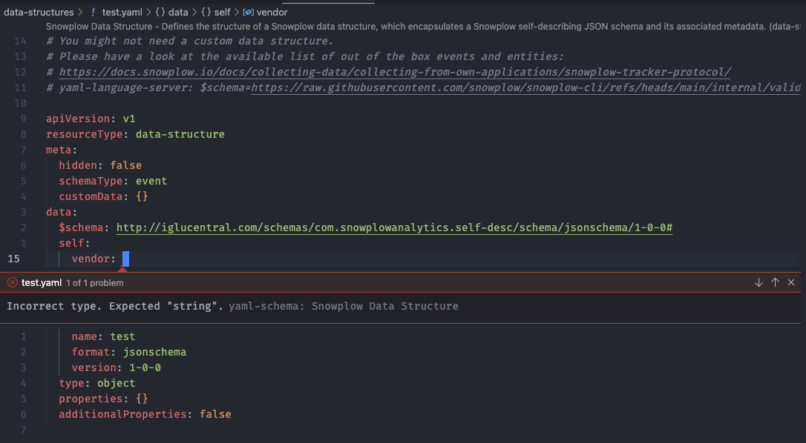

import Tabs from '@theme/Tabs';
import TabItem from '@theme/TabItem';
import TrackingPlansNomenclature from '@site/docs/reusable/tracking-plans-nomenclature/_index.md';

<Availability
  available={['cloud', 'pmc', 'selfHosted']}
  note="Snowplow CLI works with any pipeline. Sending events works with any Collector; managing data structures and tracking plans requires a Snowplow CDI (Console) account."
/>

<TrackingPlansNomenclature />

Snowplow CLI brings data management elements of Snowplow Console into the command line. It allows you to download your data structures and tracking plans to YAML/JSON files and publish them back to Console. This enables git-ops-like workflows, where your tracking design lives in your repository alongside your application code. Changes are reviewed and deployed through your standard development process.

## Install

Snowplow CLI can be installed with [homebrew](https://brew.sh/):
```bash
brew install snowplow/taps/snowplow-cli
```

Verify the installation with
```bash
snowplow-cli --help
```

For systems where homebrew is not available binaries for multiple platforms can be found in [releases](https://github.com/snowplow/snowplow-cli/releases).

Example installation for `linux_x86_64` using `curl`

```bash
curl -L -o snowplow-cli https://github.com/snowplow/snowplow-cli/releases/latest/download/snowplow-cli_linux_x86_64
chmod u+x snowplow-cli
```

Verify the installation with
```bash
snowplow-cli --help
```

## Configure

Commands that work with Console need to authenticate. There are two ways to do it:

* [Log in with your browser](#log-in-with-your-browser): for interactive use, when you run Snowplow CLI yourself in a terminal. This is the default.
* [Use an API key](#use-an-api-key): for non-interactive use, such as CI, where nobody can sign in.

### Log in with your browser

<AppliesTo feature="snowplow-cli-login" />

Run the `login` command:

```bash
snowplow-cli login
```

The command opens the Console sign-in page in your browser. If you belong to more than one organization, it asks you to select one.

After that, commands use this login when no API key is configured. They use the organization you selected at login, unless you set an organization ID in the configuration.

[Snowtype](/docs/event-studio/implement-tracking/install-snowtype/index.md#authenticate) shares the same login, so you only need to log in with one of the two tools.

To log out, run:

```bash
snowplow-cli logout
```

This also logs Snowtype out. It doesn't affect API keys.

:::note[API keys take precedence]
If an API key is configured, Snowplow CLI uses it instead of the saved login. Remove the API key from your configuration to use the login. To see which one is in use, run [`snowplow-cli status`](#verify-the-configuration).
:::

### Use an API key

For non-interactive use, such as CI, configure an API key. You need these values:

* An API key ID and the corresponding API key (secret), which you [create in Console](/docs/account-management/index.md#create-an-api-key).
* Your organization ID, which you can find [on the **Manage organization** page](https://console.snowplowanalytics.com/settings) in Console.

Snowplow CLI can take its configuration from a variety of sources. More details are available from `snowplow-cli data-structures --help`. Variations on these three examples should serve most cases.

<Tabs groupId="config">
  <TabItem value="env" label="env variables or .dotenv file" default>

  ```bash
  SNOWPLOW_CONSOLE_API_KEY_ID=********-****-****-****-************
  SNOWPLOW_CONSOLE_API_KEY=********-****-****-****-************
  SNOWPLOW_CONSOLE_ORG_ID=********-****-****-****-************
  ```

  </TabItem>
  <TabItem value="defaultconfig" label="$HOME/.config/snowplow/snowplow.yml" >

  ```yaml
  console:
    api-key-id: ********-****-****-****-************
    api-key: ********-****-****-****-************
    org-id: ********-****-****-****-************
  ```

  </TabItem>
  <TabItem value="args" label="inline arguments" >

  ```bash
  snowplow-cli data-structures --api-key-id ********-****-****-****-************ --api-key ********-****-****-****-************ --org-id ********-****-****-****-************
  ```

  </TabItem>
</Tabs>

The `setup` command can create the API key for you. It signs you in to Console in your browser, creates an API key, and saves it with your organization ID to the configuration file:

```bash
snowplow-cli setup
```

Your Console account must have permission to create API keys. The command takes these optional flags:
- `--read-only`: create a read-only API key
- `--dotenv`: store the configuration as a `.env` file in the current working directory

### Set the output format

Snowplow CLI defaults to yaml format. It can be changed to json by either providing a `--output-format json` flag or setting the `output-format: json` config value. It will work for all commands where it matters, not only for `generate`.

### Verify the configuration

To verify that everything works, run the `status` command:

```bash
snowplow-cli status
```

This command will:
- Check that a login or API credentials are configured, and show which of the two is in use (`auth=login` or `auth=api-key`)
- Verify connectivity to Snowplow Console
- Confirm your organization access
- Provide helpful troubleshooting information if issues are found

If the status check fails, the command suggests the next steps, such as running `snowplow-cli login` again.

### Configure YAML language server (optional)

During the tracking plans authoring process it's convenient to have the editor highlight errors, suggest possible values, and show examples.
All files generated by Snowplow CLI's `generate` and `download` commands will contain a special comment as part of the file. This comment can be interpreted by a YAML Language server.

For VS Code you can get this authoring functionality using this [YAML extension](https://marketplace.visualstudio.com/items?itemName=redhat.vscode-yaml). Instructions for other editors can be found [here](https://github.com/redhat-developer/yaml-language-server?tab=readme-ov-file#clients).

After that running `snowplow-cli ds generate test` and opening the generated file in the configured editor of choice should look something like the following:



## MCP server

The Snowplow CLI includes a local Model Context Protocol (MCP) server that enables natural language interaction with AI assistants like Claude Desktop, Cursor, GitHub Copilot, and other MCP-compatible clients for creating, validating, and managing your Snowplow tracking plans. This allows you to:

- Create and validate data structures through conversation
- Analyze tracking requirements and suggest implementations
- Validate tracking plans and source applications

For setup instructions and configuration examples for different MCP clients, see [CLI MCP server](/docs/ai/cli-mcp-server/index.md) and the [MCP tutorial](/tutorials/snowplow-cli-mcp/introduction).

The CLI MCP server works on tracking plan files on your machine. To work with your Snowplow Console account, including pipelines, failed events, enrichments, and Signals, directly from your codebase, install the remote [Snowplow MCP server](/docs/ai/snowplow-mcp/index.md) and the Snowplow [skills](/docs/ai/skills/index.mdx) in your coding agent with `npx plugins add snowplow/skills`.

## Use cases

- [Manage your data structures with snowplow-cli](/docs/api-reference/snowplow-cli/data-structures/index.md)
- [Send events from the command line with snowplow-cli](/docs/api-reference/snowplow-cli/send-events/index.md)
- [Manage tracking as code with Snowtype and Snowplow CLI](/tutorials/tracking-as-code/introduction)
