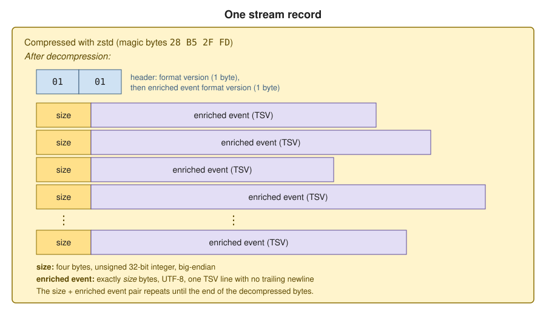

```mdx-code-block
import Tabs from '@theme/Tabs';
import TabItem from '@theme/TabItem';
```

Enrich can compress the enriched stream. When compression is enabled, Enrich batches many enriched events into a single stream record (a Kinesis record, Pub/Sub message, Kafka record, or Event Hubs event) and compresses that record. This reduces the volume of data in the stream, which reduces your cloud streaming costs.

The Snowplow loaders, Snowbridge (Event Forwarding) and Signals read compressed records. If you run your own application that consumes directly from the enriched stream, you need to update it to decompress the records before you enable compression. This page describes the record format so that you can write that code, in any language, with or without help from an AI coding agent.

Each enriched event inside a compressed record uses the same [enriched TSV format](/docs/destinations/custom-streaming/enriched-tsv-format/index.md) as an uncompressed record. Once your consumer has split a compressed record into individual events, you can process those events exactly as before, including with the [Analytics SDKs](/docs/api-reference/analytics-sdk/index.md).

## Prepare your consumer before enabling compression

Enriched stream compression is opt-in. For Snowplow Private Managed Cloud pipelines, enable it in Console: go to your pipeline, then select **Additional settings** > **Enriched stream compression** > **Enable**. For self-hosted pipelines, follow the [Enrich 6.11.x upgrade guide](/docs/api-reference/enrichment-components/upgrade-guides/6-11-x-upgrade-guide/index.md).

Deploy your updated consumer before you enable compression. After you enable it, your consumer receives a mixture of uncompressed and compressed records for a while, because records written before the change remain in the stream until they are consumed or expire. Your consumer must accept both kinds of record. The parsing algorithm on this page handles both.

A compressed record contains many events, so Enrich does not apply your configured partition key, Pub/Sub message attributes, or Kafka record headers to it. If your consumer filters or routes records using any of these, change it to read the values from the enriched events instead.

## Understand the compressed record format

Each compressed stream record contains a header followed by a batch of enriched events. The whole record is compressed as a single [zstd](https://facebook.github.io/zstd/) frame.

This page describes zstd, which is the default. If you self-host Enrich and set `compression.type` to `gzip`, each record is a gzip stream instead, starting with the bytes `1F 8B`. The decompressed layout is the same.



After decompression, the bytes are laid out as follows:

| Bytes | Content |
| ----- | ------- |
| 1 | The compressed record format version. This is always `01` for the format described on this page. |
| 1 | The enriched event format version. `01` means each event is an enriched TSV line, encoded as UTF-8, with no trailing newline. |
| 4 | The size, in bytes, of the next enriched event. This is an unsigned 32-bit integer in big-endian byte order. |
| size | The enriched event. |

The size and enriched event pair repeats until the end of the decompressed bytes. A record contains at least one event. There is no count of events and no terminator.

Here are the first 22 bytes of a decompressed record, taken from the [example record](#test-your-parser-with-the-example-record):

```txt
01 01 00 00 03 A8 74 65 73 74 2D 77 65 62 2D 64 61 74 61 09 77 65
```

The header is `01 01`. The size of the first event is `00 00 03 A8`, which is 936 bytes. The event itself starts with `74 65 73 74 2D 77 65 62 2D 64 61 74 61`, which is `test-web-data`, the value of the first TSV field, `app_id`. Next comes `09`, the tab character that separates the fields.

## Parse a stream record

To read the events from a stream record:

1. Check whether the record is compressed. If the first four bytes are `28 B5 2F FD`, the zstd magic number, it is compressed. Otherwise, it is an uncompressed record containing a single enriched TSV event, and you can stop here.
2. Decompress the whole record with zstd.
3. Read the first byte. If it is not `01`, raise an error.
4. Read the second byte. If it is not `01`, raise an error.
5. Read the next four bytes as a big-endian unsigned 32-bit integer. This is the size of the next event.
6. Read the next `size` bytes and decode them as a UTF-8 string. This is one enriched event in TSV format.
7. Repeat steps 5 and 6 until you reach the end of the decompressed bytes.

An uncompressed record can't start with the zstd magic number, because `B5` can't follow `28` in valid UTF-8. So step 1 always tells compressed and uncompressed records apart.

The version bytes in steps 3 and 4 identify the format. Raising an error on an unknown version prevents your consumer from silently dropping or corrupting events.

The examples below check the version bytes, but don't check for truncated or malformed records. Add those checks if your consumer needs them.

:::note[Decompress with a streaming API]

Snowplow writes each zstd frame in streaming mode, so the frame header doesn't declare the decompressed size. Some zstd libraries have a one-shot decompression function that requires this size and fails without it. For example, `ZstdDecompressor().decompress()` in the Python `zstandard` package fails with `could not determine content size in frame header`. Use the library's streaming API instead, as shown in the examples below.

:::

The following examples implement this algorithm. Each one takes the bytes of a single stream record and returns the enriched events as a list of TSV strings. Where Snowplow provides an [Analytics SDK](/docs/api-reference/analytics-sdk/index.md) for the language, the example also includes an optional second function. It takes the same bytes, calls the first function, and returns the events parsed by the SDK. You only need it if you use the SDK.

<Tabs groupId="language" queryString>
  <TabItem value="python" label="Python" default>

This example requires Python 3.9 or later and uses the [`zstandard`](https://pypi.org/project/zstandard/) package. The optional `parse_record_to_events` function uses the [Python Analytics SDK](/docs/api-reference/analytics-sdk/analytics-sdk-python/index.md).

```python
import io
import struct

import zstandard  # pip install zstandard
from snowplow_analytics_sdk.event_transformer import transform  # Optional: pip install snowplow_analytics_sdk

ZSTD_MAGIC = b"\x28\xb5\x2f\xfd"


def decompress(record: bytes) -> bytes:
    # Use a stream reader: Snowplow's zstd frames don't declare their content size,
    # so ZstdDecompressor().decompress() would fail
    with zstandard.ZstdDecompressor().stream_reader(io.BytesIO(record)) as reader:
        return reader.read()


def parse_record(record: bytes) -> list[str]:
    """Returns the enriched events in a stream record, as TSV strings."""
    if not record.startswith(ZSTD_MAGIC):
        # Uncompressed record: a single enriched event
        return [record.decode("utf-8")]

    data = decompress(record)
    if data[0] != 1:
        raise ValueError(f"Unsupported compressed record format version {data[0]}")
    if data[1] != 1:
        raise ValueError(f"Unsupported enriched event format version {data[1]}")

    events = []
    pos = 2
    while pos < len(data):
        (size,) = struct.unpack_from(">I", data, pos)  # 4-byte big-endian unsigned int
        pos += 4
        events.append(data[pos : pos + size].decode("utf-8"))
        pos += size
    return events


def parse_record_to_events(record: bytes) -> list[dict]:
    """Optional: returns the enriched events in a stream record, parsed by the Python Analytics SDK."""
    return [transform(event) for event in parse_record(record)]
```

  </TabItem>
  <TabItem value="go" label="Go">

This example uses the [`github.com/klauspost/compress/zstd`](https://pkg.go.dev/github.com/klauspost/compress/zstd) package. The optional `ParseRecordToEvents` function uses the [Go Analytics SDK](/docs/api-reference/analytics-sdk/analytics-sdk-go/index.md).

```go
package main

import (
	"bytes"
	"encoding/binary"
	"fmt"
	"io"

	"github.com/klauspost/compress/zstd"
	"github.com/snowplow/snowplow-golang-analytics-sdk/analytics" // Optional
)

var zstdMagic = []byte{0x28, 0xb5, 0x2f, 0xfd}

func decompress(record []byte) ([]byte, error) {
	zr, err := zstd.NewReader(bytes.NewReader(record))
	if err != nil {
		return nil, err
	}
	defer zr.Close()
	return io.ReadAll(zr)
}

// ParseRecord returns the enriched events in a stream record, as TSV strings.
func ParseRecord(record []byte) ([]string, error) {
	if !bytes.HasPrefix(record, zstdMagic) {
		// Uncompressed record: a single enriched event
		return []string{string(record)}, nil
	}

	data, err := decompress(record)
	if err != nil {
		return nil, err
	}
	if data[0] != 1 {
		return nil, fmt.Errorf("unsupported compressed record format version %d", data[0])
	}
	if data[1] != 1 {
		return nil, fmt.Errorf("unsupported enriched event format version %d", data[1])
	}

	var events []string
	pos := 2
	for pos < len(data) {
		size := int(binary.BigEndian.Uint32(data[pos : pos+4]))
		pos += 4
		events = append(events, string(data[pos:pos+size]))
		pos += size
	}
	return events, nil
}

// ParseRecordToEvents is optional: it returns the enriched events in a stream record, parsed by the Go Analytics SDK.
func ParseRecordToEvents(record []byte) ([]analytics.ParsedEvent, error) {
	events, err := ParseRecord(record)
	if err != nil {
		return nil, err
	}
	parsed := make([]analytics.ParsedEvent, 0, len(events))
	for _, event := range events {
		p, err := analytics.ParseEvent(event)
		if err != nil {
			return nil, err
		}
		parsed = append(parsed, p)
	}
	return parsed, nil
}
```

  </TabItem>
  <TabItem value="java" label="Java">

This example requires Java 9 or later and uses the [`zstd-jni`](https://github.com/luben/zstd-jni) library. Snowplow doesn't provide an Analytics SDK for Java, so this example has no conversion function. The [enriched TSV format](/docs/destinations/custom-streaming/enriched-tsv-format/index.md) page lists the fields in each event.

```java
import com.github.luben.zstd.ZstdInputStream;

import java.io.ByteArrayInputStream;
import java.io.IOException;
import java.io.InputStream;
import java.nio.ByteBuffer;
import java.nio.charset.StandardCharsets;
import java.util.ArrayList;
import java.util.List;

public class SnowplowRecordParser {

    private static boolean isZstd(byte[] r) {
        return r.length >= 4 && (r[0] & 0xff) == 0x28 && (r[1] & 0xff) == 0xb5
            && (r[2] & 0xff) == 0x2f && (r[3] & 0xff) == 0xfd;
    }

    private static byte[] decompress(byte[] record) throws IOException {
        // Use a stream: Snowplow's zstd frames don't declare their content size
        try (InputStream decompressed = new ZstdInputStream(new ByteArrayInputStream(record))) {
            return decompressed.readAllBytes();
        }
    }

    /** Returns the enriched events in a stream record, as TSV strings. */
    public static List<String> parseRecord(byte[] record) throws IOException {
        List<String> events = new ArrayList<>();
        if (!isZstd(record)) {
            // Uncompressed record: a single enriched event
            events.add(new String(record, StandardCharsets.UTF_8));
            return events;
        }

        ByteBuffer data = ByteBuffer.wrap(decompress(record)); // big-endian by default
        int formatVersion = data.get() & 0xff;
        if (formatVersion != 1) {
            throw new IOException("Unsupported compressed record format version " + formatVersion);
        }
        int eventVersion = data.get() & 0xff;
        if (eventVersion != 1) {
            throw new IOException("Unsupported enriched event format version " + eventVersion);
        }

        while (data.hasRemaining()) {
            int size = data.getInt();
            byte[] event = new byte[size];
            data.get(event);
            events.add(new String(event, StandardCharsets.UTF_8));
        }
        return events;
    }
}
```

  </TabItem>
  <TabItem value="scala" label="Scala">

This example requires Scala 2.13 or later and uses the [`zstd-jni`](https://github.com/luben/zstd-jni) library. The optional `parseRecordToEvents` function uses the [Scala Analytics SDK](/docs/api-reference/analytics-sdk/analytics-sdk-scala/index.md).

```scala
import cats.implicits._
import com.github.luben.zstd.ZstdInputStream
import com.snowplowanalytics.snowplow.analytics.scalasdk.{Event, ParsingError} // Optional

import java.io.ByteArrayInputStream
import java.nio.ByteBuffer
import java.nio.charset.StandardCharsets.UTF_8
import scala.util.Using

object SnowplowRecordParser {

  private val ZstdMagic = Array[Byte](0x28, 0xb5.toByte, 0x2f, 0xfd.toByte)

  // Use a stream: Snowplow's zstd frames don't declare their content size
  private def decompress(record: Array[Byte]): Array[Byte] =
    Using.resource(new ZstdInputStream(new ByteArrayInputStream(record)))(_.readAllBytes())

  /** Returns the enriched events in a stream record, as TSV strings. */
  def parseRecord(record: Array[Byte]): List[String] =
    if (!record.startsWith(ZstdMagic))
      // Uncompressed record: a single enriched event
      List(new String(record, UTF_8))
    else {
      val data = ByteBuffer.wrap(decompress(record)) // big-endian by default
      val formatVersion = data.get() & 0xff
      require(formatVersion == 1, s"Unsupported compressed record format version $formatVersion")
      val eventVersion = data.get() & 0xff
      require(eventVersion == 1, s"Unsupported enriched event format version $eventVersion")

      Iterator
        .continually(data)
        .takeWhile(_.hasRemaining)
        .map { d =>
          val event = new Array[Byte](d.getInt())
          d.get(event)
          new String(event, UTF_8)
        }
        .toList
    }

  /** Optional: returns the enriched events in a stream record, parsed by the Scala Analytics SDK. */
  def parseRecordToEvents(record: Array[Byte]): Either[ParsingError, List[Event]] =
    parseRecord(record).traverse(Event.parse(_).toEither)
}
```

  </TabItem>
</Tabs>

## Test your parser with the example record

Download the [example stream record](pathname:///assets/enriched-compressed-example.zst) to test your parser. It contains the same 32 enriched events as the [example TSV file](pathname:///assets/input.tsv), batched into a single compressed record by the same code that Enrich uses.

Your parser is correct if it returns 32 events from the example record, and each event is byte-for-byte identical to the corresponding line of `input.tsv`, without the trailing newline. You should also check that your parser returns a single event when you pass it one line of `input.tsv` as an uncompressed record.

In production, a compressed record usually contains many more events than the example record. The example record decompresses to about eight times its compressed size. If your consumer limits how much data it fetches or holds in memory using a byte limit, such as a Kafka fetch size or Pub/Sub flow control, remember that the limit counts compressed bytes. The decompressed events in memory can be many times larger than the limit.
