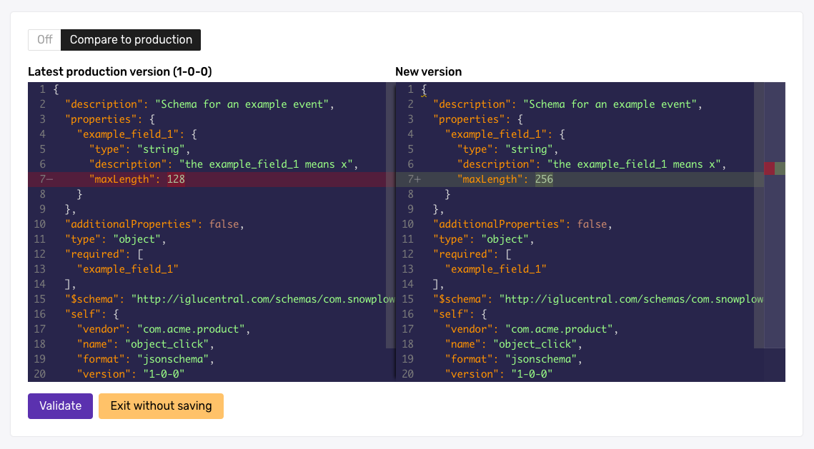

Console offers two ways to create and edit [data structures](/docs/fundamentals/schemas/index.md). Use the builder for simple data structures with basic types and validation rules. Use the JSON editor for more complex data structures that require nesting or more advanced data types.

Console saves every new data structure as a draft. See [Work with drafts](/docs/event-studio/data-structures/index.md#work-with-drafts).

## Before you begin

Two [data structure permissions](/docs/account-management/managing-permissions/index.md#data-structures) apply to this page. The **Create** permission lets you create data structures. **Edit on development** lets you edit them and publish them to the development registry.

The data structure builder supports the following types:

- String
- Enumerated list
- Integer
- Decimal
- Boolean

For data structures that need other types or nesting, use the JSON editor. To understand all available JSON Schema validation options, see the [JSON Schema reference](/docs/api-reference/json-schema-reference/index.md).

## Create a data structure with the builder

The builder creates a data structure from a form, one property at a time.

<Steps>

### Open the builder

In Console, go to **Data collection** > **Data structures** and click the **Create data structure** button.

### Fill in the general information

Populate the general information: **Name**, **Description**, and **Vendor**. Vendor allows you to organize your data structures, for example, by teams. Snowplow automatically generates the tracking URL to reference in your tracking code.

### Add properties

Add one or more properties. For each property, you can set a name, description, its type, and a possible enumeration of allowed values (for type `string`). You can also set additional constraints to define if this property should be optional or mandatory, and if `null` values are allowed.

Click **Save** on the property dialog box to save your property changes.

### Save the draft

Click **Save** on the data structure page to save your data structure as a draft. The draft isn't yet deployed to your development environment and can't be used for event validation. When you're ready to test the data structure, deploy it from the draft state to your development environment. [Deploy data structures to your development environment](/docs/event-studio/test-and-publish/index.md#deploy-data-structures-to-your-development-environment) describes deployment from the JSON editor.

</Steps>

## Create a data structure with the JSON editor

The JSON editor lets you write the JSON schema directly, which supports nesting and advanced data types.

<Steps>

### Choose the data structure type

In Console, go to **Data collection** > **Data structures**, click the **Create data structure** button, and choose the JSON editor. Select whether you'd like to create an [event](/docs/fundamentals/events/index.md) or an [entity](/docs/fundamentals/entities/index.md). You can always change this selection later.

<ThemedImage
  alt="Choice between builder and JSON editor options"
  width="60%"
  sources={{
    light: require('./images/image-2.png').default,
    dark: require('./images/image-2.png').default
  }}
/>

### Write the schema

Write the first version of your JSON schema for this data structure. The code window contains template JSON to start you off. For comprehensive guidance on all supported JSON Schema features and validation options, see the [JSON Schema reference](/docs/api-reference/json-schema-reference/index.md).

### Validate the schema

Click the **Validate** button. Console checks that your schema is valid JSON markup. Once it passes validation, you can save your data structure as a draft.

### Save the draft

Click **Save as draft** to save your data structure as a draft. As this is the first version of your data structure, it becomes version `1-0-0` when you later [deploy it to your development environment](/docs/event-studio/test-and-publish/index.md#deploy-data-structures-to-your-development-environment).

</Steps>

## Edit a data structure

To edit an existing data structure, navigate to **Data structures** and locate the data structure you wish to edit. You can find your data structure by:

- Using the search facility to search by name or vendor
- Ordering the Name column alphabetically
- Filtering the listing by Type and / or Vendor

Once located, click the name to view the data structure. You can then select from two options to edit the data structure: **Edit with builder** or **Edit with JSON editor**.

:::note[Options depend on the data structure]
The **Edit with builder** option is unavailable if the builder doesn't support the data structure you're viewing. You must edit more complex data structures with the JSON editor.
:::

### Edit with the builder

On the edit page, under the **General Information** panel, you can update the data structure type or its description. To add a new property, click the **Add Property** button. To edit or delete an existing property, click the three dots next to the property name to open the action menu, and then select the appropriate option.

When you modify the data structure, the builder marks your changes in yellow, and automatically determines the new version of your data structure based on these modifications. You can reset the data structure and erase all changes at any moment by clicking the **Clear Changes** button in the alert beneath the properties.

If you're satisfied with your changes, click **Save** and note the newly updated tracking URL.

### Edit with the JSON editor

Make the required edits to the JSON schema. You can use the **Difference** toggle above the editor to see a diff view against the latest production version of your data structure.

In this example, the `maxLength` of `example_field_1` has changed.

Once you're happy with your changes, click **Validate** to ensure you have valid JSON markup.

To deploy your changes, see [Deploy data structures to your development environment](/docs/event-studio/test-and-publish/index.md#deploy-data-structures-to-your-development-environment). To choose the right version number for your changes, see [Version and amend data structures](/docs/event-studio/data-structures/versioning/index.md).
