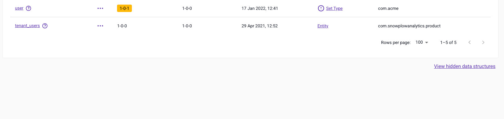
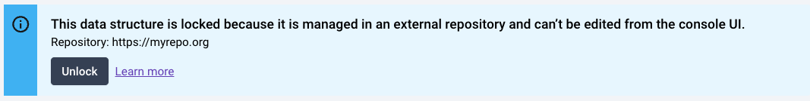

Sometimes you make errors when creating a [data structure](/docs/fundamentals/schemas/index.md), or create new data structures as part of a quick experiment. On these occasions you can hide the data structure to clean up the listing in Console, and restore it later if you need it.

Data structures that you manage from an external repository are locked in Console. You can unlock them if you need to edit them from Console.

## Hide a data structure

Navigate to **Data structures** and locate the data structure you wish to hide. You can find your data structure by:

- Using the search facility to search by name
- Ordering the Name column alphabetically
- Filtering the listing by Type and / or Vendor

Once located, either click the name to view the data structure and then click the **Hide** button, or click the three dots to bring up the action menu where you can select **Hide data structure**.

Follow the dialog instructions to confirm the action.

:::note[Hidden data structures are not deleted]
Hiding a data structure doesn't remove it from the registry, it only hides it from the Console listing. This means:

- Events can still be sent against this data structure
- You can't create a new data structure with the same name
- Draft data structures can't be hidden, only deleted, so they never appear as hidden. See [Work with drafts](/docs/event-studio/data-structures/index.md#work-with-drafts).
:::

### Restore a hidden data structure

If you have hidden a data structure and wish to restore it, navigate to the bottom of the list of data structures and locate the **View hidden data structures** link.

This link takes you to a list of hidden data structures. Locate the one you wish to restore and click **Restore data structure** to show it in the main listing.

## Unlock an externally managed data structure

You can manage data structures from an external repository using [Snowplow CLI](/docs/api-reference/snowplow-cli/data-structures/index.md).

When you manage a data structure this way, it becomes locked in the UI, disabling all editing. Console shows a banner explaining the situation, and gives people with the **Edit on production** permission (the default for admin users) the ability to unlock it.

:::tip[Keep a single source of truth]
Having a single source of truth for a data structure is a good idea. If your source of truth is an external repository, then unlocking and editing in Console will cause conflicts.
:::
