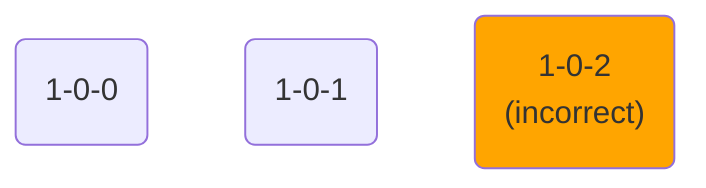
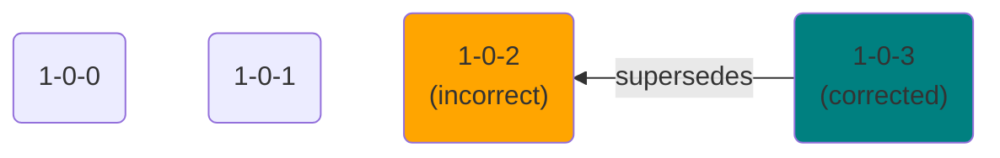
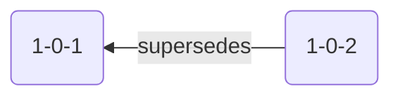
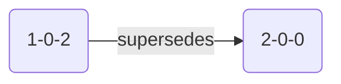
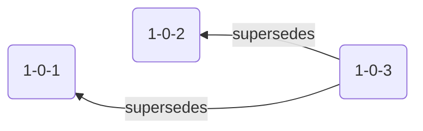
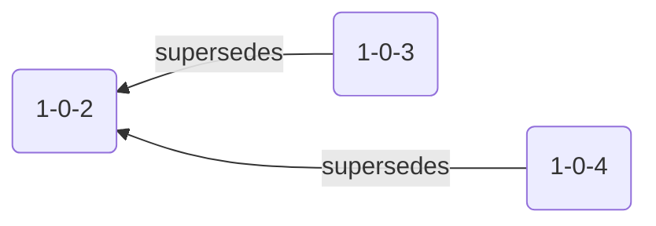
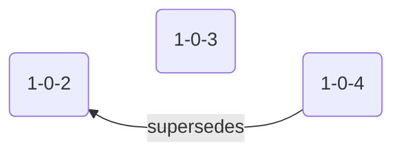
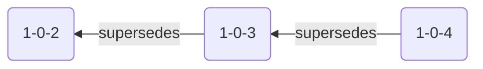
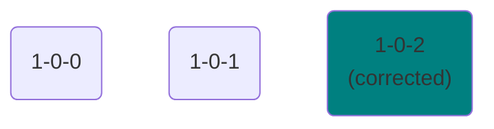

Aim to treat each schema version as immutable. However, if you can't avoid making changes to an existing schema version, you have two options: marking it as superseded, or patching the schema.

## What superseding and patching are and why they matter

Mistakes sometimes reach a schema version, for example a field marked as required that should be optional, or a missing field. The usual fix is to create a new schema version and update the tracking code to use it. When that isn't possible or practical, superseding and patching let you fix the mistake without waiting for the tracking code to change:

- Superseding: creates a new, corrected schema version and marks the incorrect version as superseded by it. Enrich then validates events that reference the incorrect version against the corrected one. Use superseding for schema versions that are already in production, especially when you can't quickly update the tracking code, as is common with mobile apps.
- Patching: overwrites the content of an existing schema version without changing its version number. Only patch schema versions that aren't in production yet.

## How superseding and patching work

Superseding adds a new version that takes over validation for one or more earlier versions. Patching changes an existing version in place.

### Mark a schema as superseded

To supersede a schema version, you create a new version that lists the incorrect version in a `$supersedes` field. Iglu Server records the relationship, and Enrich uses it during validation.

Marking a schema as superseded requires these component versions:

<AppliesTo feature="schema-superseding-enrich" />

<AppliesTo feature="schema-superseding-iglu-server" />

<AppliesTo feature="schema-superseding-micro" />

Before:



After:



Here's how this works, at a glance:
* Suppose schema `1-0-2` is wrong.
* Draft a new schema version correcting the issue.
* In the new schema, add the following field at the root: `"$supersedes": ["1-0-2"]`.
* [Set the version](/docs/event-studio/data-structures/versioning/index.md) of the new schema as usual, i.e. `1-0-3` if there are no breaking changes or `2-0-0` if there are.
* [Add](/docs/event-studio/test-and-publish/index.md#promote-data-structures-to-production) the new schema to your production environment.
* Enrich updates events and entities that use schema `1-0-2` to use version `1-0-3`, and validates them against that version. Enrich also adds a special entity to these events to record this.

The `$supersedes` field states that the schema version defined in the `self` part supersedes the schema versions listed in the `$supersedes` field (one or more). Its value must be an array of strings, even if it only includes one item. For example:

```json
...
"$supersedes": ["1-0-2", "1-0-3"],
...
```

:::note[Patching and superseding]

Once you've defined the `$supersedes` field for a schema version, you can't update it, even in the development environment where patching is allowed. Likewise, you can't patch (overwrite) an existing schema version to add `$supersedes`.

You can only change which schema version supersedes which by creating _new_ schema versions.

For example, if version `1-0-2` is defined to supersede version `1-0-1`, and you create version `1-0-3` which also supersedes `1-0-1`, then the newest version, `1-0-3`, supersedes `1-0-1`. See [Rules for superseding](#rules-for-superseding) for how this is determined.

:::

:::tip[Schema caching]

Various pipeline components, most importantly Enrich (including Enrich embedded in Snowplow Micro), cache schemas to improve performance. The default caching time is 10 minutes, controlled by the [Iglu Resolver configuration](/docs/api-reference/iglu/iglu-resolver/index.md). This means that the effect of superseding a schema isn't immediate.

:::

### Rules for superseding

Iglu Server enforces the following rules for `$supersedes`.

#### A schema version can only supersede previous versions

For example, `1-0-2` can supersede `1-0-1`, but _can't_ supersede `1-0-3`, `1-1-0`, or `2-0-0`. Iglu Server rejects a schema with a definition that breaks this rule.

<table>
<thead><tr><td align="center">✅ OK</td><td align="center">❌ Invalid</td></tr></thead>
<tbody>
<tr>
<td>



</td>
<td>



</td>
</tr>
</tbody>
</table>

#### A schema version can supersede multiple previous versions at once

Enrich validates events that reference any of those versions against the superseding version.

<table>
<thead><tr><td align="center">✅ OK</td></tr></thead>
<tbody>
<tr>
<td>



</td>
</tr>
</tbody>
</table>

#### At any given moment, a schema version can only be superseded by a single schema version

Iglu Server automatically upholds this rule.

For example, if you specify that `1-0-3` supersedes `1-0-2` and later that `1-0-4` also supersedes `1-0-2`, the latest schema, `1-0-4`, automatically becomes the one that supersedes `1-0-2`.

<table>
<thead><tr><td align="center">Specified</td><td align="center">Becomes</td></tr></thead>
<tbody>
<tr>
<td>



</td>
<td>



</td>
</tr>
</tbody>
</table>

The same happens if you specify "chains", e.g. `1-0-3` supersedes `1-0-2` and `1-0-4` supersedes `1-0-3`. Iglu Server updates this automatically so that `1-0-4` supersedes `1-0-2` and `1-0-3`.

<table>
<thead><tr><td align="center">Specified</td><td align="center">Becomes</td></tr></thead>
<tbody>
<tr>
<td>



</td>
<td>


</td>
</tr>
</tbody>
</table>

### Overwrite a schema

Overwriting a schema (also called "patching") is available if your schema version isn't yet in production.

:::danger[Development schemas only]
For Snowplow CDI customers, patching is disabled for production pipelines.

Patching in a production environment can break your loading, especially if your patch contains breaking changes.

Also, never patch a schema version that exists in a production environment, even if you are doing the patching in a development environment. This causes problems when you later try to promote that schema to production.
:::

If you are working on a new schema version in a development environment, patching is safer as it won't corrupt any production data.

Patching replaces the content of an existing version in place, so the version number stays the same. For example, patching an incorrect version `1-0-2` leaves a corrected `1-0-2`, with no new version.

Before:


After:



## Example

This example shows how superseding fixes events from a mobile app that fail validation because of a mistake in the tracking code.

Suppose you have a mobile application that sends events with entities that use the following schema:

<details>
  <summary>Geolocation <code>1-0-2</code></summary>

```json
{
    "$schema": "http://iglucentral.com/schemas/com.snowplowanalytics.self-desc/schema/jsonschema/1-0-0#",
    "description": "Schema for client geolocation contexts",
    "self": {
        "vendor": "com.acme",
        "name": "geolocation",
        "format": "jsonschema",
        "version": "1-0-2"
    },
    "type": "object",
    "properties": {
        "latitude": {
            "type": "number",
        },
        "longitude": {
            "type": "number",
        }
    },
    "additionalProperties": false
}
```

</details>

Later, you realize that the tracking code mistakenly includes an `altitude` field in the entity objects:

<details>
  <summary>Wrong tracking code (iOS)</summary>

```swift
let event = ScreenView(name: "Screen")
event.entities.add(
    SelfDescribingJson(schema: "iglu:com.acme/geolocation/jsonschema/1-0-2",
        andDictionary: [
            "latitude": 38.7223,
            "longitude": 9.1393,
            // highlight-next-line
            "altitude": 20 // extra field not defined in the schema
        ])!)
tracker.track(event)
```

</details>

Since `additionalProperties` is set to `false`, all events with the `altitude` field end up as [failed events](/docs/fundamentals/failed-events/index.md).

You can create a new schema with version `1-0-3` that contains the `altitude` field, and use this schema in the next version of the application. This makes the events valid. However, users don't all update their application to the new version at once. Events from the older version keep arriving, so failed events continue until all users are on the newer version.

To fix this, add the `$supersedes` field to the new schema:

<details>
  <summary>Geolocation <code>1-0-3</code> with <code>$supersedes</code></summary>

```json
{
    "$schema": "http://iglucentral.com/schemas/com.snowplowanalytics.self-desc/schema/jsonschema/1-0-0#",
    // highlight-next-line
    "$supersedes": ["1-0-2"],
    "description": "Schema for client geolocation contexts",
    "self": {
        "vendor": "com.acme",
        "name": "geolocation",
        "format": "jsonschema",
        "version": "1-0-3"
    },
    "type": "object",
    "properties": {
        "latitude": {
            "type": "number",
        },
        "longitude": {
            "type": "number",
        },
        "altitude": {
            "type": "number",
        }
    },
    "additionalProperties": false
}
```

</details>

When Enrich receives events from the mobile application that use schema `1-0-2`, it updates them to use schema `1-0-3` and validates them against that schema. These events are therefore valid.

To record this, Enrich adds an extra entity to all such events:

```json
{
    "schema": "iglu:com.snowplowanalytics.iglu/validation_info/jsonschema/1-0-0",
    "data": {
        "originalSchema": "iglu:com.acme/geolocation/jsonschema/1-0-2",
        "validatedWith": "1-0-3"
    }
}
```

Finally, if you [browse](/docs/event-studio/data-structures/index.md) schema version `1-0-2`, you can see that Iglu Server automatically keeps track of which schema supersedes which. Schema `1-0-2` contains a `$supersededBy` field:

<details>
  <summary>Geolocation <code>1-0-2</code> with <code>$supersededBy</code></summary>

```json
{
    "$schema": "http://iglucentral.com/schemas/com.snowplowanalytics.self-desc/schema/jsonschema/1-0-0#",
    // highlight-next-line
    "$supersededBy": "1-0-3",
    "description": "Schema for client geolocation contexts",
    "self": {
        "vendor": "com.acme",
        "name": "geolocation",
        "format": "jsonschema",
        "version": "1-0-2"
    },
    "type": "object",
    "properties": {
        "latitude": {
            "type": "number",
        },
        "longitude": {
            "type": "number",
        }
    },
    "additionalProperties": false
}
```

</details>

## Related concepts

- [Versioning schemas](/docs/fundamentals/schemas/versioning/index.md): how schema versions work and when a change is breaking.
- [Mark a schema as superseded](/docs/event-studio/data-structures/versioning/index.md#mark-a-schema-as-superseded) and [Patch a schema](/docs/event-studio/data-structures/versioning/index.md#patch-a-schema): the steps to supersede or patch a schema in Console.
- [Iglu Server](/docs/api-reference/iglu/iglu-repositories/iglu-server/index.md): the schema registry that tracks which versions supersede which.
