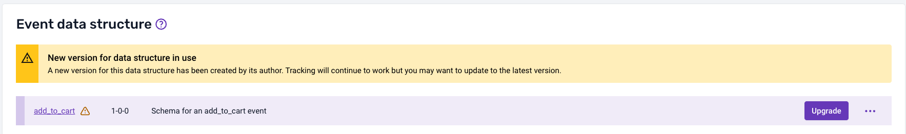
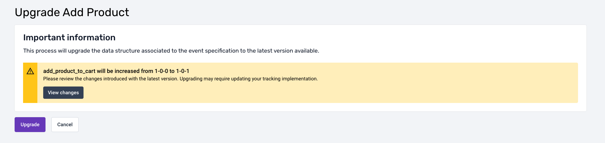
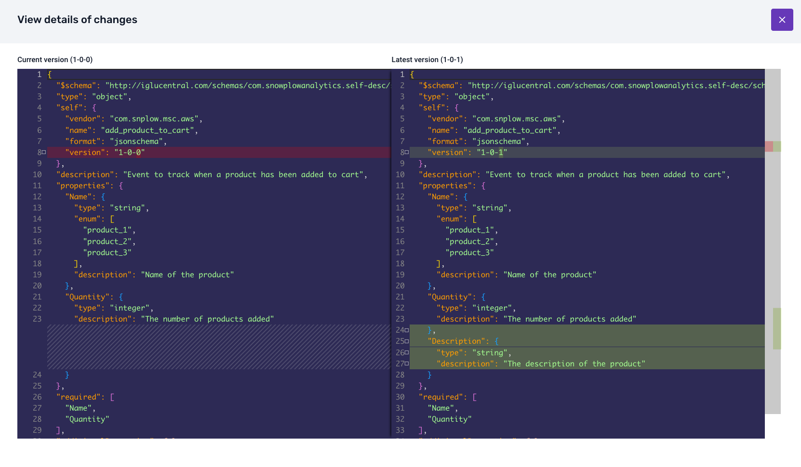
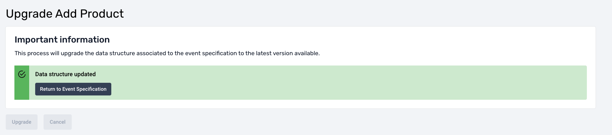
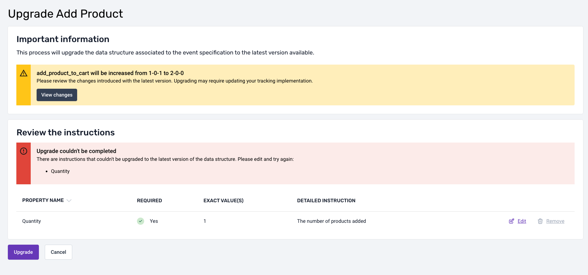

Tracking designs change as your data and events evolve. A change to a data structure usually affects the event specifications that reference it, and the tracking code that implements them. To roll out a change, you edit the data structure, choose the version, and deploy it to your development environment to test it. When the new version of the data structure becomes available, you upgrade the event specifications that reference it, publish the new specification version, regenerate your tracking code, and watch the rollout.

Every data structure is based on a versioned schema. For how Snowplow versions schemas and which changes are breaking, see [schema versioning](/docs/fundamentals/schemas/versioning/index.md).

## Change a data structure

Edit the data structure in Console with the builder or the JSON editor, as described in [Edit a data structure](/docs/event-studio/data-structures/create/index.md#edit-a-data-structure). The builder determines the new version from your changes, and the JSON editor asks you to select the version when you publish, as described in [Version and amend data structures](/docs/event-studio/data-structures/versioning/index.md). Deploy the new version to your development environment to test it, as described in [Deploy data structures to your development environment](/docs/event-studio/test-and-publish/index.md#deploy-data-structures-to-your-development-environment).

## Upgrade event specifications to the new version

[Data structures](/docs/fundamentals/schemas/index.md) define reusable JSON schemas, which different event specifications can reference for their events and entities. Each [event specification](/docs/event-studio/tracking-plans/event-specifications/index.md) can contain instructions that rely on a specific version of a data structure, to specialize or constrain the event specification in a more granular way.

A new version of a data structure can be compatible or incompatible with previous versions. Changes can conflict with the instructions in event specifications, for both events and entities, that reference an older version of the data structure. Console lets you upgrade the event specification instructions to the new version.

When a new version of a data structure is available, Console indicates that the event or entity that references the data structure has a new version available, and shows an **Upgrade** button.

Clicking **Upgrade** opens a page that shows the new version you're upgrading to, along with a **View changes** button.

Click **View changes** to see the differences between the current version of the data structure and the version you're upgrading to.

At the bottom of the page, a button confirms the upgrade. When you confirm, the upgrade either completes without conflicts, or Console asks you to resolve conflicts.

### Upgrade without conflicts

If the event specification instructions are compatible with the new data structure version, Console upgrades the event specification to the new version of the data structure. All instructions update without any further action from you.

### Resolve conflicts

If the new version of the data structure introduces incompatibilities with the existing event specification instructions, Console flags the conflicting properties. You must resolve these conflicts before Console can upgrade the event specification.

The conflict resolution options depend on the type of incompatibility:

- **Remove conflicting instructions**: when a property is no longer present in the new data structure version
- **Modify conflicting instructions**: when a property in the new data structure version has changed in an incompatible way, for example a type change, added or removed enum values, or an added pattern

## Publish the new specification version

Publish the upgraded event specification to make the new version active in the pipeline, as described in [Publish event specifications](/docs/event-studio/test-and-publish/index.md#publish-event-specifications). The publishing flow checks that the data structures the specification references have been promoted to production, and requires you to promote any that haven't in the same step.

The **History** tab of an event specification lists its versions, with the changes between any two versions.

An event tracked with Snowtype version 0.17.0 or later declares the specification version it was tracked against, and the pipeline [validates](/docs/event-studio/tracking-plans/event-specification-validation/index.md) each event against that version. When you publish a new version of a specification, events from existing tracker code continue to declare the previous version, validating against its instructions. The new version applies once you regenerate your tracker code with [Snowtype](/docs/event-studio/implement-tracking/index.md) and deploy the updated tracker code, after which new events declare and validate against the new version.

Different versions of a specification can coexist. Each event validates against the version it declares, whether the variation comes from a rolling update, from different applications using different versions, or from different deployment stages.

## Update tracking code and watch the rollout

Snowtype can [detect new versions and regenerate your code](/docs/event-studio/implement-tracking/keep-code-up-to-date/index.md). Then deploy the regenerated tracker code.

To follow the rollout, open the event specification's **Tracking summary** tab, which breaks event volumes down by specification version and application ID. Use it to check that the new version has reached all applications, or that an application still sends an old version. See [Track specification versions and application IDs](/docs/event-studio/tracking-plans/data-quality/index.md#track-specification-versions-and-application-ids).
