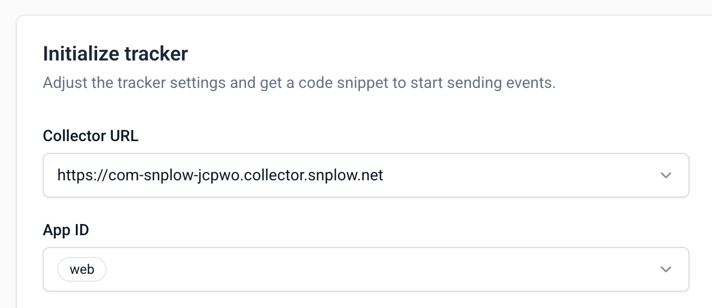
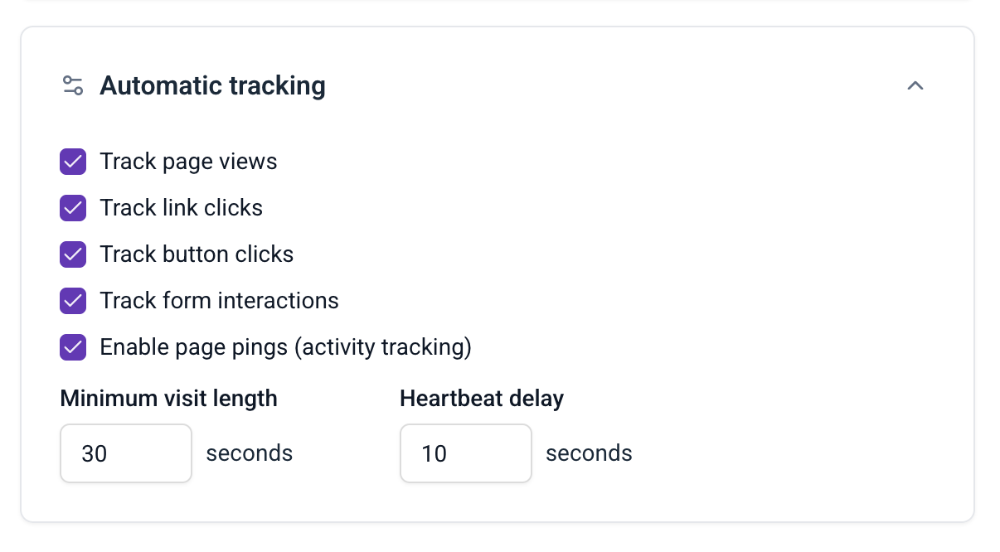
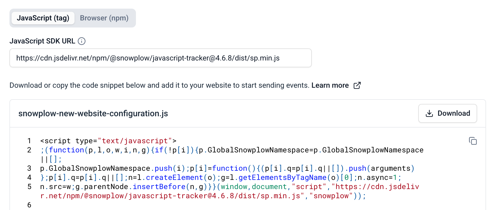
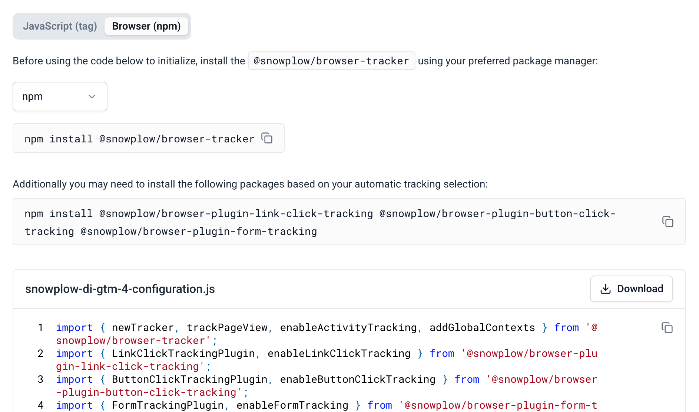

import Tabs from '@theme/Tabs';
import TabItem from '@theme/TabItem';
import AiAssistantInstall from '@site/docs/reusable/ai-assistant-install/_index.md';

Once you've defined the [event specifications](/docs/event-studio/tracking-plans/event-specifications/index.md) in your tracking plan, developers use them to instrument tracking code in your applications, either manually or with code generation in Console or Snowtype.

## Before you begin

Before you hand off a tracking plan, you need:

* A [tracking plan](/docs/event-studio/tracking-plans/create-and-manage/index.md) with its [event specifications](/docs/event-studio/tracking-plans/event-specifications/index.md) defined.
* A [source application](/docs/event-studio/source-applications/create/index.md), to use the **Set up tracking** tab.

## Choose an implementation method

Pick the method that fits the tracker and the work your developers need to do. For custom tracking on web, you can use the Console code snippets with or without Snowtype.

| Method | What developers get | Go to |
| --- | --- | --- |
| **Set up tracking** tab on a source application | A tracker initialization snippet, with the Collector URL, app ID, and automatic tracking settings you choose. JavaScript tracker only. | [Initialize the tracker from a source application](#initialize-the-tracker-from-a-source-application) |
| Console code snippets | The exact tracking call for each event specification, including all required properties and entities. JavaScript tracker only, for event specifications with custom event data structures. | [Share event-specific code snippets](#share-event-specific-code-snippets) |
| Snowtype | Type-safe tracking code generated from your event specifications and data structures, for the [supported trackers](/docs/event-studio/implement-tracking/index.md#supported-trackers). The **Implement tracking** button on a tracking plan page gives the Snowtype generate command for that plan. | [Generate tracking code with Snowtype](#generate-tracking-code-with-snowtype) |
| A coding agent with the Snowplow MCP server and skills | Tracking added to your application from your tracking plans and event specifications, with a check that the events arrive. | [Snowplow MCP server](/docs/ai/snowplow-mcp/index.md) and [skills](/docs/ai/skills/index.mdx) |

:::tip[Implement tracking with your AI assistant]
For example, ask a coding agent: "Implement the event specifications from our checkout tracking plan in this app, and confirm each event reaches my development pipeline."

<AiAssistantInstall />
:::

## Initialize the tracker from a source application

Once you have created a [source application](/docs/event-studio/source-applications/index.md), you can use the **Set up tracking** tab to configure tracking and generate ready-to-use code snippets.

:::info[JavaScript tracker only]
The Set up tracking tab supports the JavaScript tracker. You can always customize your tracking further by referring to the [tracker documentation](/docs/sources/index.md).
:::

The Set up tracking tab provides a visual interface to configure your tracker and generates code snippets based on your selections.

### Set the Collector URL and app ID

Configure the basic tracker settings:

- **Collector URL**: the endpoint where your events will be sent
- **App ID**: select one of the application IDs associated with your source application

### Choose automatic tracking

Enable out-of-the-box tracking features to capture common user interactions without additional code:

- **Page views**: automatically track when pages are viewed
- **Link clicks**: capture clicks on links
- **Form interactions**: track form submissions and field interactions
- **Page pings**: monitor user engagement with periodic activity pings

Toggle these features based on your tracking requirements.

### Copy the tracker code

The code snippet at the bottom of the Set up tracking tab updates in real time as you modify settings. Copy the code snippet and integrate it into your application to begin tracking.

Choose your implementation method:

<Tabs groupId="implementation" queryString>
  <TabItem value="tag" label="JavaScript (tag)" default>

Add a `<script>` tag to your website.

The SDK URL is pre-filled with a CDN URL for the most recent tracker version. You can edit it if you host the tracker on your own domain.

  </TabItem>
  <TabItem value="npm" label="Browser (npm)">

Install the tracker as an npm package for bundled applications and any required plugins using your preferred package manager.

  </TabItem>
</Tabs>

## Share event-specific code snippets

When you view an event specification in Console, the **Working with this event** section provides ready-to-use code snippets with the exact tracking calls for the event, including all required properties and entities. Developers paste a snippet into the application code and provide the property values. The snippets are available for the JavaScript tracker only, for event specifications with custom event data structures. See [Console code snippets](/docs/event-studio/implement-tracking/index.md#console-code-snippets) for an example snippet.

## Generate tracking code with Snowtype

Snowtype is Snowplow's CLI code generation tool, available for Snowplow CDI customers only. It reads your event specifications and data structures from your Snowplow account, and generates type-safe tracking code for the language and tracker you specify. See [implement tracking with Snowtype](/docs/event-studio/implement-tracking/index.md) for its workflow and supported trackers, and [install Snowtype](/docs/event-studio/implement-tracking/install-snowtype/index.md) to get started.

:::note[Snowtype and templates]
Snowtype **does not support** [tracking plan templates](/docs/event-studio/tracking-plans/templates/index.md).
:::

Snowtype version 0.17.0 or later attaches the event specification version to tracked events, which [event specification validation](/docs/event-studio/tracking-plans/event-specification-validation/index.md#validate-against-a-new-specification-version) needs. Events tracked with earlier Snowtype versions don't produce a validation entity.

When the tracking is in place, [test, promote, and publish your tracking design](/docs/event-studio/test-and-publish/index.md). For a guided version of this hand-off, use the [Implement tracking card](/docs/get-started/console/index.md#implement-tracking) on the Getting Started dashboard in Console.
