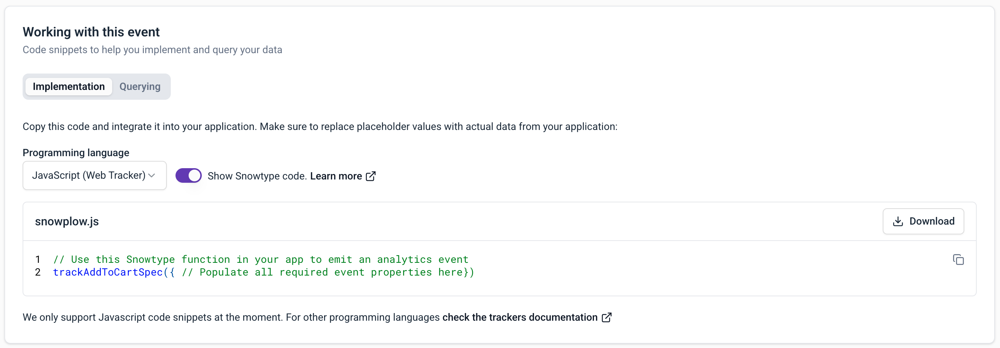

```mdx-code-block
import AiAssistantInstall from '@site/docs/reusable/ai-assistant-install/_index.md';

<Availability
  available={['cloud', 'pmc']}
  note="Snowtype is available for Snowplow CDI customers only."
/>
```

Once you've defined your [tracking plans](/docs/event-studio/tracking-plans/index.md) and [event specifications](/docs/event-studio/tracking-plans/event-specifications/index.md), the next step is implementing the tracking code in your applications.

Snowplow recommends implementing tracking with Snowtype, Snowplow's command-line code generation tool. Snowtype reads your [event specifications](/docs/event-studio/tracking-plans/event-specifications/index.md) and [data structures](/docs/event-studio/data-structures/index.md), either from your Snowplow account or from files in your repository, and generates type-safe tracking code for the language and tracker you specify.

This provides several key advantages over manual implementation:
* Quicker implementation: reduce the work needed to produce production-ready tracking code
* Type safety: ensure your tracking code is consistent with your schemas and catch errors before they reach your pipeline
* Workflow integration: use CI/CD GitOps-like processes to [keep your tracking code in sync](/docs/event-studio/implement-tracking/keep-code-up-to-date/index.md) with your schemas

For custom tracking on web, you also have the option of using the ready-to-use event specification code snippets in [Console](https://console.snowplowanalytics.com), with or without Snowtype. See below for details.

:::tip[Implement tracking with your AI assistant]
A coding agent connected to the Snowplow MCP server can read your tracking plans and event specifications, add the tracking to your application, and check that the events arrive. For example: "Implement the event specifications from our checkout tracking plan in this app, and confirm each event reaches my development pipeline."

<AiAssistantInstall />
:::

## Choose where your tracking definitions live

Your tracking definitions are your data structures and tracking plans. You can manage them in one of two ways:

* From Console: the definitions live in your Snowplow account. You write the tracking code by hand, copy the Console code snippets, or generate it with Snowtype.
* As code: the definitions live as files in your application's repository. Snowtype generates the tracking code from those files, and Snowplow CLI checks each change in pull requests and publishes it to Console.

### Compare tracking from Console and as code

| Aspect | From Console | As code |
| --- | --- | --- |
| Where the definitions live | Your Snowplow account, edited in Console or by a coding agent connected to the [Snowplow MCP server](/docs/ai/snowplow-mcp/index.md) | Files in your application's repository |
| How the tracking code is produced | By hand, from the [Console code snippets](#console-code-snippets), or with Snowtype | With Snowtype, from the [local tracking plans](/docs/event-studio/implement-tracking/snowtype-config/index.md#local-tracking-plans) |
| What catches a breaking change | Validation of test events in [Snowplow Micro](/docs/testing/snowplow-micro/index.md) or a [Console development environment](/docs/testing/snowplow-micro/console/index.md) | [Snowtype and Snowplow CLI checks](/tutorials/tracking-as-code/automate-with-github-actions) on every pull request |
| Where you review a change before it's live | A draft event specification in Console, until you [publish it](/docs/event-studio/test-and-publish/index.md) | A pull request, next to the code change that needs it |
| Which steps need Console credentials | Editing the definitions, and generating code with Snowtype (with a [browser login or an API key](/docs/event-studio/implement-tracking/install-snowtype/index.md#authenticate)) | Only checking changes against Console, and publishing them |

### Decide when to manage tracking as code

Track from Console when you're starting out, experimenting, or building your first integration. You can still generate type-safe code with Snowtype without moving your definitions to a repository.

Manage tracking as code when several people change the tracking, your application builds in CI, or you need a review and a history for every tracking change. Every change to a definition then goes through the same pull request as the code that sends the event.

### Move a tracking plan to your repository

To move an existing tracking plan from Console to your repository, download the [data structures](/docs/api-reference/snowplow-cli/data-structures/index.md#downloading-data-structures) with Snowplow CLI, and download the [tracking plans](/docs/api-reference/snowplow-cli/tracking-plans/index.md#downloading-tracking-plans-event-specifications-and-source-apps) with `snowplow-cli dp download --versions`, which writes the version Console holds into each event specification. If Snowtype already generates code for the tracking plan from Console, see [local tracking plans](/docs/event-studio/implement-tracking/snowtype-config/index.md#local-tracking-plans) to switch it to your repository. Then follow the tutorial to [manage tracking as code with Snowtype and Snowplow CLI](/tutorials/tracking-as-code/introduction).

## Snowtype workflow

The workflow for using Snowtype is:

1. **Define** your events and entities in [Console](https://console.snowplowanalytics.com) or [programmatically](/docs/event-studio/programmatic-management/index.md).
2. **Generate** tracking code by [running Snowtype](/docs/event-studio/implement-tracking/generate-tracking-code/index.md) in your project. It produces typed functions you call instead of constructing event payloads manually.
3. **Track** events using the generated functions in your application code.
4. **Update** when schemas change. Snowtype can [detect new versions](/docs/event-studio/implement-tracking/keep-code-up-to-date/index.md) and regenerate your code.

## Supported trackers

Snowtype generates code for the following Snowplow trackers:

| Tracker                                                         | Language               |
| --------------------------------------------------------------- | ---------------------- |
| [Browser](/docs/sources/web-trackers/index.md)                  | TypeScript, JavaScript |
| [JavaScript](/docs/sources/web-trackers/index.md)               | JavaScript             |
| [iOS](/docs/sources/mobile-trackers/index.md)                   | Swift                  |
| [Android](/docs/sources/mobile-trackers/index.md)               | Kotlin                 |
| [React Native](/docs/sources/react-native-tracker/index.md)     | TypeScript             |
| [Flutter](/docs/sources/flutter-tracker/index.md)               | Dart                   |
| [Node.js](/docs/sources/node-js-tracker/index.md)               | TypeScript, JavaScript |
| [Go](/docs/sources/golang-tracker/index.md)                     | Go                     |
| [Java](/docs/sources/java-tracker/index.md)                     | Java                   |
| [Google Tag Manager](/docs/sources/google-tag-manager/index.md) | JavaScript             |

Check out the generated code examples for [data structures](/docs/event-studio/implement-tracking/generate-tracking-code/example-data-structures/index.md) and [event specifications](/docs/event-studio/implement-tracking/generate-tracking-code/example-event-specs/index.md) for each language to see how Snowtype integrates with each tracker.

## Console code snippets

When viewing an [event specification](/docs/event-studio/tracking-plans/event-specifications/index.md) in Console, the **Working with this event** section provides ready-to-use code snippets.

The snippets in the **Implementation** tab show the exact tracking calls needed for each event, including all required properties and entities.

:::note[Available for custom web events only]
Code snippets are available for the JavaScript tracker only, for event specifications with custom event data structures.
:::

Here's an example snippet for the JavaScript tracker. It provides a `trackSelfDescribingEvent` call for the event specification, with the correct schema references and properties.

The example event specification has an event data structure named `article_click`, and one entity data structure, `article`. The snippet also includes an autogenerated `event_specification` entity. This helps with analysis as it's a direct link between the tracked event and the tracking plan.

To use your snippet, paste it into your application code, and provide the appropriate property values.

```javascript
window.snowplow("trackSelfDescribingEvent", {
    "event": {
        "schema": "iglu:com.example/article_click/jsonschema/1-0-1",
        "data": {
            "name": "", // string - Required - maxLength: 1000
            "location": "", // string - Nullable - maxLength: 1000
        }
    },
    "context": [
        // Entity: article (min: 0)
        {
            "schema": "iglu:com.example/article/jsonschema/3-0-0",
            "data": {
                "publish_date": "", // string - Nullable
                "content_id": "", // string - Nullable
            }
        },
        // System entity. Please do not edit it.
        {
            "schema": "iglu:com.snowplowanalytics.snowplow/event_specification/jsonschema/1-0-3",
            "data": {
                "id": "0a0ef8bb-314c-4973-8988-f192e8714d68",
                "name": "Article Click",
                "data_product_id": "28a6316a-47fd-473b-b5a1-00c555ba25e4",
                "data_product_name": "Article Performance",
                "data_product_domain": "Marketing"
            }
        }
    ]
});
```

Use the **Show Snowtype code** toggle to display the specific Snowtype function name to call in your tracking implementation. Note that it relies on you having generated the required Snowtype code in your project.


