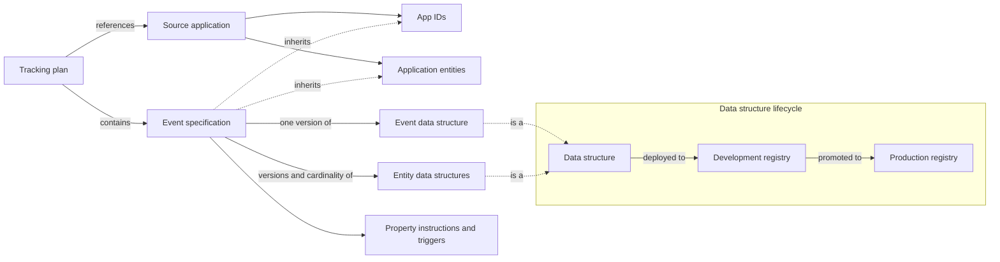
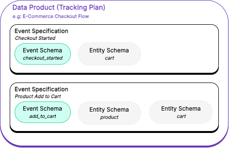

```mdx-code-block
<Availability
  available={['cloud', 'pmc', 'addon']}
  note="Event Studio is a paid addon for Snowplow CDI."
/>
```

Event Studio is a set of tools for designing and implementing behavioral data event tracking. The Event Studio UI is included in [Snowplow Console](https://console.snowplowanalytics.com). Event Studio provides:

* **Schema management**: define and version [data structures](/docs/event-studio/data-structures/index.md) for events and entities
* **Tracking plans**: document your tracking implementation, assign ownership, and establish data contracts with [tracking plans and event specifications](/docs/event-studio/tracking-plans/index.md). See [Introduction to tracking plans](/docs/fundamentals/tracking-plans/index.md)
* **Observability**: [monitor data quality](/docs/event-studio/tracking-plans/data-quality/index.md) and tracking implementation
* **Code generation**: automatically generate tracking code from your designs, using [Snowtype](/docs/event-studio/implement-tracking/index.md)

:::tip[Start with best practice]
New to tracking design? Start with the [best practice](/docs/fundamentals/tracking-design-best-practice/index.md) guide to learn how to approach designing your tracking implementation.
:::

## How the pieces fit together

Event Studio connects source applications, tracking plans, event specifications, and data structures. This diagram shows how they relate:



The same relationships, as a list:

1. A [source application](/docs/event-studio/source-applications/index.md) lists the [application IDs](/docs/event-studio/source-applications/index.md#application-ids) it sends, and the [application entities](/docs/event-studio/source-applications/index.md#application-entities) expected with every event it tracks.
2. A tracking plan references one or more source applications, and contains event specifications. Each event specification belongs to a single tracking plan.
3. Each event specification inherits the app IDs and application entity data structures of the tracking plan's source applications.
4. Each event specification uses one version of an event data structure, and optionally versions of entity data structures, with how many of each entity to expect.
5. Each event specification adds instructions for how to populate each property, and triggers that describe when the event occurs.
6. A data structure starts as a draft. You deploy it to your development environment for testing, then promote it to your production environment. By default, each pipeline has a development and a production Iglu Server instance.

A data structure describes the [structure of the data](/docs/fundamentals/schemas/index.md), and validates the values of the properties in your events and entities. An event specification is a narrower definition: it also defines the right values for fields when the event is triggered, and the entities to attach. For example, an `add_to_cart` data structure permits `currency` to be either `"USD"` or `"EUR"`. An event specification can narrow `currency` to `"USD"`, so [event specification validation](/docs/event-studio/tracking-plans/event-specification-validation/index.md) flags an event that declares the specification with `currency = "EUR"`, even though the data structure accepts it.

### Example

This diagram shows how a tracking plan, its event specifications, and data structures relate:



This example `Ecommerce Checkout Flow` tracking plan groups two event specifications for ecommerce checkout behavior:
* `Checkout Started` describes a `checkout_started` event, with an associated `cart` entity
* `Product Add To Cart` describes an `add_to_cart` event, with `cart` and `product` entities

The individual event and entity data structures can also be used in other event specifications and tracking plans.

## Work through the design workflow

Design tracking in the order the objects depend on each other. An event specification references data structures and source applications, so create those first:

1. [Find existing events](/docs/event-studio/event-catalog/index.md) in the Event Catalog, to see whether a team has already defined a similar event.
2. [Plan your source applications](/docs/event-studio/source-applications/index.md), then [create them](/docs/event-studio/source-applications/create/index.md).
3. [Create the data structures](/docs/event-studio/data-structures/create/index.md) for your events and entities.
4. [Create a tracking plan](/docs/event-studio/tracking-plans/create-and-manage/index.md), or [start from a template](/docs/event-studio/tracking-plans/templates/index.md).
5. [Define event specifications](/docs/event-studio/tracking-plans/event-specifications/index.md) in the tracking plan.
6. [Hand off the tracking plan to developers](/docs/event-studio/hand-off-to-implementation/index.md).
7. [Test, promote, and publish](/docs/event-studio/test-and-publish/index.md) your data structures and event specifications.
8. [Monitor tracking plan data quality](/docs/event-studio/tracking-plans/data-quality/index.md).
9. [Evolve your tracking design](/docs/event-studio/evolve-tracking-design/index.md) as your data structures change.
10. [Manage your tracking design as code](/docs/event-studio/programmatic-management/index.md) with the Snowplow CLI or the Console API.

You can also work through any of these steps with an AI assistant connected to the [Snowplow MCP server](/docs/ai/snowplow-mcp/index.md).

Event specifications also drive data modeling: they enable [automatically generated dbt models](/docs/modeling-your-data/automatically-generated-data-models/index.md) that transform atomic events into analysis-ready tables. The models follow the structure defined in your specifications, creating consistent table schemas and joining related [entities](/docs/fundamentals/entities/index.md). When you update specifications, you can regenerate the corresponding data models, keeping your warehouse transformations in sync with your tracking design.

## Related concepts

Event Studio builds on these concepts:

* [Events](/docs/fundamentals/events/index.md): actions that occur in your systems
* [Entities](/docs/fundamentals/entities/index.md): the objects associated with events, such as a user or a product
* [Schemas](/docs/fundamentals/schemas/index.md): the structure that events and entities are validated against, called data structures in Console
* [Tracking plans](/docs/fundamentals/tracking-plans/index.md): logical groupings of related business events with defined ownership
* [Tracking design best practice](/docs/fundamentals/tracking-design-best-practice/index.md): how to approach designing your tracking implementation
