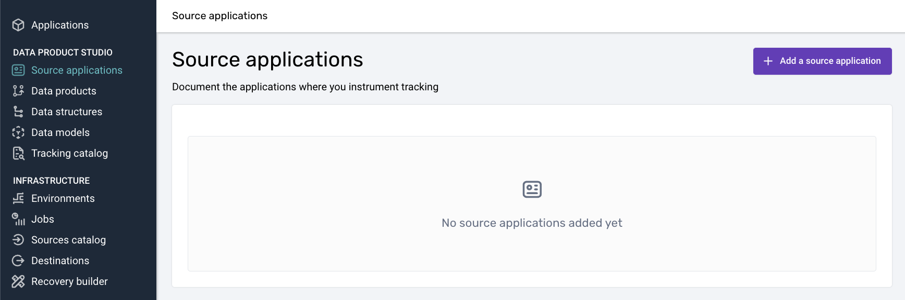
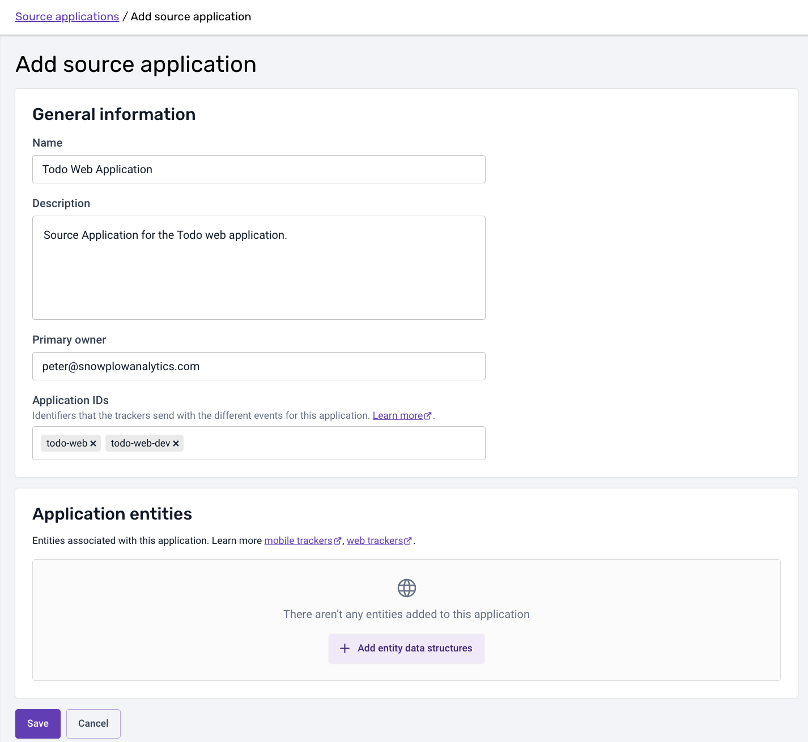

Register each independently deployable application, such as a web application, an Android application, or an iOS application, as a source application. A source application represents the tracking estate of one application on a specific platform. Its application IDs and application entities flow down to the tracking plans and event specifications that reference it. See [Plan source applications](/docs/event-studio/source-applications/index.md) for how source applications work.

## Before you begin

Decide how many source applications you need, and which [application IDs](/docs/event-studio/source-applications/index.md#application-ids) each one uses. Snowplow recommends a unique application ID for each deployment environment, for example `${appId}-qa` for staging and `${appId}-dev` for development.

Also decide which [application entities](/docs/event-studio/source-applications/index.md#application-entities) you will implement and expect with every event from each application.

## Create the source application

To create a source application in Console:

<Steps>

### Open the source applications list

Navigate to the **Source applications** section and click **Add a source application**.

### Enter the source application details

Fill in the inputs on the creation screen:

- **Name**: a name for the application that is understood across your organization
- **Description**: a few words on what the source application represents, and any notes
- **Primary owner**: the owner's email address
- **Application IDs**: the [application IDs](/docs/event-studio/source-applications/index.md#application-ids) expected for this application, for example one per environment such as `${appId}-dev`. The application IDs automatically flow down to the tracking plans and event specifications that relate to this source application
- **Application entities**: the [application entities](/docs/event-studio/source-applications/index.md#application-entities) you will implement and expect with every event from this application. If an application entity is only set conditionally, mark it as optional, with a note explaining the condition

</Steps>

To use the source application, connect it when you [create or edit a tracking plan](/docs/event-studio/tracking-plans/create-and-manage/index.md). Once you have created a source application, you can use the **Set up tracking** tab to initialize a tracker: see [Initialize the tracker from a source application](/docs/event-studio/hand-off-to-implementation/index.md#initialize-the-tracker-from-a-source-application). You can also generate a source application definition as code with the [Snowplow CLI](/docs/api-reference/snowplow-cli/tracking-plans/index.md#creating-source-application), or create source applications with an AI assistant connected to the [Snowplow MCP server](/docs/ai/snowplow-mcp/index.md).
