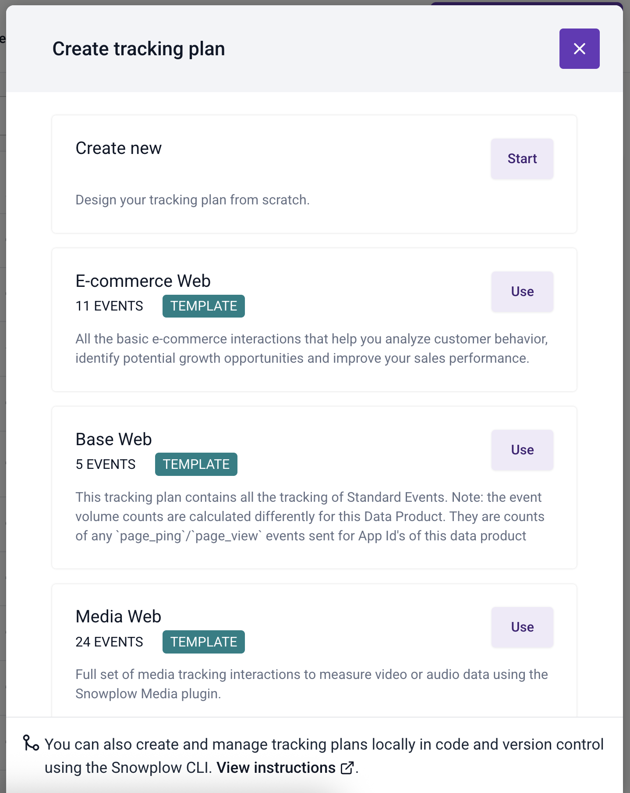

import AiAssistantInstall from '@site/docs/reusable/ai-assistant-install/_index.md';

A tracking plan groups the event specifications for one domain, with an explicit owner. You create tracking plans in the **Tracking plans** section of Console, either from scratch or from a template. See [tracking plan elements](/docs/event-studio/tracking-plans/index.md) for the information each plan holds.

:::tip[Create tracking plans with your AI assistant]
As an alternative to the steps on this page, you can ask an AI assistant connected to the Snowplow MCP server to create and update tracking plans for you, including their event specifications and data structures. For example: "Create a tracking plan for our checkout flow, with an event specification for each step and a product entity."

<AiAssistantInstall />
:::

## Before you begin

To create a tracking plan, you need the **Create** permission on tracking plans. Every tracking plan permission also requires at least the **View** permission on data structures. See [managing permissions](/docs/account-management/managing-permissions/index.md#tracking-plans).

Snowplow recommends creating the [source applications](/docs/event-studio/source-applications/create/index.md) the tracking plan is implemented in first, so you can connect them to the plan.

## Create a tracking plan from scratch

Follow these steps to create an empty tracking plan and add event specifications to it.

<Steps>

### Open the Create tracking plan dialog

Navigate to the **Tracking plans** section from the navigation bar and click **Create tracking plan**.

### Choose Create new

A dialog offers the existing templates and an option to create a tracking plan from scratch. Select **Create new**.

### Enter the tracking plan information

Enter your tracking plan information and click **Create and continue** to navigate to the event specification page. See [tracking plan elements](/docs/event-studio/tracking-plans/index.md) for what a tracking plan holds.

:::note[Names must be unique]
Each tracking plan name must be unique, including for tracking plans created from a template.
:::

### Add event specifications

The next page lets you create multiple event specifications. You can click on any row to enter the details on this screen, or you can complete the information later. See [define event specifications](/docs/event-studio/tracking-plans/event-specifications/index.md) for the details you can add.

</Steps>

## Create a tracking plan from a template

To create a tracking plan based on a pre-defined template, navigate to the **Tracking plans** section from the navigation bar, click **Create tracking plan** or **Templates**, and select a template. See [tracking plan templates](/docs/event-studio/tracking-plans/templates/index.md) for the available templates and the event specifications they include.

By default, a tracking plan created from a Base template isn't connected to a source application. Edit the tracking plan and set its source application.

## Manage the tracking plan

The tracking plan overview page shows all the event specifications in the plan and the [data quality](/docs/event-studio/tracking-plans/data-quality/index.md) of the plan over the last 30 days.

From the overview page, you can use:

* **Share**: allow other members of your organization to access the tracking plan
* **Subscribe**: receive notifications of any changes in the tracking plan
* **Data quality rules**: choose whether events that fail [validation](/docs/event-studio/tracking-plans/event-specification-validation/index.md) are loaded to your warehouse marked as violations, or [sent to failed events](/docs/event-studio/tracking-plans/data-quality/index.md#send-invalid-events-to-failed-events)
* **Implement tracking**: automatically generate the code for your tracking plan to include in your application. See [hand off to developers](/docs/event-studio/hand-off-to-implementation/index.md).

:::note[Console users only]
Sharing and subscribing is only available for users registered in Snowplow Console.
:::

The breadcrumb navigation takes you to the tracking plan overview or to the list of tracking plans. You can also open the list of tracking plans by clicking **Tracking plans** in the navigation bar on the left.

To edit a tracking plan at any time, select it from the tracking plans listing in the main menu.

When a data structure that an event specification uses gets a new version, you can upgrade the event specification. See [evolve your tracking design](/docs/event-studio/evolve-tracking-design/index.md#upgrade-event-specifications-to-the-new-version).
