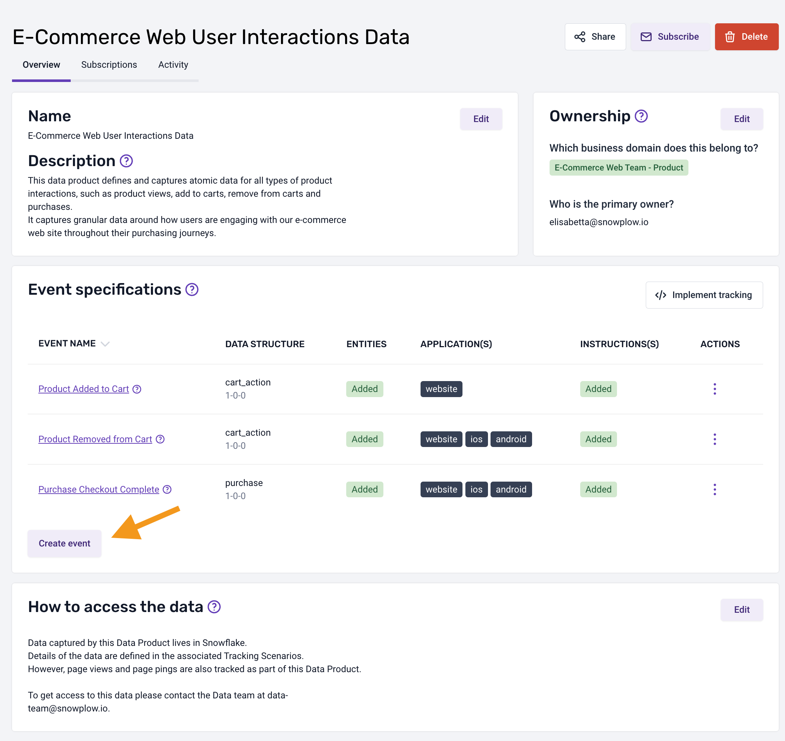
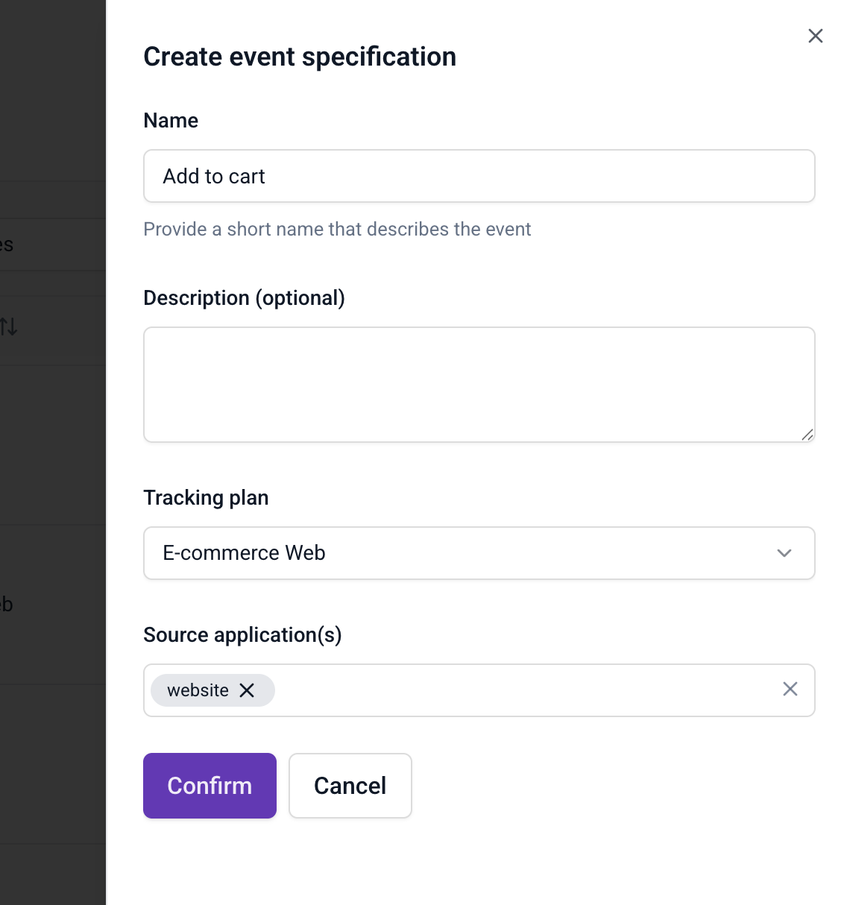
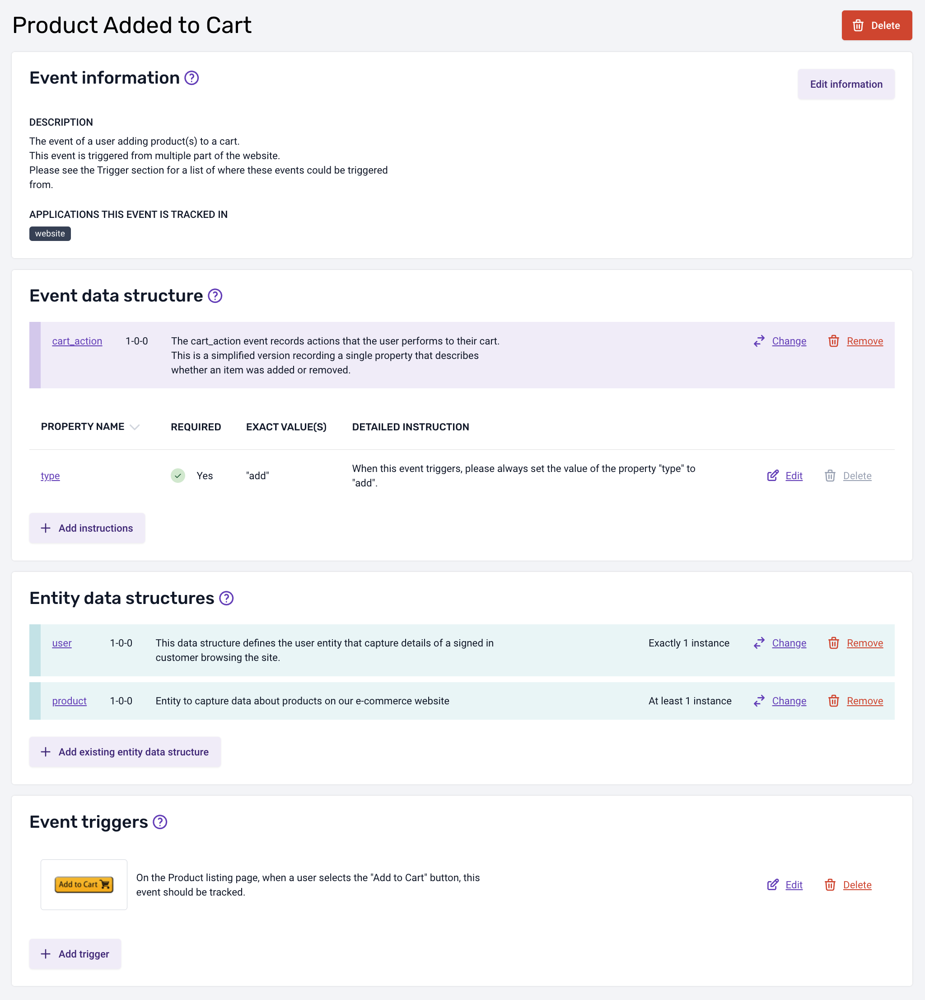
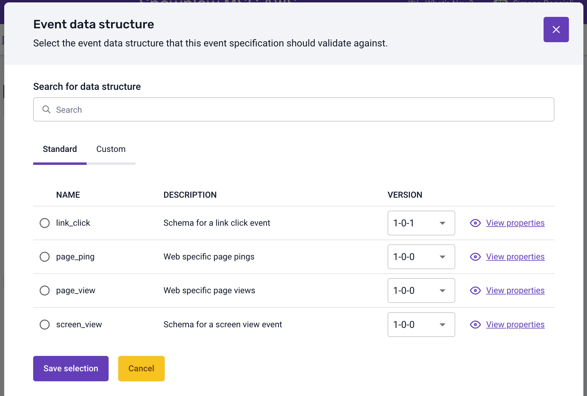
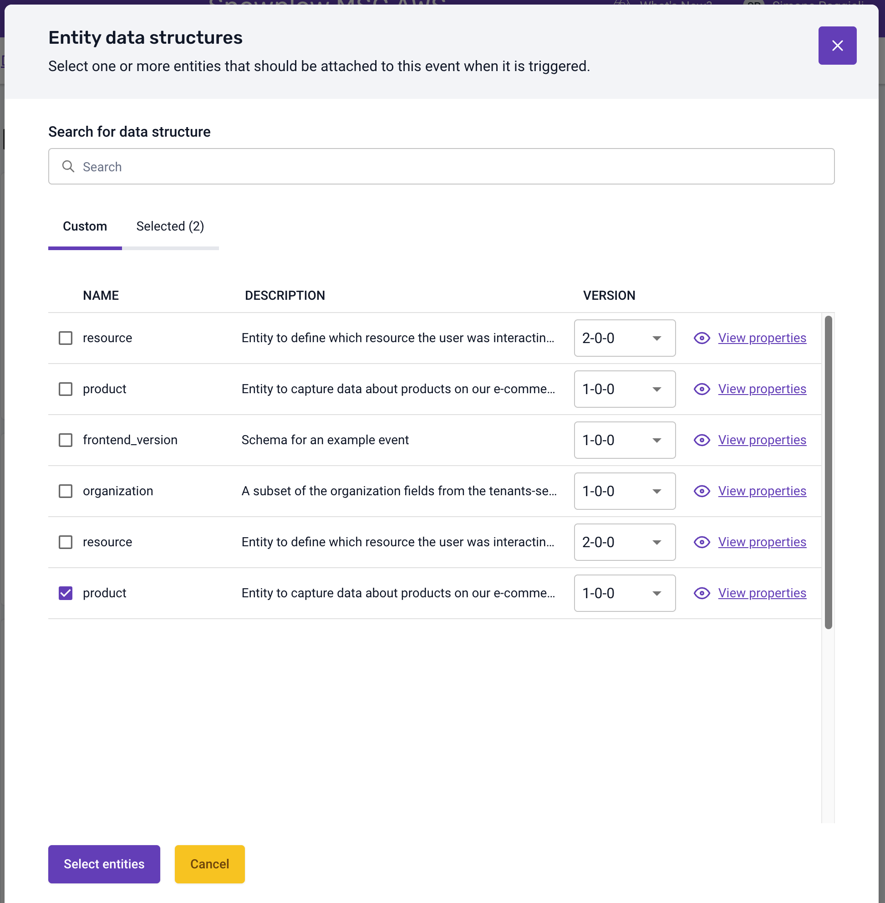
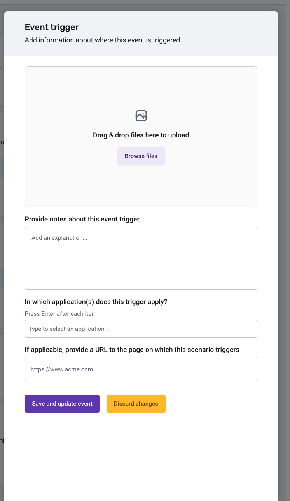
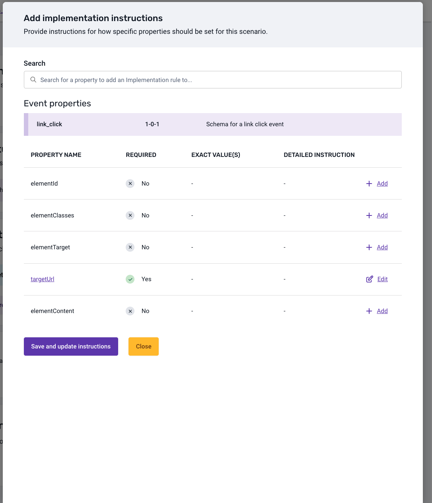

An event specification is a complete definition of one business event inside a tracking plan. It defines what data should be tracked and when the event occurs, along with metadata about the event such as ownership. See [tracking plan elements](/docs/event-studio/tracking-plans/index.md) for the fields an event specification holds.

Event specifications act as data contracts between teams. When you create an event specification, you define exactly what data your applications should send, what your data warehouse will receive, and what your downstream consumers can rely on.

Once an event specification is ready, you can [publish it](/docs/event-studio/test-and-publish/index.md) to make it active in the pipeline. Publishing enables [event specification inference](/docs/event-studio/tracking-plans/event-specification-inference/index.md) and [event specification validation](/docs/event-studio/tracking-plans/event-specification-validation/index.md).

## Before you begin

Before you define an event specification, you need:

* A [tracking plan](/docs/event-studio/tracking-plans/create-and-manage/index.md) to hold the event specification. You can only make event specifications within tracking plans, and each event specification belongs to a single tracking plan.
* The event and entity [data structures](/docs/event-studio/data-structures/create/index.md) that the event specification uses. Create any custom data structures first.
* The tracking plan permissions described in [managing permissions](/docs/account-management/managing-permissions/index.md#tracking-plans).

## Create an event specification

You can create an event specification from a tracking plan or from the Event Catalog, then open it to add details.

### Create an event specification from a tracking plan

To create an event specification from a tracking plan:

1. Select a tracking plan.
2. Click **Create event**.
3. In the dialog, enter a name for your event specification and click **Save and continue**.

The tracking plan page shows your new event specification.

### Create an event specification from the Event Catalog

From the [Event Catalog](/docs/event-studio/event-catalog/index.md), you can create new event specifications without first navigating to a tracking plan.

To create an event specification from the Event Catalog:

1. Click **Create event specification**.
2. Enter a name that describes the event.
3. Optionally add a description.
4. Select the tracking plan this event specification belongs to.
5. Select the source applications where this event is tracked.
6. Click **Confirm**.

After creation, you can add event and entity data structures, triggers, and property instructions.

:::tip
Use descriptive names that reflect the business action being tracked. For example, "Add to cart" is clearer than "cart_event_1".
:::

## Open an event specification

To add more information to an event specification, or modify an existing one:

1. Navigate to the appropriate tracking plan.
2. Select the event specification.

This opens an overview of the event specification, containing the details that have been added to date. The event specification page has three tabs:

* **Details**: the sections described on this page
* **Tracking summary**: event volumes per specification version and application ID, see [monitor tracking plan data quality in Console](/docs/event-studio/tracking-plans/data-quality/index.md#track-specification-versions-and-application-ids)
* **History**: the list of versions of the specification, with the changes between any two versions

The **Details** tab starts with the event information section. It holds the meta-information for your event specification: the event name, description, and the applications in which this event is tracked.

## Choose the event and entity data structures

Each event specification has an event [data structure](/docs/event-studio/data-structures/index.md), plus optional entity data structures. You can select which version of each data structure to use.

### Event data structure

The event data structure is the one this event will validate against as it is processed by your pipeline. To set it, click **Add existing data structure** on the **Event data structure** panel and select a data structure.

You can choose from two types of data structures:

* **Standard**: provided by the Snowplow tracker by default
* **Custom**: provided by your organization

### Entity data structures

In the **Entity data structures** section, you define the [entities](/docs/fundamentals/entities/index.md) that should be associated with the event when it is triggered. Click **Add existing data structure** and select the entities.

To help you make an informed selection, you can view a detailed breakdown of the properties of each entity, by version.

After you select an entity, the next step of the dialog lets you define the expected cardinality of the entity on the event specification: how many instances of the entity to expect.

## Add triggers and property instructions

Triggers and property instructions tell developers when to track the event and how to populate it.

### Add event triggers

Event triggers define the locations and circumstances under which this event is triggered.

To create your first trigger, select the **Add trigger** button. A dialog appears, where you can upload an image, add notes, specify which applications the trigger applies to, and provide additional context such as the URL of the page on which this trigger applies.

You can edit or delete an existing trigger by clicking the buttons beside each entry in the triggers list.

### Add property instructions

Property instructions specify how each property of a selected event or entity data structure should be populated.

The dialog lists the properties of the selected data structure, with the ability to provide the exact value or values, or a description of how to populate each property when the event is triggered.

To configure detailed instructions for a property:

1. Click **Add instruction** or **Edit** beside the property.
2. Select the type of instruction you want to add or edit, and fill in the required input fields.
3. Click **Save and update instruction** to return to the properties list.

:::note
Instructions for required properties are added by default and can be edited, but they can't be deleted.
:::

Implementation instructions, entity cardinality rules, and trigger details are available to the developers implementing the tracking through the Snowtype [instructions feature](/docs/event-studio/implement-tracking/generate-tracking-code/index.md#markdown-instructions).
