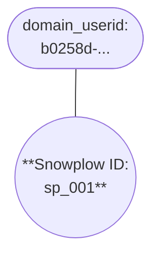
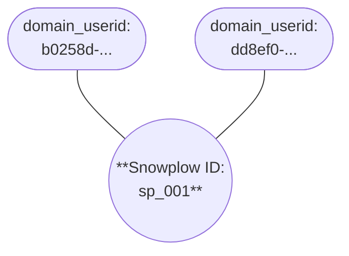
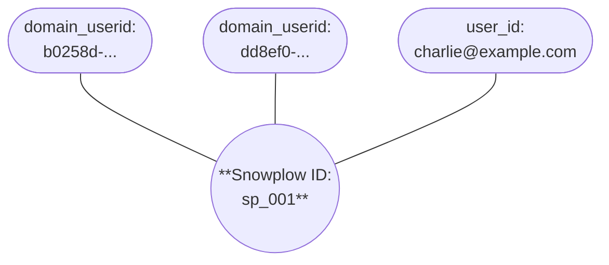

```mdx-code-block
import Tabs from '@theme/Tabs';
import TabItem from '@theme/TabItem';
```

When users navigate between different domains in your ecosystem, their user identity may get fragmented. Examples include navigation from your main website to a partner site, or to a mobile app. This creates gaps in your user journey data and makes it difficult to understand the complete customer experience across your digital properties.

:::info[Web subdomains]
This problem doesn't usually apply for navigation between web subdomains, for example between `www.example.com` and `blog.example.com`. This is because the web trackers have `discoverRootDomain` [enabled by default](/docs/sources/web-trackers/tracker-setup/initialization-options/index.md).
:::

Cross-navigation (also called cross-domain) tracking solves this problem by passing user identification data in URL parameters when users click links to other domains. This enables you to maintain user continuity across your applications.

To use cross-navigation tracking, configure the [web](#configure-the-web-tracker) or [native mobile](/docs/sources/mobile-trackers/tracking-events/session-tracking/index.md#decorating-outgoing-links-using-cross-navigation-tracking) trackers to add an additional parameter, named `_sp`, to the querystring of outbound links. This process is called "link decoration".

Link decoration makes the added values visible in the `url` field of events on the destination page or URI. The querystring is added only to the events at the destination page: it doesn't persist throughout the user's session.

## Querystring properties

The `_sp` querystring parameter has two different formats: extended or short. You can also configure exactly which properties you want to include.

Available properties:

| Property         | Description                                    | Extended | Short |
| ---------------- | ---------------------------------------------- | -------- | ----- |
| `domainUserId`   | Current tracker-generated UUID user identifier | ✅        | ✅     |
| `timestamp`      | Current epoch timestamp, millisecond precision | ✅        | ✅     |
| `sessionId`      | Current session UUID identifier                | ✅        |       |
| `subjectUserId`  | Custom business user identifier                | ✅        |       |
| `sourceId`       | Application identifier                         | ✅        |       |
| `sourcePlatform` | Platform of the current device                 | ✅        |       |
| `reason`         | Custom information or identifier               | ✅        |       |

For example, the link `appSchema://path/to/page` would look like this after decoration with the full extended format:

```
appSchema://path/to/page?_sp=domainUserId.timestamp.sessionId.subjectUserId.sourceId.sourcePlatform.reason
```

## How are the querystring parameters processed?

By default, your pipeline will process only the short format querystring `_sp={domainUserId}.{timestamp}`, even if you've decorated the links with the extended format. To process the extra properties, you'll need to configure the [cross-navigation enrichment](/docs/pipeline/enrichments/available-enrichments/cross-navigation-enrichment/index.md).

Both default and extended formats will populate the [atomic](/docs/fundamentals/canonical-event/index.md) `refr_domain_userid` and `refr_dvce_tstamp` fields. The enrichment also adds a `cross_navigation` entity to the event.

| Feature                                                 | Default behavior | With cross-navigation enrichment |
| ------------------------------------------------------- | ---------------- | -------------------------------- |
| Processes short format `_sp={domainUserId}.{timestamp}` | ✅                | ✅                                |
| Processes extended format properties                    | ❌                | ✅                                |
| Populates `refr_domain_userid` field                    | ✅                | ✅                                |
| Populates `refr_dvce_tstamp` field                      | ✅                | ✅                                |
| Adds `cross_navigation` entity                          | ❌                | ✅                                |

## Configure the web tracker

Configure link decoration on web using the `crossDomainLinker` and `useExtendedCrossDomainLinker` fields of the [configuration object](/docs/sources/web-trackers/tracker-setup/initialization-options/index.md). To decorate links in the native mobile trackers, see [decorating outgoing links](/docs/sources/mobile-trackers/tracking-events/session-tracking/index.md#decorating-outgoing-links-using-cross-navigation-tracking).

### Choose which links to decorate

Provide a callback for the `crossDomainLinker` option to configure which links to decorate. It should be a function taking one argument, the link element, that returns `true` if the tracker should decorate the link element and `false` otherwise.

We recommend specifying a subset of links to decorate, to avoid decorating unintended links. For example, links within the same domain, or "links" that are actually email addresses or telephone numbers.

This function would only decorate those links whose destination is `http://acme.de/` or whose HTML ID is `crossDomainLink`:

<Tabs groupId="platform" queryString>
  <TabItem value="js" label="JavaScript (tag)" default>

```javascript
snowplow('newTracker', 'namespace', '{{collector_url_here}}', {
  appId: 'my-app-id',
  appVersion: '0.1.0',
  cookieSameSite: 'Lax',
  crossDomainLinker: function (linkElement) {
    return (linkElement.href === 'http://acme.de' || linkElement.id === 'crossDomainLink');
  }
});
```

  </TabItem>
  <TabItem value="browser" label="Browser (npm)">

```javascript
newTracker('namespace', '{{collector_url_here}}', {
  appId: 'my-app-id',
  appVersion: '0.1.0',
  cookieSameSite: 'Lax',
  crossDomainLinker: function (linkElement) {
    return (linkElement.href === 'http://acme.de' || linkElement.id === 'crossDomainLink');
  }
});
```

  </TabItem>
</Tabs>

If you want to decorate every link to the domain `github.com`:

```javascript
{
  crossDomainLinker: function (linkElement) {
    return /^https:\/\/github\.com/.test(linkElement.href);
  }
}
```

#### Check hostname

To only decorate links that are on a different domain to the current page, check the hostname.

```javascript
{
  crossDomainLinker: function (linkElement) {
    return linkElement.hostname !== location.hostname;
  }
}
```

If you have a shared configuration deployed across multiple sites, you may want to check both:

```javascript
{
  crossDomainLinker: function (linkElement) {
    var networkSites = [
      "mysite.com",
      "sistersite.com"
    ];
    return linkElement.hostname !== location.hostname && networkSites.indexOf(linkElement.hostname) > -1;
  }
}
```

Here, link decoration will only occur when links are to different sites within the list.

### Update event listeners

When the tracker loads it doesn't immediately decorate links. Instead, it adds event listeners to links which decorate them when a user clicks on them or navigates to them using the keyboard. This ensures that the timestamp added to the querystring is fresh.

If further links get added to the page after the tracker has loaded, you can use the tracker's `crossDomainLinker` method to add listeners again. Listeners won't be added to links which already have them, so it's good practice to use the same linker function every call.

<Tabs groupId="platform" queryString>
  <TabItem value="js" label="JavaScript (tag)" default>

```javascript
snowplow('crossDomainLinker', function (linkElement) {
  return (linkElement.href === 'http://acme.de' || linkElement.id === 'crossDomainLink');
});
```

  </TabItem>
  <TabItem value="browser" label="Browser (npm)">

```javascript
crossDomainLinker(function (linkElement) {
  return (linkElement.href === 'http://acme.de' || linkElement.id === 'crossDomainLink');
});
```

  </TabItem>
</Tabs>


### Configure extended format properties

To decorate links with extended `_sp` format properties, set `useExtendedCrossDomainLinker`:

<Tabs groupId="platform" queryString>
  <TabItem value="js" label="JavaScript (tag)" default>

```javascript
snowplow('newTracker', 'namespace', '{{collector_url_here}}', {
  appId: 'my-app-id',
  appVersion: '0.1.0',
  cookieSameSite: 'Lax',
  crossDomainLinker: function(defineWhichLinksToDecorate) { },
  useExtendedCrossDomainLinker: true,
});
```

  </TabItem>
  <TabItem value="browser" label="Browser (npm)">

```javascript
newTracker('namespace', '{{collector_url_here}}', {
  appId: 'my-app-id',
  appVersion: '0.1.0',
  cookieSameSite: 'Lax',
  crossDomainLinker: function(defineWhichLinksToDecorate) { },
  useExtendedCrossDomainLinker: true,
});
```

  </TabItem>
</Tabs>

This will add `sessionId` and `sourceId` to the querystring.

To include further properties:

<Tabs groupId="platform" queryString>
  <TabItem value="js" label="JavaScript (tag)" default>

```javascript
snowplow('newTracker', 'namespace', '{{collector_url_here}}', {
  appId: 'my-app-id',
  appVersion: '0.1.0',
  cookieSameSite: 'Lax',
  crossDomainLinker: function(defineWhichLinksToDecorate) { },
  useExtendedCrossDomainLinker: {
    userId: true;
    sessionId: true;
    sourceId: true;
    sourcePlatform: true;
    reason: true; // can also be a callback
  },
});
```

  </TabItem>
  <TabItem value="browser" label="Browser (npm)">

```javascript
newTracker('namespace', '{{collector_url_here}}', {
  appId: 'my-app-id',
  appVersion: '0.1.0',
  cookieSameSite: 'Lax',
  crossDomainLinker: function(defineWhichLinksToDecorate) { },
  useExtendedCrossDomainLinker: {
    userId: true;
    sessionId: true;
    sourceId: true;
    sourcePlatform: true;
    reason: true; // can also be a callback
  },
});
```

  </TabItem>
</Tabs>

:::note[PII in user ID]

If your `userId` values contains PII, check that you're not leaking them to third-party sites in your link decoration.

:::

Provide a callback to `reason` in the form `((evt: Event) => string)` to add custom information to the querystring. If set to `true`, the link text will be used.

### Shared page URLs and user IDs

If a user clicks a cross-site link, and the tracker decorates the URL with their `domain_userid`, and then they share that URL, other users will also have the parameters when they visit the shared page. This could cause problems if you are using `domain_userid` as a user identifier.

You can choose to hide the parameter after the first event, e.g. a page view, fires on the destination page. Because the pipeline populates dedicated event fields with the parameter, you won't need additional modeling to stitch the IDs. If the user copies the URL after the tracking code has fired, it may not include the `_sp` parameter and get copied to other users they share it with.

You can do this using the [History API](https://developer.mozilla.org/en-US/docs/Web/API/History/replaceState).

<Tabs groupId="platform" queryString>
  <TabItem value="js" label="JavaScript (tag)" default>

The URL-updating code runs in a [callback](/docs/sources/web-trackers/tracking-events/index.md#get-event-properties) to ensure it doesn't run before the page view event can capture the original URL.

```javascript
snowplow('trackPageView'); // page URL is https://example.com/?example=123&_sp=6de9024e-17b9-4026-bd4d-efec50ae84cb.1680681134458
snowplow(function(){
  if (/[?&]_sp=/.test(window.location.href)) {
    history.replaceState(history.state, "", window.location.href.replace(/&?_sp=[^&#]+/, "")); // page URL is now https://example.com/?example=123
  }
});
```

  </TabItem>
  <TabItem value="browser" label="Browser (npm)">

```javascript
trackPageView(); // page URL is https://example.com/?example=123&_sp=6de9024e-17b9-4026-bd4d-efec50ae84cb.1680681134458
if (/[?&]_sp=/.test(window.location.href)) {
  history.replaceState(history.state, "", window.location.href.replace(/&?_sp=[^&#]+/, "")); // page URL is now https://example.com/?example=123
}
```

  </TabItem>
</Tabs>

This approach can work with other parameters, e.g. `utm_source`, but it's not recommended unless you are sure other systems have also already captured the parameter values.

Some systems may consider the URL update a single page application page change, and automatically fire additional page view events with this implementation. Test this technique to ensure compatibility with your existing vendors.

## Tracker support

This table shows the support for cross-domain tracking across the main client-side [Snowplow tracker SDKs](/docs/sources/index.md). The server-side trackers don't include link click tracking.

| Tracker                                                                                                                                      | Supported | Since version |
| -------------------------------------------------------------------------------------------------------------------------------------------- | --------- | ------------- |
| [Web](/docs/sources/web-trackers/tracking-events/link-click/index.md)                                                                        | ✅         | 0.7.0         |
| [iOS](/docs/sources/mobile-trackers/tracking-events/session-tracking/index.md#decorating-outgoing-links-using-cross-navigation-tracking)     | ✅         | 6.0.0         |
| [Android](/docs/sources/mobile-trackers/tracking-events/session-tracking/index.md#decorating-outgoing-links-using-cross-navigation-tracking) | ✅         | 6.0.0         |
| React Native                                                                                                                                 | ❌         |               |
| Flutter                                                                                                                                      | ❌         |               |

## Identities and cross-domain tracking

[Snowplow Identities](/docs/identities/index.md) provides real-time identity resolution, stitching together user identifiers from different events into unified profiles.

Cross-navigation tracking is directly supported within Identities. If you [enable cross-domain tracking support](/docs/identities/configuration/index.md#enable-cross-domain-tracking-aliases) in the Identities configuration, Identities automatically extracts `refr_domain_userid` and maps it to `domain_userid` and `client_session_user_id`. The result is that all of a user's activity across your domains — anonymous or authenticated — resolves to the same `snowplow_id`, without any downstream modeling to join the identifiers yourself.

### Example cross-domain resolution

In this example, ExampleCompany runs two sites on separate cookie domains: `brandA.com` and `brandB.com`. Cross-domain tracking is configured on the web tracker, and the ExampleCompany team has enabled cross-domain tracking in the Identities configuration.

A user browses `brandA.com` anonymously. The event contains a `domain_userid`. Identities creates a new Snowplow ID.

| Event property  | Value        |
| --------------- | ------------ |
| `url`           | `brandA.com` |
| `domain_userid` | `b0258d-...` |
| `user_id`       | -            |



The user clicks a link to `brandB.com`. The destination site assigns a new `domain_userid`, but the event also contains a `refr_domain_userid` field with the `domain_userid` from `brandA.com`. Identities treats `refr_domain_userid` as equivalent to `domain_userid`, finds the existing Snowplow ID, and links the new `domain_userid` to it.

| Event property       | Value        |
| -------------------- | ------------ |
| `url`                | `brandB.com` |
| `domain_userid`      | `dd8ef0-...` |
| `refr_domain_userid` | `b0258d-...` |
| `user_id`            | -            |



The user then logs into `brandB.com`. The event contains the same `domain_userid` from that site plus a `user_id`. Identities adds the `user_id` to the existing Snowplow ID.

| Event property  | Value                     |
| --------------- | ------------------------- |
| `url`           | `brandB.com/user-profile` |
| `domain_userid` | `dd8ef0-...`              |
| `user_id`       | `charlie@example.com`     |



All of the user's activity across both sites, both anonymous and authenticated, is resolved to the same Snowplow ID.
