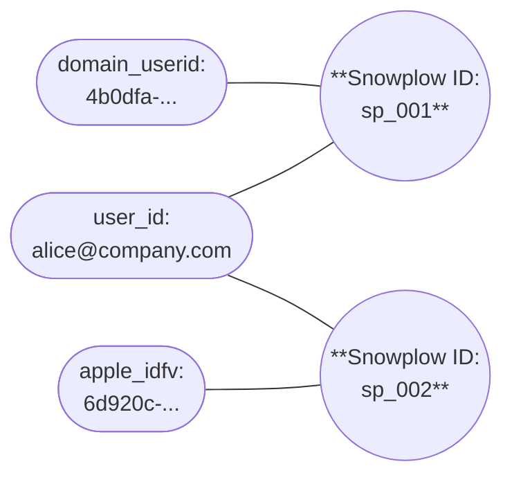
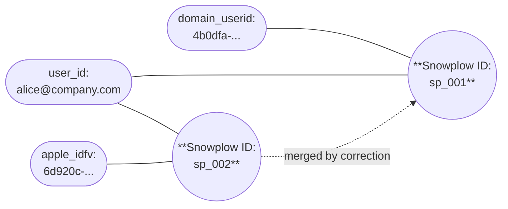

A correction is a graph consistency change that Identities applies in the background in case the real-time processing missed it. Corrections are how Identities manages the quality of the identity graph. Under normal operation, every [merge](/docs/identities/concepts/merges/index.md) happens as Identities processes the event. Two situations can leave a merge behind. One is extreme concurrency, when a user's events reach more than one instance of Identities at the same moment. The other is post-incident recovery, after the graph database was unavailable or slow. A late-merge correction applies the missed merge later and announces the repair to your warehouse in a correction event, so the graph is eventually consistent.

:::note[No action needed]
Identities applies corrections automatically, and it emits a merge event for every merge a correction makes, so there is nothing to change in your models. To find out which merges were late, query the correction events instead.
:::

Events already in your warehouse keep the Snowplow ID that Identities assigned to them. The merge event maps them to the surviving Snowplow ID, as for any other merge.

## How a late merge happens

Identities runs on more than one instance. Each instance resolves events against the graph as it sees it at that moment, and it doesn't see the links another instance is still writing. When two instances resolve events for the same user at the same moment, each can link the same identifier to a different Snowplow ID. Neither instance sees the other's link, so neither merges the two Snowplow IDs. This is a late merge: a merge that should have happened as Identities processed the event, but didn't.

In this example, a user has browsed the ExampleCompany website anonymously, so `sp_001` holds their `domain_userid`. The same user has also used the ExampleCompany mobile app anonymously, so `sp_002` holds their `apple_idfv`. The user then logs in on both devices within the same second:

1. The web event carries `domain_userid` and `user_id`. The mobile event carries `apple_idfv` and the same `user_id`. Instance A receives the web event and instance B receives the mobile event.
2. Instance A links `user_id` to `sp_001`. Instance B links `user_id` to `sp_002`. Neither instance sees the other's link yet, so neither plans a merge.
3. Identities detects, in the background, that both `sp_001` and `sp_002` hold `user_id`, and creates a correction.
4. The correction merges `sp_002` into `sp_001`, because `sp_001` is older, and Identities emits a correction event.

Before the correction, the graph holds two Snowplow IDs that share `user_id`:

After the correction, all three identifiers resolve to `sp_001`, and future events for the user carry `sp_001` in their identity entity:

## What a correction changes

A late-merge correction applies the merge that real-time processing missed. It:

* Uses the same rules as a real-time merge, so it merges the Snowplow IDs that share the identifier into the oldest of them
* Respects the merge limit, which caps how many Snowplow IDs can merge into one, and [unique identifiers](/docs/identities/concepts/unique-identifiers/index.md)
* Never creates a Snowplow ID and never changes the value of an existing Snowplow ID
* Never rewrites an earlier merge

A Snowplow ID that these rules refuse stays separate. Identities emits a correction event only when the correction changed the graph. Detection and application run in the background, so some time passes between the concurrent events and the correction. During that time, events for the user carry whichever Snowplow ID their identifiers resolve to.

## Recognize a correction in your warehouse

A [correction event](/docs/identities/concepts/index.md#correction-events) arrives in your enriched event stream the same way as a [merge event](/docs/identities/concepts/index.md#merge-events) does. It carries the Snowplow IDs the correction applied. For a late merge (currently, the only correction type), that's the surviving Snowplow ID and every Snowplow ID merged into it, in the same `snowplow_id`, `merges`, and `merged` fields as a merge event. Identities also emits a merge event for the same merge, so a model that already handles merge events needs no change. Note that the two events can arrive in either order. Query correction events to find out which merges were late and what each correction changed.

Six fields set a correction event apart from a merge event:

* `correction_id` identifies the correction and equals the event's `event_id`
* `type` names the class of correction, `late_merge` for a late merge
* `source` names who found the correction, `automatic` for a correction that Identities found itself
* `affected_snowplow_ids` lists the Snowplow IDs this correction changed, as opposed to the full merge history in `merges`
* `refused_snowplow_ids` lists the Snowplow IDs that the merge rules refused, when there are any
* `applied_at` is when the correction changed the graph, and the event's `true_tstamp` and `derived_tstamp` carry the same value

The merge event for the same merge carries the `correction_id` as its `triggering_event_id`, where a merge event for a real-time merge carries the `event_id` of the event that caused the merge.

The Identities [dbt package](/docs/identities/data-models/index.md) handles late merges through the respective merge events. See [Merges](/docs/identities/concepts/merges/index.md) for how a real-time merge works, and [Identity resolution process](/docs/identities/concepts/index.md#identity-resolution-process) for how Identities resolves each event.
