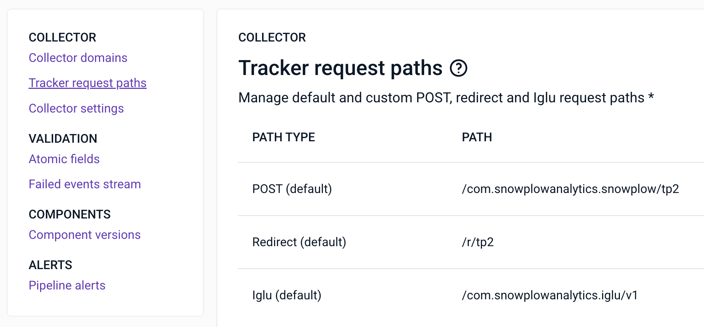
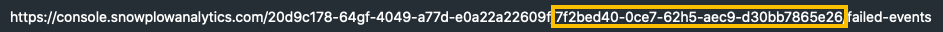

The Collector is the pipeline component that receives events from your [trackers](/docs/sources/index.md) and webhooks. Its configuration sets the cookie domains, the request paths it accepts, and its cookie attributes. Check it when you set up a new tracker, change your cookie domain, or debug events that don't arrive.

You can view the configuration in Snowplow Console, or retrieve it from the Console API. Snowplow monitors Collector health around the clock, but if you want Collector checks in your own monitoring systems, use the API: read the Collector endpoints and settings from it, then run your health checks against them. That way your checks follow any configuration change.

To look up a field in the API response, or the HTTP headers the Collector accepts, see the [Collector configuration reference](/docs/pipeline/collector/configuration-reference/index.md). If you run Snowplow Self-Hosted, configure the Collector with its [configuration file](/docs/api-reference/stream-collector/configure/index.md) instead.

## Before you begin

You'll need:

* Access to your pipeline in [Snowplow Console](https://console.snowplowanalytics.com)
* To use the API, a Console user account for API access, and a `clientid` and `clientsecret` for the API service. Create the user on the [**Users** page](https://console.snowplowanalytics.com/users), and request the credentials from the [**Credentials** page](https://console.snowplowanalytics.com/credentials) in Console.

## Steps

To only view the configuration, the first step is enough. The remaining steps retrieve the same configuration from the API.

<Steps>

### View the configuration in Console

Log in to Console and click **Pipeline Configuration** in the navigation menu for your pipeline.


Console shows your configuration, with default values displayed for empty fields. This view reads the same API that the rest of these steps use.



### Get an access token

Exchange your credentials for a token:

```bash
curl --request POST \
  --url 'https://id.snowplowanalytics.com/oauth/token' \
  --header 'content-type: application/x-www-form-urlencoded' \
  --data grant_type=password \
  --data username=USER@DOMAIN.COM \
  --data password='PASSWORD' \
  --data audience=https://snowplowanalytics.com/api/ \
  --data client_id='YOUR_CLIENT_ID' \
  --data client_secret='YOUR_CLIENT_SECRET'
```

Send the token with every API request, in the `Authorization: Bearer {{token}}` header.

### Find your organization and pipeline IDs

Your organization ID is on the [**Manage organization** page](https://console.snowplowanalytics.com/settings) in Console.

The pipeline ID is the second UUID in the browser's address bar when you view the pipeline in Console:



### Call the configuration endpoint

Send a `GET` request to the Collector configuration endpoint, with your IDs and token:

```bash
curl \
  --header 'Authorization: Bearer {{token}}' \
  'https://console.snowplowanalytics.com/api/msc/v1/organizations/{organizationId}/resources/v1/pipelines/{pipelineId}/configuration/collector'
```

To try the endpoint in your browser instead, open the [API specification](https://console.snowplowanalytics.com/api/msc/v1/docs/index.html?url=/api/msc/v1/docs/docs.yaml#/configuration/getOrganizationsOrganizationidResourcesV1PipelinesPipelineidConfigurationCollector), click **Authorize** at the top of the page, and enter your token. The specification then uses it for every request you send.

### Check the response

The response is a JSON object with the `cookieDomains`, `paths`, `cookieAttributes`, and `blockUnencrypted` fields. Compare it with the values Console showed in the first step. The [Collector configuration reference](/docs/pipeline/collector/configuration-reference/index.md#response-fields) describes each field and its default.

To monitor the Collector, have your monitoring system read the configuration from this endpoint, and point your health checks at the request paths it lists.

</Steps>
