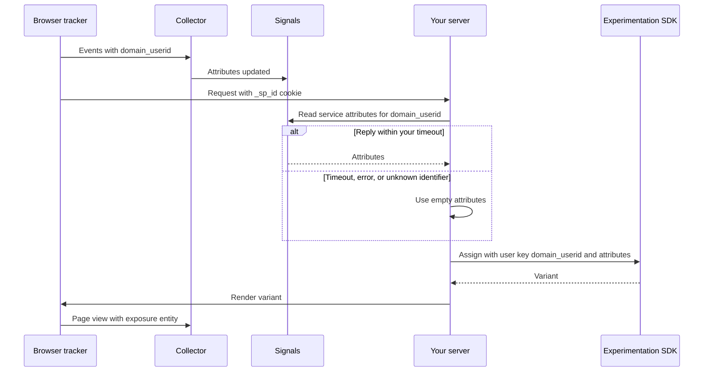

```mdx-code-block
import Tabs from '@theme/Tabs';
import TabItem from '@theme/TabItem';
```

Experimentation and feature flag tools, such as Optimizely, GrowthBook, LaunchDarkly, Kameleoon, and Conductrics, decide which variant a user sees. They evaluate targeting rules and bandit models against the attributes your application passes in at the moment of assignment. Signals computes what the user is doing in the current session, so passing Signals attributes at assignment lets an experiment target in-session behavior, such as intent or hesitation, rather than audiences synced from another system.

The experimentation tool still owns the split, the holdout, and the statistics. This page describes a pattern that works with any tool whose SDK accepts user attributes:

1. Read the user's attributes from Signals on your server, with a timeout
2. Pass the attributes to the experimentation SDK when it assigns a variant
3. Track the exposure in Snowplow, so experiment results join to your events in the warehouse

Start by [connecting to Signals](/docs/signals/connection/index.md) and defining a [service](/docs/signals/applications/services/index.md) that returns the attributes you want to target on.

## Read attributes before assignment

Reading attributes requires an API key, so read them on your server, in an edge function, or in a back-end endpoint, never in the browser. Client-side experimentation tools need a first-party endpoint that holds the key and returns attributes only for the caller's own identifier.



Assignment shouldn't wait on Signals. Race the read against a timeout that fits your latency budget, and fall back to an empty set of attributes on a timeout or an error. Experimentation SDKs skip targeting conditions on values of the wrong type, so pass only strings, numbers, and booleans, and drop `null` values.

<Tabs groupId="signals-experiments" queryString>
<TabItem value="nodejs" label="Node.js" default>

Create the `Signals` client once, outside your request handler, and reuse it across requests.

```typescript
import { Signals } from '@snowplow/signals-node';

const signals = new Signals({
  baseUrl: SIGNALS_DEPLOYED_URL,
  apiKey: CONSOLE_API_KEY,
  apiKeyId: CONSOLE_API_KEY_ID,
  organizationId: ORG_ID,
});

type Scalar = string | number | boolean;

export async function readSignals(
  service: string,
  attributeKey: string,
  identifier: string,
  timeoutMs: number,
): Promise<Record<string, Scalar>> {
  const timeout = new Promise<Record<string, unknown>>((resolve) =>
    setTimeout(() => resolve({}), timeoutMs),
  );
  try {
    const values = await Promise.race([
      signals.getServiceAttributes({ name: service, attribute_key: attributeKey, identifier }),
      timeout,
    ]);
    return Object.fromEntries(
      Object.entries(values ?? {}).filter(([, v]) =>
        ['string', 'number', 'boolean'].includes(typeof v),
      ),
    ) as Record<string, Scalar>;
  } catch {
    return {};
  }
}
```

</TabItem>
<TabItem value="python" label="Python">

The Python SDK call is synchronous, so run it in a thread pool to apply a timeout.

```python
from concurrent.futures import ThreadPoolExecutor, TimeoutError

executor = ThreadPoolExecutor(max_workers=8)

def read_signals(service: str, attribute_key: str, identifier: str, timeout_s: float) -> dict:
    future = executor.submit(
        sp_signals.get_service_attributes,
        name=service,
        attribute_key=attribute_key,
        identifier=identifier,
    )
    try:
        values = future.result(timeout=timeout_s)
    except Exception:  # Includes TimeoutError
        return {}
    return {k: v for k, v in (values or {}).items() if isinstance(v, (str, int, float, bool))}
```

</TabItem>
</Tabs>

Then merge the attributes into the user object your experimentation SDK expects, and assign. For example, with an SDK that takes a user object:

```typescript
const attributes = await readSignals('checkout_intent', 'domain_userid', domainUserId, TIMEOUT_MS);

// Replace with your experimentation SDK's assignment call
const variant = experiments.assign('checkout_offer', {
  key: domainUserId,
  ...attributes,
});
```

The method and object names depend on the tool: a user context in Optimizely, attributes in GrowthBook, a context in LaunchDarkly, custom data in Kameleoon, or traits on a Conductrics selection. Users without Signals attributes don't match conditions built on them, so they fall into the default or control path. This means a Signals-targeted experiment mostly includes users who have already generated some events. Describe that population when you report results.

## Choose the identifiers

Two identifiers are involved in each assignment, and they can be different:

* **Bucketing key**: the identifier the experimentation tool hashes to assign a variant
* **Attribute key**: the identifier you read Signals attributes with, set by the [attribute keys](/docs/signals/attributes/attribute-keys/index.md) of your attribute groups

Choose the bucketing key to match the unit of the outcome you measure:

* Use `domain_userid` by default, and set it as the experimentation tool's user key, so exposures, Signals attributes, and atomic events join without a mapping table
* Use `domain_sessionid` only for experiments whose outcome happens within the same session, because Snowplow sessions roll over after a period of inactivity and each new session would be assigned again
* Use `user_id` only if the experimentation tool keeps the assignment sticky across login, otherwise users can switch variants when they log in

Don't let the experimentation tool generate its own anonymous identifier alongside Snowplow's. You can still read session-keyed attributes while bucketing on `domain_userid`, or use [identity resolution](/docs/signals/attributes/identity-resolution/index.md) to read one person's attributes by `domain_userid` before and after login.

On your server, get `domain_userid` and `domain_sessionid` from the `_sp_id` cookie, or send them from the browser with `getDomainUserId()` and `getDomainSessionId()`. See [Getting cookie values](/docs/sources/web-trackers/cookies-and-local-storage/getting-cookie-values/index.md). On a user's first page view the cookie may not exist yet, so experiments that target in-session behavior should assign on a later request or on an interaction.

## Track exposures in Snowplow

Track each assignment the user actually sees as part of your Snowplow data, so you can analyze experiment results in your warehouse alongside the rest of your behavioral data. Use the schema your experimentation tool already provides, if there is one. For example, the [Optimizely plugin](/docs/sources/web-trackers/tracking-events/optimizely/index.md) adds Optimizely entities to web events, and GrowthBook publishes `iglu:io.growthbook/experiment_viewed/jsonschema/1-0-0` on Iglu Central.

Otherwise, define your own [entity](/docs/fundamentals/entities/index.md) in [Event Studio](/docs/event-studio/data-structures/index.md) and attach it to the page view that renders the variant. Attaching it to the page view means the JavaScript tracker sets `domain_userid` and `domain_sessionid` for you. A useful exposure entity includes:

| Field | Description |
| --- | --- |
| `vendor` | The tool that assigned the variant, for example `optimizely` or `growthbook` |
| `experiment_id` | The tool's experiment, flag, or agent key |
| `variation_id` | The variant the user was assigned |
| `assignment_key` | The identifier the tool bucketed on, for example `domain_userid` |
| `signals_service` | The Signals service you read, if any |
| `signals_attributes_used` | The names of the Signals attributes passed to the tool, not their values |

```javascript
window.snowplow('trackPageView', {
  context: [{
    schema: 'iglu:com.example/experiment_exposure/jsonschema/1-0-0',
    data: {
      vendor: 'growthbook',
      experiment_id: 'checkout_offer',
      variation_id: '1',
      assignment_key: 'domain_userid',
      signals_service: 'checkout_intent',
      signals_attributes_used: ['cart_value', 'product_views_last_10_min'],
    },
  }],
});
```

Record attribute names rather than values. The values stay in Signals, and you can join them back in the warehouse if you need them for analysis. For decisions made only on the server, track a [self-describing event](/docs/fundamentals/events/index.md#self-describing-events) with the [Node.js tracker](/docs/sources/node-js-tracker/tracking-events/index.md) instead, and set `domain_userid` on it explicitly.

## Trigger an assignment from an intervention

[Interventions](/docs/signals/interventions/index.md) let you run an experiment at the moment a user meets a condition, for example when a user hesitates at checkout. Subscribe to interventions with the [browser plugin](/docs/signals/applications/subscribe/index.md), and call the experimentation tool from your intervention handler:

```typescript
addInterventionHandlers({
  async checkoutHesitation(intervention) {
    // Ask your server to assign, using the pattern above
    const variant = await assignFromServer('checkout_offer');
    if (variant !== 'control') {
      showOffer(variant);
    }
  },
});
```

Call the experimentation tool from one handler only, so each intervention produces one assignment. Users in the control group still generate an `intervention_handle` event but see no change, which gives you a clean comparison between users who met the condition and were treated, and those who met it and weren't.

The intervention subscription endpoint doesn't authenticate subscribers, so don't include personal or sensitive attributes in interventions keyed on anonymous identifiers. See [Subscribe to interventions](/docs/signals/applications/subscribe/index.md).

```mdx-code-block
import SignalsFreeTier from "@site/docs/reusable/signals-free-tier/_index.md"

<SignalsFreeTier/>
```
