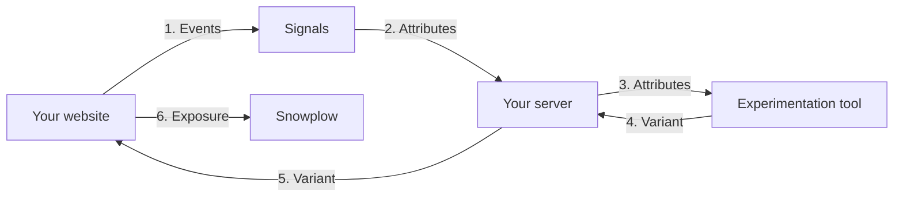

```mdx-code-block
import Tabs from '@theme/Tabs';
import TabItem from '@theme/TabItem';
```

Experimentation and feature flag tools, such as Optimizely, GrowthBook, LaunchDarkly, and Conductrics, decide which variant each user sees. They make that decision using the attributes your application passes in. Signals gives them attributes that describe what the user is doing right now, so your experiments can target and learn from behavior in the current session.

Your experimentation tool still assigns variants, holds out a control group, and calculates results. Signals provides the attributes, and Snowplow records which variant each user saw.

## Why use Signals with your experimentation tool

Experimentation tools usually target on what they can see on the page, or on audiences synced from another system. Synced audiences arrive minutes or hours later, so they describe a past session rather than the current one.

Passing Signals attributes at assignment lets you:

* Target on in-session behavior: show a variant to users who are comparing prices, hesitating at checkout, or returning for the third time today
* Give bandits better context: contextual bandits, such as Optimizely's contextual multi-armed bandit, learn from the attributes they receive at each decision
* Use one definition everywhere: the attribute you target on is the same attribute you segment results by, so "high intent" means the same thing in targeting and in analysis
* Analyze results in your own warehouse: exposures are part of your Snowplow data, so you can join them to every other event a user generated
* Start an experiment at the right moment: trigger an assignment when a user meets a condition, using [interventions](/docs/signals/interventions/index.md)

## How it works

The integration runs in your server code, the same code that handles a page request or an API call. For example, an Express route, a Next.js route handler or server component, or a Python view. Reading attributes needs an API key, so it can't run in the browser.



In order:

1. Your website sends events to Snowplow, and Signals updates the user's attributes
2. When the user requests a page, your server reads their attributes from Signals
3. Your server passes the attributes to the experimentation SDK
4. The SDK assigns a variant
5. Your server renders the variant
6. Your website tracks which variant the user saw, as part of the page view

The Optimizely, GrowthBook, and LaunchDarkly SDKs evaluate rules locally, so reading from Signals is the only network call this adds to the request. Conductrics makes its selection through an API call, so the request makes two calls in sequence.

## Pass attributes at assignment

Start by [connecting to Signals](/docs/signals/connection/index.md) and defining a [service](/docs/signals/applications/services/index.md) that returns the attributes you want to target on. Create the `Signals` client once when your server starts, and reuse it for every request.

Assignment shouldn't wait on Signals. This helper returns an empty set of attributes if the read takes longer than your timeout or fails. It also drops `null` values, because experimentation tools skip conditions on missing or wrongly typed values.

<Tabs groupId="signals-language" queryString>
<TabItem value="nodejs" label="Node.js" default>

```typescript
import { Signals } from '@snowplow/signals-node';

const signals = new Signals({
  baseUrl: SIGNALS_DEPLOYED_URL,
  apiKey: CONSOLE_API_KEY,
  apiKeyId: CONSOLE_API_KEY_ID,
  organizationId: ORG_ID,
});

type Scalar = string | number | boolean;

export async function readSignals(
  service: string,
  domainUserId: string,
  timeoutMs: number,
): Promise<Record<string, Scalar>> {
  const timeout = new Promise<Record<string, unknown>>((resolve) =>
    setTimeout(() => resolve({}), timeoutMs),
  );
  try {
    const values = await Promise.race([
      signals.getServiceAttributes({
        name: service,
        attribute_key: 'domain_userid',
        identifier: domainUserId,
      }),
      timeout,
    ]);
    return Object.fromEntries(
      Object.entries(values ?? {}).filter(([, v]) =>
        ['string', 'number', 'boolean'].includes(typeof v),
      ),
    ) as Record<string, Scalar>;
  } catch {
    return {};
  }
}
```

</TabItem>
<TabItem value="python" label="Python">

The Python SDK call is synchronous, so the helper runs it in a thread pool to apply a timeout.

```python
from concurrent.futures import ThreadPoolExecutor

executor = ThreadPoolExecutor(max_workers=8)

def read_signals(service: str, domain_user_id: str, timeout_s: float) -> dict:
    future = executor.submit(
        sp_signals.get_service_attributes,
        name=service,
        attribute_key="domain_userid",
        identifier=domain_user_id,
    )
    try:
        values = future.result(timeout=timeout_s)
    except Exception:  # Includes the timeout
        return {}
    return {k: v for k, v in (values or {}).items() if isinstance(v, (str, int, float, bool))}
```

</TabItem>
</Tabs>

Then pass the attributes to your experimentation SDK. In each example, `domainUserId` is the user's Snowplow ID, read from the `_sp_id` cookie, and `checkout_intent` is a Signals service.

<Tabs groupId="experimentation-tool" queryString>
<TabItem value="optimizely" label="Optimizely" default>

Create each attribute in your Optimizely project before you use it in an audience.

```typescript
import {
  createInstance,
  createPollingProjectConfigManager,
  createBatchEventProcessor,
} from '@optimizely/optimizely-sdk';

const optimizely = createInstance({
  projectConfigManager: createPollingProjectConfigManager({ sdkKey: OPTIMIZELY_SDK_KEY }),
  eventProcessor: createBatchEventProcessor(),
});
await optimizely.onReady();

// In your request handler
const attributes = await readSignals('checkout_intent', domainUserId, TIMEOUT_MS);
const user = optimizely.createUserContext(domainUserId, attributes);
const decision = user.decide('checkout_offer');
```

</TabItem>
<TabItem value="growthbook" label="GrowthBook">

Add each attribute in GrowthBook under **SDK Configuration** > **Attributes** so you can target on it.

```typescript
import { GrowthBookClient } from '@growthbook/growthbook';

const growthbook = new GrowthBookClient({
  apiHost: GROWTHBOOK_API_HOST,
  clientKey: GROWTHBOOK_CLIENT_KEY,
});
await growthbook.init();

// In your request handler
const attributes = await readSignals('checkout_intent', domainUserId, TIMEOUT_MS);
const gb = growthbook.createScopedInstance({
  attributes: { id: domainUserId, ...attributes },
});
const offer = gb.getFeatureValue('checkout-offer', 'control');
```

</TabItem>
<TabItem value="launchdarkly" label="LaunchDarkly">

LaunchDarkly targets on any attribute in the context, with no setup in the LaunchDarkly UI.

```typescript
import { init } from '@launchdarkly/node-server-sdk';

const launchdarkly = init(LAUNCHDARKLY_SDK_KEY);
await launchdarkly.waitForInitialization({ timeout: 10 });

// In your request handler
const attributes = await readSignals('checkout_intent', domainUserId, TIMEOUT_MS);
const detail = await launchdarkly.variationDetail(
  'checkout-offer',
  { kind: 'user', key: domainUserId, ...attributes },
  false,
);
```

</TabItem>
<TabItem value="conductrics" label="Conductrics">

Conductrics selects a variation through its REST API, and takes attributes as traits in `type:value` form. Create each trait in the Conductrics admin first, because Conductrics ignores traits it doesn't know. Group numeric attributes into trait values, such as `intent:high`, or send them as `inputs`.

```typescript
const CONDUCTRICS_URL = 'https://api.v3.conductrics.com/{{owner_code}}/v3/agent-api';

function toTraits(attributes: Record<string, string | number | boolean>): string[] {
  const views = Number(attributes.product_views_last_10_min ?? 0);
  return [`intent:${views >= 5 ? 'high' : views >= 2 ? 'medium' : 'low'}`];
}

// In your request handler
const attributes = await readSignals('checkout_intent', domainUserId, TIMEOUT_MS);
const params = new URLSearchParams({ apikey: CONDUCTRICS_API_KEY, session: domainUserId });
const response = await fetch(`${CONDUCTRICS_URL}?${params}`, {
  method: 'POST',
  headers: { 'Content-Type': 'application/json' },
  body: JSON.stringify({
    commands: [{ a: 'checkout-offer' }],
    traits: toTraits(attributes),
  }),
});
const selection = await response.json();
const offer = selection.sels['checkout-offer'];
```

</TabItem>
</Tabs>

Other tools follow the same pattern: read the attributes, then pass them wherever the SDK accepts user attributes. For example, Kameleoon calls them custom data.

### Choose the user key

The user key is the identifier the experimentation tool uses to assign a variant. Use `domain_userid` by default, as in the examples, so experiment exposures, Signals attributes, and Snowplow events all join on the same ID. Don't let the experimentation tool create its own anonymous ID as well.

Use `domain_sessionid` only for experiments where the outcome happens in the same session, because a new session would assign the user again. Use `user_id` only if your tool keeps assignments the same across login.

Your server can read `domain_userid` from the `_sp_id` cookie, as described in [Getting cookie values](/docs/sources/web-trackers/cookies-and-local-storage/getting-cookie-values/index.md). On a user's first page view the cookie may not exist yet, so experiments that target in-session behavior should assign on a later request.

Users without Signals attributes, because the read timed out or because they're new, don't match conditions built on Signals attributes, and see the default variant. Keep this in mind when you report results.

## Track exposures in Snowplow

Track which variant each user saw as part of your Snowplow data. You can then analyze experiment results in your warehouse alongside the rest of your behavioral data.

Define an [entity](/docs/fundamentals/entities/index.md) for exposures in [Event Studio](/docs/event-studio/data-structures/index.md). A useful exposure entity includes:

| Field | Description |
| --- | --- |
| `vendor` | The tool that assigned the variant, for example `optimizely` |
| `experiment_id` | The experiment or flag key |
| `variation_id` | The variant the user was assigned |
| `signals_attributes_used` | The names of the Signals attributes passed to the tool, not their values |

On your server, build the exposure from the SDK's result, and return it with the page:

<Tabs groupId="experimentation-tool" queryString>
<TabItem value="optimizely" label="Optimizely" default>

```typescript
const exposures = decision.variationKey
  ? [{
      vendor: 'optimizely',
      experiment_id: decision.ruleKey ?? decision.flagKey,
      variation_id: decision.variationKey,
      signals_attributes_used: Object.keys(attributes),
    }]
  : [];
```

</TabItem>
<TabItem value="growthbook" label="GrowthBook">

GrowthBook calls `trackingCallback` for each experiment the user is assigned to.

```typescript
const exposures = [];
const gb = growthbook.createScopedInstance({
  attributes: { id: domainUserId, ...attributes },
  trackingCallback: (experiment, result) => {
    exposures.push({
      vendor: 'growthbook',
      experiment_id: experiment.key,
      variation_id: String(result.key),
      signals_attributes_used: Object.keys(attributes),
    });
  },
});
const offer = gb.getFeatureValue('checkout-offer', 'control');
```

GrowthBook also publishes its own exposure event, `iglu:io.growthbook/experiment_viewed/jsonschema/1-0-0`, which you can track instead.

</TabItem>
<TabItem value="launchdarkly" label="LaunchDarkly">

`variationDetail` tells you whether the user is in an experiment.

```typescript
const exposures = detail.reason.inExperiment
  ? [{
      vendor: 'launchdarkly',
      experiment_id: 'checkout-offer',
      variation_id: String(detail.variationIndex),
      signals_attributes_used: Object.keys(attributes),
    }]
  : [];
```

</TabItem>
<TabItem value="conductrics" label="Conductrics">

Each selection in the response includes a policy, `p`. A policy of `p` means the agent is paused, so the user isn't in an experiment.

```typescript
const exposures = selection.items
  .filter((item) => item.p !== 'p')
  .map((item) => ({
    vendor: 'conductrics',
    experiment_id: item.a,
    variation_id: item.c,
    signals_attributes_used: Object.keys(attributes),
  }));
```

Conductrics can also send its own selection events to your Snowplow pipeline. Ask Conductrics to set this up for your account.

</TabItem>
</Tabs>

Then attach the exposures to the page view in the browser. The JavaScript tracker adds `domain_userid` and `domain_sessionid` to the event, so the exposure joins to the user's other events.

```javascript
window.snowplow('trackPageView', {
  context: exposures.map((data) => ({
    schema: 'iglu:com.example/experiment_exposure/jsonschema/1-0-0',
    data,
  })),
});
```

Record attribute names rather than values. The values stay in Signals, and you can join them back in the warehouse if you need them.

## Trigger an experiment from an intervention

[Interventions](/docs/signals/interventions/index.md) let you assign a variant at the moment a user meets a condition, for example when they hesitate at checkout, rather than on the next page load.

Subscribe to interventions with the [browser plugin](/docs/signals/applications/subscribe/index.md). The intervention payload includes the user's attributes, so your handler can pass them straight to your experimentation tool's browser SDK. Each example assumes you've already initialized the tool's browser SDK for the current user.

<Tabs groupId="experimentation-tool" queryString>
<TabItem value="optimizely" label="Optimizely" default>

```typescript
addInterventionHandlers({
  checkoutHesitation(intervention) {
    const user = optimizely.createUserContext(domainUserId, intervention.attributes);
    const decision = user.decide('checkout_offer');
    if (decision.variationKey && decision.variationKey !== 'control') {
      showOffer(decision.variationKey);
    }
  },
});
```

</TabItem>
<TabItem value="growthbook" label="GrowthBook">

```typescript
addInterventionHandlers({
  async checkoutHesitation(intervention) {
    await growthbook.updateAttributes(intervention.attributes);
    const offer = growthbook.getFeatureValue('checkout-offer', 'control');
    if (offer !== 'control') {
      showOffer(offer);
    }
  },
});
```

</TabItem>
<TabItem value="launchdarkly" label="LaunchDarkly">

```typescript
addInterventionHandlers({
  async checkoutHesitation(intervention) {
    await ldClient.identify({ ...ldClient.getContext(), ...intervention.attributes });
    const offer = ldClient.variation('checkout-offer', false);
    if (offer) {
      showOffer(offer);
    }
  },
});
```

</TabItem>
<TabItem value="conductrics" label="Conductrics">

The Conductrics API key stays on your server, so the handler asks your server to make the selection. The server endpoint runs the selection call shown in [Pass attributes at assignment](#pass-attributes-at-assignment), with the intervention's attributes converted to traits.

```typescript
addInterventionHandlers({
  async checkoutHesitation(intervention) {
    const response = await fetch('/api/conductrics/select', {
      method: 'POST',
      headers: { 'Content-Type': 'application/json' },
      body: JSON.stringify({ agent: 'checkout-offer', attributes: intervention.attributes }),
    });
    const { offer } = await response.json();
    // In this example, variation A is the control
    if (offer !== 'A') {
      showOffer(offer);
    }
  },
});
```

</TabItem>
</Tabs>

Users in the control group still trigger the intervention but see no change. This gives you a fair comparison between users who met the condition and were treated, and those who met it and weren't. Track the exposure with the same entity as above.

The intervention subscription endpoint doesn't authenticate subscribers, so don't include personal or sensitive attributes in interventions. See [Subscribe to interventions](/docs/signals/applications/subscribe/index.md).

```mdx-code-block
import SignalsFreeTier from "@site/docs/reusable/signals-free-tier/_index.md"

<SignalsFreeTier/>
```
