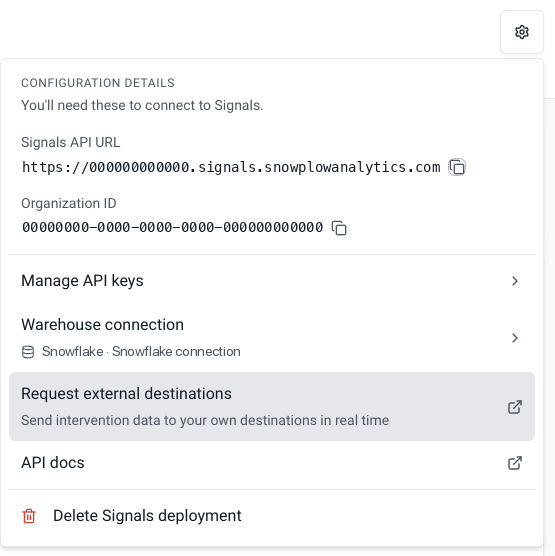

Intervention forwarding sends every triggered intervention to a destination you own, as soon as Signals triggers it. Use it when the system that reacts to an intervention is a back-end service, such as a CRM, a messaging platform, or your own profile service, rather than a page or app that can [subscribe](/docs/signals/applications/subscribe/index.md) to interventions.

Forwarding doesn't replace subscriptions. Both receive the same triggered interventions, and you can use them together. You can't configure forwarding yourself in Console: you request it, and Snowplow sets it up for you.

Forwarding can deliver interventions to these destinations:

| Destination | What Snowplow sends |
| --- | --- |
| Webhook | One HTTPS `POST` request per intervention to an endpoint you host |
| Kafka | One message per intervention to a Kafka topic |
| Amazon Kinesis | One record per intervention to a Kinesis stream |
| Google Cloud Pub/Sub | One message per intervention to a Pub/Sub topic |

Forwarding sends the full intervention payload. You can't filter interventions or transform the payload on the way, so filter them in the system that receives them, for example by the intervention `name`. An intervention is sent once, the first time its criteria are met, as described in the [subscription delivery example](/docs/signals/applications/subscribe/index.md#delivery-example). For the payload fields, the webhook request, and how Snowplow handles webhook responses, see the [forwarded intervention reference](/docs/signals/applications/forward-interventions/reference/index.md).

## Before you begin

You'll need:

* Access to Signals in [Snowplow Console](https://console.snowplowanalytics.com)
* At least one [published intervention](/docs/signals/interventions/index.md#publish-and-manage-the-intervention) that targets an attribute key in your events
* A destination you own: an HTTPS endpoint, a Kafka topic, an Amazon Kinesis stream, or a Google Cloud Pub/Sub topic
* For a webhook, a bearer token that your endpoint accepts

## Steps

Forwarding is set up by Snowplow, so most of these steps are about giving Snowplow what it needs.

<Steps>

### Request external destinations in Console

In Console, go to **Signals** > **Overview**, open the settings menu in the top right of the page, and select **Request external destinations**.

The option opens a form that asks for your organization, the destination you want, and what you plan to use it for. Snowplow then contacts you to collect the details for your destination.

### Share your destination details

For a webhook, give Snowplow the host name of your endpoint and, optionally, a path. For example, the host `profiles.example.com` with the path `interventions/forward` sends requests to `https://profiles.example.com/interventions/forward`. Snowplow always sends requests over HTTPS.

Also share the bearer token that your endpoint expects. Snowplow sends it in the `Authorization: Bearer <token>` header of every request.

For Kafka, Amazon Kinesis, or Google Cloud Pub/Sub, give Snowplow the topic or stream to write to and how to authenticate to it.

Don't put tokens or other credentials in the request form or in email. Share them through the credential sharing form in Console instead: select **Contact us**, turn on **Credential sharing form**, enter the support ticket number that Snowplow gives you for your request, and add the credentials in **Message**.

### Allowlist Snowplow's IP addresses

If your destination only accepts traffic from known IP addresses, ask Snowplow for the IP addresses that the forwarded interventions come from. Add them to your allowlist before forwarding starts.

### Check that interventions arrive

Once Snowplow confirms that forwarding is deployed, generate events that meet the criteria of one of your published interventions. Check that your destination receives a payload with that intervention's `name` and a new `intervention_id`, as shown in the [example payload](/docs/signals/applications/forward-interventions/reference/index.md#example).

</Steps>

## Troubleshooting

These problems apply to webhooks. Snowplow treats each of these responses as a setup error: it stops delivering and retries occasionally until you fix the problem.

| Your endpoint returns | Fix |
| --- | --- |
| `401` or `403` | Check that your endpoint accepts the token you shared with Snowplow, with the `Bearer ` prefix. If you changed the token, share the new one with Snowplow. |
| `404`, `405`, or `410` | Check that the host and path you shared match your endpoint, and that it accepts `POST` requests. |
| `415` | Make your endpoint accept `Content-Type: application/json`. |
