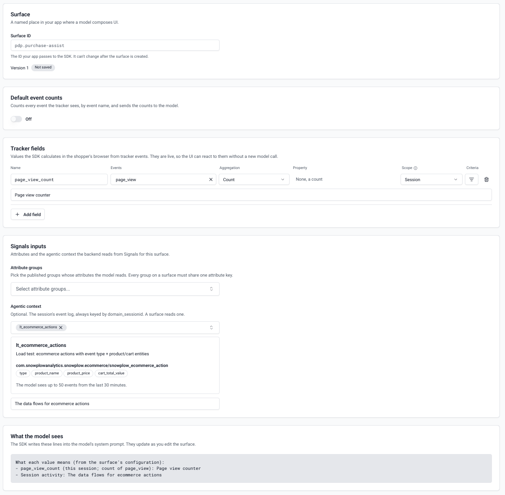

A surface declares which behavior powers one place in your app where a model composes UI, and what each value means. You create and edit surfaces in Console, so you can change them without a deploy.

## Create a surface

{/* TODO: add the Console navigation path to the surface editor, and how to publish, once confirmed. */}

The surface editor in Console has five sections:



| Section | What you set |
| --- | --- |
| **Surface** | The **Surface ID** your app passes to the surface hook, for example `pdp_purchase_assist`. It can't change after you create the surface. |
| **Default event counts** | Whether to [count every event](#count-every-event) the tracker sends |
| **Tracker fields** | [Values computed in the user's browser](#add-tracker-fields), which the generated UI can react to |
| **Signals inputs** | [What Signals knows about the user](#add-signals-data), read on your server |
| **What the model sees** | A preview of the lines Signals GenUI adds to the model's system prompt. It updates as you edit. |


## Add tracker fields

A tracker field is one named value that Signals GenUI computes in the browser from the [events](/docs/fundamentals/events/index.md) your tracker sends. Its settings are the same as a Signals [attribute](/docs/signals/attributes/attributes/index.md)'s. Each field is live in your UI framework's state under its name, for example `/signals/pings_on_page`, so the generated UI can react to it without a new request.

| Setting | Description |
| --- | --- |
| **Name** | The value's name, in the prompt and in your UI framework's state |
| **Events** | The events to read. With none, the field reads every event. |
| **Aggregation** | How the events become one value. See below. |
| **Property** | For every aggregation except a count: the property to read |
| **Scope** | **Page view** restarts the value on every page view. **Session** keeps it for the user's session. |
| **Criteria** | Optional: only events that meet conditions on their properties |
| Description | What the value means, for the model. See [write descriptions for the model](#write-descriptions-for-the-model). |

Each aggregation has a starting value, so the model and your UI can tell that something hasn't happened yet:

| Aggregation | Value | Before the event happens |
| --- | --- | --- |
| Count | How many matching events | `0` |
| First | The property's value in the first matching event | `null` |
| Last | The property's value in the latest matching event | `null` |
| Unique list | The property's distinct values, in the order they first appeared | `[]` |

A property can be an atomic field the tracker sends, such as `page_urlpath` or `page_title`, a value in a self-describing event's data, or a value in one of the event's [entities](/docs/fundamentals/entities/index.md). Criteria compare a property with a value, using `=`, `!=`, `<`, `>`, `<=`, `>=`, `like`, `in`, `is null`, or `is not null`.

Session-scoped values are kept in the browser's memory, so a full page reload resets them. Client-side navigation keeps them.

### Track page pings

Fields on `page_ping` events need [activity tracking](/docs/sources/web-trackers/tracking-events/activity-page-pings/index.md). If you pass your own tracker to the page component, enable activity tracking on it. If Signals GenUI creates the tracker, set the page component's `tracking` prop:

```tsx
<SignalsGenUI
  signalsUrl="https://{{123abc}}.signals.snowplowanalytics.com"
  appId="my-app"
  collectorUrl="https://collector.example.com"
  tracking={{ activity: { minimumVisitLength: 10, heartbeatDelay: 10 } }}
/>
```

### Count every event

Turn on **Default event counts** to count every event the tracker sends, by `event_name`, without adding a field for each one: `page_view`, `page_ping`, `event` for structured events, or a self-describing event's schema name, such as `snowplow_ecommerce_action`.

The counts cover the user's session, and are live in your UI framework's state under `event_counts`, for example `/signals/event_counts/page_view`. An event count is missing until its event first happens. The model gets the 30 most frequent events.

## Add Signals data

Signals data gives the model what Signals knows about the user beyond the current page. Add it under **Signals inputs**:

* **Attribute groups**: the published [attribute groups](/docs/signals/attributes/attribute-groups/index.md) whose [calculated attributes](/docs/signals/attributes/index.md) the model reads. Every group on a surface must use the same [attribute key](/docs/signals/attributes/attribute-keys/index.md).
* **Agentic context**: optional, one [agentic context](/docs/signals/applications/agentic-contexts/index.md), with a description for the model. It's the user's recent activity in this session.

Your server reads this data for each request. If a read fails or takes more than two seconds, the model gets the surface without that data.

Signals data isn't live: the model uses it to decide what to show, and the generated UI can't condition on it.

## Write descriptions for the model

A value's description is how the model learns what the value means. The model already gets a short summary of each field's definition, such as `count of page_ping`, so use the description for what the value says about the user.

Good descriptions:

* Say what the value measures, in the user's terms: "Activity heartbeats on this page, about one per 10 seconds of active reading"
* Give the thresholds that matter: "2 means about 20 seconds engaged, 4 means the user is reading closely"
* Say what a value suggests, without dictating the UI: "Once it's 1, they have decided"

Check the result in **What the model sees**. Descriptions never pass through the browser, so the user can't change what the model is told a value means.
