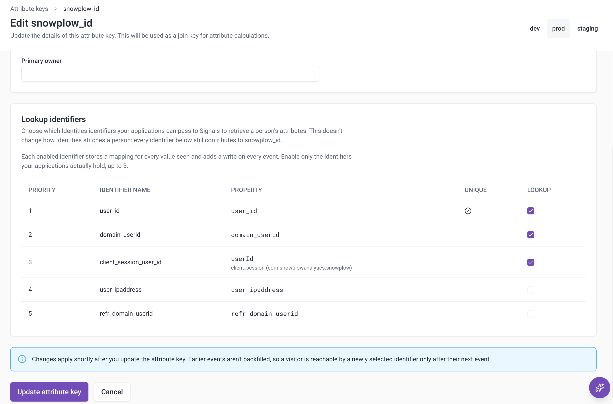
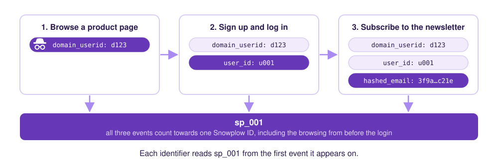
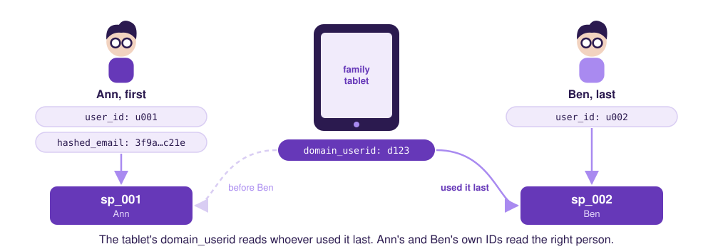

```mdx-code-block
import Tabs from '@theme/Tabs';
import TabItem from '@theme/TabItem';
```

The same person often reaches you through more than one identifier. For example, a user browses anonymously with a `domain_userid` cookie, then logs in with a `user_id`. Attributes keyed on `domain_userid` or `user_id` keep that activity in separate profiles.

With identity resolution, Signals calculates attributes against the [Snowplow ID](/docs/identities/concepts/index.md#snowplow-ids) that [Identities](/docs/identities/index.md) assigns to each person, so all of their activity counts toward one profile. Your application keeps reading with whichever identifier it already has, and Signals returns that person's attributes.

If Identities is already set up on your pipeline, setting up identity resolution takes three steps, with no changes to your application or its reads:

1. [Select up to three lookup identifiers](#select-lookup-identifiers) on the built-in `snowplow_id` attribute key, such as `domain_userid` and `user_id`.
2. [Create stream attribute groups](#create-attribute-groups-keyed-on-snowplow_id) keyed on `snowplow_id`, and publish them.
3. [Read attributes](#retrieve-attributes-by-a-lookup-identifier) as before, with a lookup identifier as the attribute key.

Attributes start empty and build up from the events processed after you publish the attribute group, so a lifetime attribute covers only the activity since then.

Identity resolution works best today for people who browse anonymously and then log in on the same device, and for people who move between your own sites. Logging in to an existing account from another device is [partly supported](#cross-device), with full support coming soon. See [Supported use cases](#supported-use-cases) for what a read returns in each case.

## How identity resolution works

Identities resolves each event to a Snowplow ID and attaches it to the event in the [identity entity](/docs/identities/concepts/index.md#identity-entity). Signals includes a built-in `snowplow_id` [attribute key](/docs/signals/attributes/attribute-keys/index.md) that reads the Snowplow ID from that entity, so you can calculate attributes per person instead of per device or per session.

Your application doesn't need to know the Snowplow ID, and shouldn't rely on it: when Identities [merges](/docs/identities/concepts/merges/index.md) two Snowplow IDs, the person is represented by the one that's kept. Instead, to read attributes keyed on `snowplow_id`, you choose up to three lookup identifiers from the identifiers in your Identities configuration. These are the identifiers your application can read attributes by. Each read uses one identifier, so selecting several lets each part of your application read the same person with the identifier it has. For example, your website can read by the `domain_userid` cookie, and your backend by the `user_id` of a logged-in user.

When you read by a lookup identifier, Signals returns the attributes of the person that identifier was most recently seen with on your events.


For examples of what a read returns, see [Supported use cases](#supported-use-cases).

## Before you start

To use identity resolution, you need Identities set up on the same pipeline as your Signals deployment, with the identifiers you want to read by in its configuration, and that configuration finished deploying. You can set it up yourself in Console. See [Configure Identities](/docs/identities/configuration/index.md), and for advice on picking identifiers, [Choosing identifiers](/docs/identities/configuration/choosing-identifiers/index.md).

{/* TODO: add the minimum Signals and Python SDK versions. */}

## Configure the snowplow_id attribute key

Select the lookup identifiers on the built-in `snowplow_id` attribute key, then create stream attribute groups that use `snowplow_id` as their key. The selection applies to all attribute groups keyed on `snowplow_id` in your deployment.

### Decide which identifiers to use

You can select up to three lookup identifiers. Each lookup identifier adds a write to every event that carries it, so the number is limited, and may be raised later. If you need more, [contact Snowplow Support](https://support.snowplow.io/).

Choose the identifiers your application has at the moment it reads attributes. They usually fall into three roles, and each one behaves differently:

| Role | Examples | Appears on | What a read by it returns |
| --- | --- | --- | --- |
| Anonymous ID | `domain_userid`, a mobile device ID, or your own device or cookie ID | Nearly every event | The person who used the device most recently |
| Known ID | `user_id`, or your own customer ID field | Events after the user logs in | The logged-in person, once they've logged in since you selected it |
| Occasional ID | A hashed email address, a loyalty card number, or another field the user provides now and then | Only the events that capture it, such as a newsletter signup or checkout | The person it was last seen with, which can be out of date until it appears on another event |

The names depend on your Identities configuration. For example, your known ID might be a custom field called `acme_customer_id`.

:::tip[Shared identifiers]
Some identifiers are shared by many people. For example, offices, households, and mobile networks put many people behind one IP address. A read by a shared identifier returns whoever was most recently seen with it, which might not be the person making the request. Select one only if that's acceptable for your use case.
:::

Each event that carries an identifier keeps it linked to its person for as long as your attributes keep their data. Anonymous and known IDs appear often enough to stay linked. An occasional ID, such as a hashed email captured once at signup, can stop resolving between appearances.

### Select lookup identifiers

Select the lookup identifiers on the `snowplow_id` attribute key.

<Tabs groupId="signals-impl" queryString>
<TabItem value="console" label="Console" default>

Navigate to **Signals** > **Attribute keys** in Console and open the `snowplow_id` key. The **Lookup identifiers** card lists the identifiers from your pipeline's [Identities configuration](/docs/identities/configuration/index.md), in priority order, with the property each one is read from.


To select lookup identifiers:

1. Click **Edit**. If no identifiers are enabled yet, you can click **Enable identifiers** instead.
2. Under **Lookup identifiers**, select up to three identifiers.
3. Click **Update attribute key**.



Console flags the `snowplow_id` key when its selection and your Identities configuration don't match:

| Console shows | Cause | What to do |
| --- | --- | --- |
| **Requires Identities** in the attribute keys list | Your pipeline doesn't have Identities set up | Click **Configure** to set up Identities. See [Configure Identities](/docs/identities/configuration/index.md) |
| **Needs attention** in the attribute keys list | A selected identifier was removed from your Identities configuration | Open the key and click **Remove from this key**, or add the identifier back in Identities. You can't change the selection until you do |
| **Identifiers are still enabled without Identities** on the key | Identities was removed from your pipeline while identifiers were selected | Click **Clear identifiers** |

The **Configure** button only appears if you have permission to create or edit the Identities configuration.

</TabItem>
<TabItem value="sdk" label="Python SDK">

Publish an `AttributeKey` named `snowplow_id`, with `lookup_identifiers` set to the names of up to three identifiers from your [Identities configuration](/docs/identities/configuration/index.md):

```python
from snowplow_signals import AttributeKey, Signals

sp_signals = Signals({{ config }})

sp_signals.publish([
    AttributeKey(name="snowplow_id", lookup_identifiers=["domain_userid", "user_id"]),
])
```

The SDK fills in the rest of the built-in key's definition, so don't set `property` or `key`.

Every name must be in your current Identities configuration. If one isn't, for example because of a typo or because you've removed it from Identities, Signals rejects the change with an HTTP 422 error that names it.

Publishing `snowplow_id` without `lookup_identifiers` keeps the current selection, including one made in Console. To remove every lookup identifier, set `lookup_identifiers` to an empty list.

</TabItem>
<TabItem value="assistant" label="Snowplow Assistant">

Ask the [Snowplow Assistant](/docs/ai/console-agent/index.md) in Console to select the lookup identifiers, naming the identifiers you want, for example:

```txt
Let my application read snowplow_id attributes by domain_userid and user_id.
```

The Assistant asks you to approve the change before it saves it. You can ask the same of an agent connected to the [Snowplow MCP server](/docs/ai/snowplow-mcp/index.md).

</TabItem>
</Tabs>

After you change the selection, a new lookup identifier resolves from the next event that carries it. You don't need to republish your attribute groups. If you remove a lookup identifier, reads by it return an HTTP 400 error immediately.

### Create attribute groups keyed on snowplow_id

To calculate attributes per person, create a stream [attribute group](/docs/signals/attributes/attribute-groups/index.md) and select `snowplow_id` as its attribute key.

In the Python SDK, set `attribute_key` to the built-in `snowplow_id`:

```python
from snowplow_signals import StreamAttributeGroup, snowplow_id

person_attribute_group = StreamAttributeGroup(
    name="person_attributes",
    version=1,
    attribute_key=snowplow_id,
    owner="user@company.com",
    attributes=[page_view_count],
)
```

## Retrieve attributes by a lookup identifier

Read attributes keyed on `snowplow_id` the same way as any other attributes, using a [service or an attribute group](/docs/signals/applications/retrieve-attributes/index.md). Set `attribute_key` to the lookup identifier's name, such as `domain_userid`, and `identifier` to its value:

<Tabs groupId="signals-retrieve" queryString>
<TabItem value="python" label="Python" default>

```python
attributes = sp_signals.get_service_attributes(
    name="my_service",
    attribute_key="domain_userid",
    identifier="218e8926-3858-431d-b2ed-66da03a1cbe5",
)
```

</TabItem>
<TabItem value="nodejs" label="Node.js">

```typescript
const attributes = await signals.getServiceAttributes({
  name: "my_service",
  attribute_key: "domain_userid",
  identifier: "218e8926-3858-431d-b2ed-66da03a1cbe5",
});
```

</TabItem>
</Tabs>

A read returns the attributes of the person the identifier was most recently seen with. If Signals hasn't seen the identifier on an event yet, or its link has [expired](#decide-which-identifiers-to-use), each attribute is `null`. Reading by any attribute key other than `snowplow_id` or one of its lookup identifiers returns an HTTP 400 error that lists the ones you can use.

After a [merge](#cross-device), an identifier keeps returning the Snowplow ID that isn't kept until it appears on another event.

:::warning[Only read by identifiers you've verified]
Signals links an identifier to a person based on the identifiers that arrive on your events, and doesn't check who sent them. If someone sends events from their own browser that carry another user's identifier, such as that user's email address, Identities can link their browser's `domain_userid` to the other user's Snowplow ID. A read by that `domain_userid` then returns the other user's attributes.

Reading attributes needs an API key, so reads run on your backend. Before your backend shows a person's attributes to the user, or acts on them in a reply, check that the identifier belongs to that user, for example a `user_id` from an authenticated session. Treat reads by an anonymous ID as unverified.
:::

## Supported use cases

Identity resolution is being released in stages. This table shows which use cases are supported.

| Use case | Scenario | Status |
| --- | --- | --- |
| [Anonymous to known](#anonymous-to-known) | A user browses anonymously, then logs in | ✅ Supported |
| [Cross-domain](#cross-domain) | A user moves between your sites | ✅ Supported for first visits. ⚠️ Partly supported for returning visitors |
| [Shared device](#shared-device) | Several people use the same device | ✅ Supported, with `user_id` as a unique identifier |
| [Cross-device](#cross-device) | A user switches between devices or browsers | ⚠️ Partly supported |

The [known limitations](#known-limitations) at the end of this section apply to all of them.

The examples show what a read returns for one lookup identifier of each [role](#decide-which-identifiers-to-use): `domain_userid` as the anonymous ID, `user_id` as the known ID, and `hashed_email` as the occasional ID. In the Returns column, a Snowplow ID such as `sp_001` stands for the attributes calculated for that Snowplow ID.

### Anonymous to known

Supported. A user browses anonymously, then logs in to a new account, or to an account they've already logged in to on this device. Identities links the `user_id` to the device's Snowplow ID, so all of the user's activity, including the browsing from before the login, counts toward one Snowplow ID.



<details>
<summary>Example: sign up after browsing</summary>

| Event | Identifiers | Snowplow ID |
| --- | --- | --- |
| Browse a product page | `domain_userid` (`d123`) | `sp_001` |
| Sign up and log in | `domain_userid` (`d123`), `user_id` (`u001`) | `sp_001` |
| Subscribe to the newsletter | `domain_userid` (`d123`), `user_id` (`u001`), `hashed_email` (`3f9a…c21e`) | `sp_001` |

| Read by | Returns |
| --- | --- |
| `domain_userid` (`d123`) | `sp_001`, from the first event onward |
| `user_id` (`u001`) | `sp_001`, including the product page view from before the login, once the login event has arrived |
| `hashed_email` (`3f9a…c21e`) | `sp_001`, once the newsletter event has arrived. Before that, `null` |

</details>

### Cross-domain

Supported. A user moves from one of your sites to another with a different cookie domain. With [cross-domain tracking](/docs/identities/concepts/cross-domain-tracking/index.md) enabled in Identities, the second site's `domain_userid` is linked to the first site's Snowplow ID, so the activity on both sites counts toward one Snowplow ID.

If the user has visited the second site before, its `domain_userid` already has its own Snowplow ID, and Identities merges the two. In that case, the [cross-device](#cross-device) limitations apply.


<details>
<summary>Example: follow a link to a sister site</summary>

| Event | Identifiers | Snowplow ID |
| --- | --- | --- |
| Log in on `brandA.com` | `domain_userid` (`dA1`), `user_id` (`u001`) | `sp_001` |
| Follow a link to `brandB.com` for the first time | `domain_userid` (`dB1`), `refr_domain_userid` (`dA1`) | `sp_001` |

| Read by | Returns |
| --- | --- |
| `domain_userid` (`dA1`) or `domain_userid` (`dB1`) | `sp_001`, with the activity on both sites |
| `user_id` (`u001`) | `sp_001`, with the activity on both sites, even though the user hasn't logged in on `brandB.com` |
| `hashed_email` | Not captured in this example. It works as in [anonymous to known](#anonymous-to-known) |

</details>

### Shared device

Supported when `user_id` is marked as a [unique identifier](/docs/identities/concepts/unique-identifiers/index.md) in Identities. Each person who logs in keeps their own Snowplow ID. Reads by a known or occasional ID return the right person. Reads by the device's anonymous ID return whoever used the device most recently.

To stop one person's anonymous activity counting toward the next, [reset identifiers on logout](/docs/identities/configuration/choosing-identifiers/index.md#reset-identifiers-on-logout).



<details>
<summary>Example: two people log in on a family tablet</summary>

| Event | Identifiers | Snowplow ID |
| --- | --- | --- |
| Ann logs in and checks out on the family tablet | `domain_userid` (`d123`), `user_id` (`u001`), `hashed_email` (`3f9a…c21e`) | `sp_001` |
| Ben logs in on the same tablet | `domain_userid` (`d123`), `user_id` (`u002`) | `sp_002` |

| Read by | Returns |
| --- | --- |
| `domain_userid` (`d123`) | `sp_002`, Ben, who used the tablet last |
| `user_id` (`u001`) or `hashed_email` (`3f9a…c21e`) | `sp_001`, Ann |
| `user_id` (`u002`) | `sp_002`, Ben |

</details>

### Cross-device

Partly supported. A user browses anonymously on a device or browser that isn't linked to their account yet, for example a new phone or a browser with cleared cookies, then logs in to their existing account. The device already has its own Snowplow ID, so Identities [merges](/docs/identities/concepts/merges/index.md) the two and keeps the older one. All new activity counts toward the Snowplow ID that's kept.

What isn't supported:

* Activity from before the merge stays split: attributes calculated under the Snowplow ID that isn't kept aren't added to the one that's kept.
* Identifiers switch over only when they next appear: an identifier that hasn't appeared on an event since the merge keeps returning the Snowplow ID that isn't kept until it does. For an anonymous ID, this is usually the first event of a returning visit. For an occasional ID, such as a hashed email, it can last until the user next provides it.

![Diagram: on a laptop, earlier, the website's domain_userid d123, user_id u001, and hashed_email belong to sp_001. A new phone browses as domain_userid p456 under sp_002, then logs in with user_id u001. Identities merges sp_002 into sp_001, which is kept. Each identifier reads the Snowplow ID it was last seen with, so from the login on, the phone's p456 reads sp_001, and the phone browsing from before the login stays under sp_002. Adding sp_002's attribute values to sp_001 on a merge is coming soon.](../../images/identity-resolution-cross-device.svg)

<details>
<summary>Example: log in on a new phone</summary>

| Event | Identifiers | Snowplow ID |
| --- | --- | --- |
| Earlier, on the website | `domain_userid` (`d123`), `user_id` (`u001`), `hashed_email` (`3f9a…c21e`) | `sp_001` |
| Browse the app anonymously on a new phone | `domain_userid` (`p456`) | `sp_002` |
| Log in on the phone | `domain_userid` (`p456`), `user_id` (`u001`) | `sp_001`, after merging `sp_002` into it |

| Read by | Returns |
| --- | --- |
| `domain_userid` (`d123`), `user_id` (`u001`), or `hashed_email` (`3f9a…c21e`) | `sp_001`: the website activity and everything from the login onward, without the phone browsing from before the login |
| `domain_userid` (`p456`) | Before the login, `sp_002`: the phone browsing only. From the login onward, the same as the row above |

If the device's Snowplow ID is the older one, for example because the user browsed the app before creating their account on the website, the device's ID is kept instead. The account's activity from before the merge is then the part that's missing.

</details>

<details>
<summary>Example: return to a laptop after logging in on a phone</summary>

| Event | Identifiers | Snowplow ID |
| --- | --- | --- |
| Last week: browse the app on the phone without logging in | `domain_userid` (`p012`) | `sp_001` |
| Monday: sign up on the laptop | `domain_userid` (`l789`), `user_id` (`u001`), `hashed_email` (`3f9a…c21e`) | `sp_002` |
| Tuesday: log in on the phone, which has an older Snowplow ID | `domain_userid` (`p012`), `user_id` (`u001`) | `sp_001`, after merging `sp_002` into it |
| Wednesday: first page view back on the laptop | `domain_userid` (`l789`) | `sp_001` |

| Read by | Returns on Wednesday |
| --- | --- |
| `user_id` (`u001`) or `domain_userid` (`p012`) | `sp_001`: the phone activity and everything since Tuesday, without Monday's laptop activity |
| `domain_userid` (`l789`) | Before the page view, `sp_002`: Monday's laptop activity only. After it, the same as the row above |
| `hashed_email` (`3f9a…c21e`) | `sp_002`: Monday's laptop activity only, until an event with the hashed email arrives |

</details>

### Known limitations

The following limitations apply to every use case. They're temporary, and Snowplow is working on removing them:

* No backfill: attributes keyed on `snowplow_id` include only events processed after you publish the attribute group, so they start empty and build up over time. An identifier can read them only after it appears on an event sent after you select it as a lookup identifier.
* Occasional IDs can expire: an identifier that doesn't appear on an event for longer than your attributes keep their data stops resolving. See [Decide which identifiers to use](#decide-which-identifiers-to-use).
* Stream attribute groups only: attribute groups keyed on `snowplow_id` can't use a [warehouse source](/docs/signals/attributes/warehouse-config/index.md) or [backfill](/docs/signals/attributes/attribute-groups/index.md#backfill-attributes).
* Interventions can't target `snowplow_id`: an [intervention](/docs/signals/interventions/index.md) with criteria on attributes keyed on `snowplow_id` needs a target your application has, such as `domain_userid`. Signals delivers it to the device whose event triggered it. If you don't set a target, Signals rejects the intervention.
* Deleting by identifier doesn't delete the person's attributes: to delete data, call the Signals API's `DELETE /api/v1/{attribute_key}/{identifier}` endpoint. Deleting by a lookup identifier stops it resolving to the person, but the attributes calculated for their Snowplow ID remain. To delete the person's attributes, use `snowplow_id` as the attribute key and their Snowplow ID as the identifier. You can find it on their events in the [identity entity](/docs/identities/concepts/index.md#identity-entity). Reads by their lookup identifiers then return `null`. Deleting doesn't remove the person from Identities, so new events calculate their attributes again under the same Snowplow ID.

```mdx-code-block
import SignalsFreeTier from "@site/docs/reusable/signals-free-tier/_index.md"

<SignalsFreeTier/>
```
