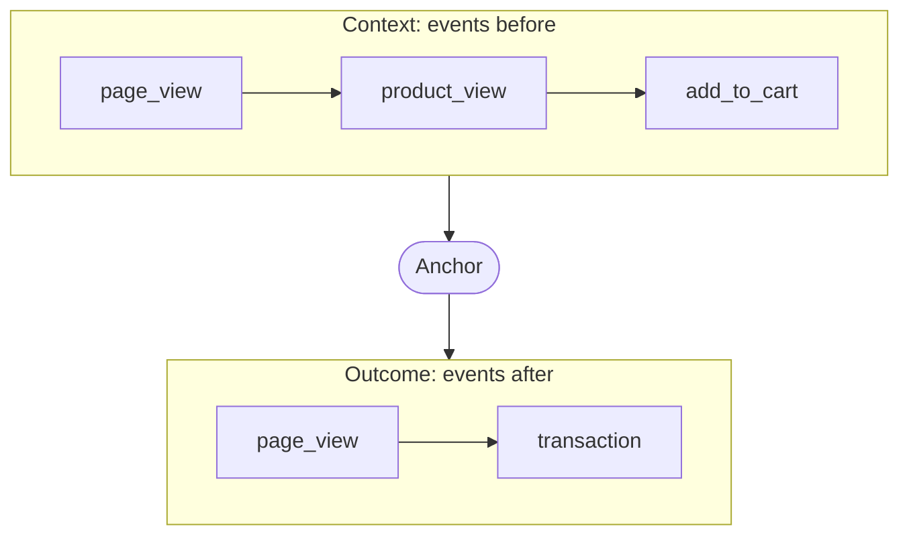

To train or test a model on past traffic, you need to go back to points in time and see two things: what was known about the user at that point, and whether they went on to convert afterwards. Each row in a dataset holds both for one anchor:

- Context is what your application would have known at the anchor: attribute values and agentic contexts, computed only from the events before it.
- Outcomes are what happened after the anchor, such as whether the user went on to purchase. They come from labels on the anchors or from outcome columns.



In this session, the row for the anchor has attributes such as `product_views = 1` and `cart_adds = 1`, computed from the three earlier events. Its outcome `purchased_later` is `true`, because a `transaction` followed later in the session.

## Add attributes at each anchor

Every attribute in the `attribute_groups` you pass becomes a column. Signals computes each value from the events for that attribute key before the anchor, looking back as far as the longest period across your attributes. Use `max_lookback_days` to override that window.

Values include only the events before the anchor, never the anchor event itself, for every anchor type.

The attribute groups don't need to be published. You can pass a draft definition to test it before it goes live.

Because each attribute becomes a column, attribute names must be unique across all the attribute groups you pass, ignoring case. Names also can't match the dataset's own columns: `anchor_ts`, `label`, or an attribute key column such as `domain_sessionid`. To use two groups that share an attribute name, rename the attribute in one of them.

## Add agentic contexts at each anchor

Pass up to five [agentic context](/docs/signals/agentic-contexts/index.md) definitions as `agentic_contexts` to add one column per agentic context. Each column holds an array of the entries the streaming engine would have buffered at that anchor, oldest first, in the same shape as the JSON returned when you [retrieve an agentic context](/docs/signals/applications/agentic-contexts/index.md).

```python
# sp_signals: the client from Connect to Signals
# session_attributes, product_view, and span: as in Choose dataset anchors
agentic_context = sp_signals.get_event_log(name="recent_activity")

run = sp_signals.submit_dataset_run_with_event_anchors(
    attribute_groups=[session_attributes],
    criteria=product_view,
    training_span=span,
    agentic_contexts=[agentic_context],
)
```

The entries follow the agentic context's configuration:

- Only events that match its event selections are included, with the properties it projects, plus `event_id`, `event_name`, `page_urlpath`, and `derived_tstamp`.
- Entries older than `max_age_seconds` before the newest entry are dropped, and only the newest `max_events` are kept.
- If no matching event arrived within `max_age_seconds` before the anchor, the column holds an empty array.

Agentic contexts are buffered per session, so the dataset gets a `domain_sessionid` column when you add one. Agentic contexts in datasets require Snowflake. Event selections that use an event specification ID aren't supported yet.

## Add outcome columns

Outcomes are boolean columns that record whether something happened after each anchor, for example whether the user purchased later in the session. Use them to check a model's answers against what users did next, or as labels for training. Outcomes never select or filter anchors, so they work with every anchor type.

```python
from snowplow_signals import AtomicProperty, Criteria, Criterion, DatasetOutcome

# sp_signals, session_attributes, product_view, and span: as in Choose dataset anchors
# user_attributes: an attribute group keyed on domain_userid
purchase = Criteria(
    all=[Criterion.eq(AtomicProperty(name="event_name"), "transaction")]
)

run = sp_signals.submit_dataset_run_with_event_anchors(
    attribute_groups=[session_attributes, user_attributes],
    criteria=product_view,
    training_span=span,
    outcomes=[
        DatasetOutcome(name="purchased_later", criteria=purchase),
        DatasetOutcome(
            name="purchased_within_7_days",
            criteria=purchase,
            attribute_key="domain_userid",
            within_seconds=7 * 24 * 3600,
        ),
    ],
)
```

An outcome is `true` when an event matching `criteria` has a later `collector_tstamp` than the anchor, has the anchor's value of `attribute_key`, and occurs within `within_seconds` of the anchor if set. Otherwise it's `false`.

An outcome is empty (`NULL`) when the anchor has no value for its `attribute_key`, for example an outcome on `domain_userid` for an anchor without a user ID. Signals can't tell whether that user did anything next, so filter these rows out rather than counting them as `false`.

You can add up to 20 outcomes to a dataset.

| Field | Description | Type | Required? |
| --- | --- | --- | --- |
| `name` | Name of the outcome column. Must not match another column in the dataset, ignoring case, including `anchor_ts` and `label`. | `str` | ✅ |
| `criteria` | Events that count as the outcome happening. Same format as event anchor criteria. | `Criteria` | ✅ |
| `attribute_key` | Attribute key the outcome follows. Only events with the anchor's value of this key count. Must be a key column of the dataset: the key of one of the attribute groups, or `domain_sessionid` with session or event anchors. | `str` | Default: `"domain_sessionid"` |
| `within_seconds` | Only count events up to this many seconds after the anchor, up to a year. Required for any attribute key other than `domain_sessionid`. Without it, an outcome on `domain_sessionid` covers the rest of the session, up to a day after the dataset's last anchor. | `int` | Default: `None` |

## Review an example row

A dataset with event anchors, two session attributes, a `recent_activity` agentic context, and a `purchased_later` outcome has rows like this:

| domain_sessionid | anchor_ts | product_views | cart_adds | recent_activity | purchased_later |
| --- | --- | --- | --- | --- | --- |
| `abc-123` | 2026-01-05 19:25:22 | 4 | 1 | `[{"event_name": "page_view", "page_title": "Apparel", ...}, ...]` | `true` |
| `def-456` | 2026-01-05 19:31:08 | 1 | | `[{"event_name": "page_view", "page_title": "Home", ...}]` | `false` |

Attributes with no value at the anchor, such as a counter with no matching events yet, are empty.
