<NotebookLinks path="snowplow-incubator/signals-notebooks/blob/main/quickstart.ipynb" />

```mdx-code-block
import Tabs from '@theme/Tabs';
import TabItem from '@theme/TabItem';
```

[Snowplow Signals](/docs/signals/introduction/index.md) computes attributes from your behavioral data in real time and serves them to your applications over an API. In this tutorial you calculate three session attributes from page views in your event stream, then retrieve them for your current session.

You define the attributes in Snowplow Console. If you'd rather define them in code, the **Open in Colab** notebook has the same steps for the [Signals Python SDK](https://pypi.org/project/snowplow-signals/). To have a coding agent do this for you instead, follow the [quickstart with your coding agent](/docs/signals/quickstart/index.md).

## What you'll build

This tutorial takes less than 10 minutes, from enabling Signals to retrieving calculated attributes.

You'll create:

* An [attribute group](/docs/signals/attributes/attribute-groups/index.md) called `quickstart_group` that calculates, for each session:
  * `page_view_count`: how many page views in the last 15 minutes
  * `most_recent_browser`: the last seen browser name
  * `first_referrer`: the first seen page referrer
* A [service](/docs/signals/applications/services/index.md) called `quickstart_service` that serves the attribute group to applications

You'll finish by retrieving the attribute values for your own browsing session with the Python SDK.

## Requirements

You'll need:

* A web application where you can add the JavaScript tracker and track page views
* A Snowflake warehouse
* Signals enabled on your Snowplow account
* A Python notebook environment, such as Google Colab or Jupyter

:::note[Signals free tier]
If you don't have a Snowplow account, sign up for the [Signals free tier](https://signals.snowplow.io/start?utm_source=docs.snowplow.io&utm_medium=referral), which includes event collection, to follow along.
:::

## Steps

Each step builds on the one before it. Keep your web application open in another tab, so that you can generate page views as you go.

<Steps>

### Enable Signals

Log in to [Console](https://console.snowplowanalytics.com) and go to the **Signals** section.

If Signals isn't enabled for your organization yet, follow [Set up Signals](/docs/signals/setup/index.md) first.

### Create the attribute group

To create an attribute group, go to **Signals** > **Attribute groups** in Console and click **Create attribute group**.

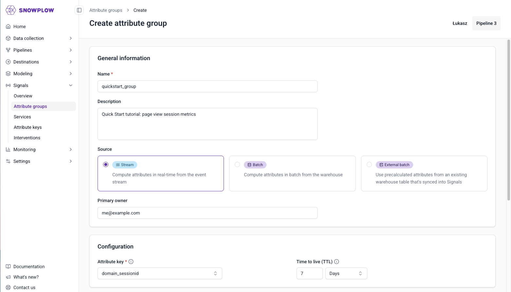

Specify the basic configuration for your attribute group:

* **Name**: `quickstart_group`
* **Description**: Quick Start tutorial: page view session metrics
* **Source**: stream
* **Primary owner**: your email address

The name is the group's unique identifier. The description and owner are optional.

Under the **Configuration** section, select the following:

* **Attribute key**: `domain_sessionid`
* **TTL**: leave as default

### Add the page view counter

Click **Add attribute** to create each attribute.

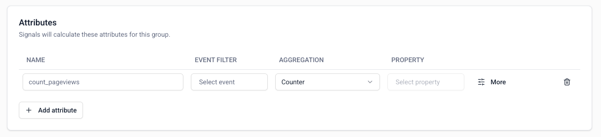

The first attribute counts page view events within the last 15 minutes. Enter `page_view_count` in the attribute name field.

To set the event to calculate this attribute from:

1. Click the event filter field to bring up the event selection options
2. Page views are a built-in Snowplow event, so they're listed in the default **Snowplow events** tab
3. Click in the search box to find `page_view`
4. Click **Confirm** to add the event to the attribute

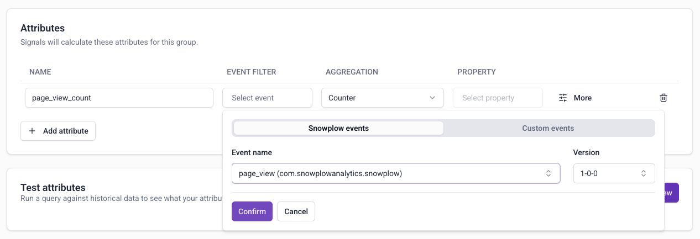

Leave the aggregation as `Counter`. This aggregation doesn't use a property, so leave the property field blank.

To set the time period, update the **Period** field to 15 minutes.

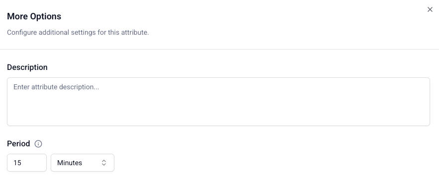

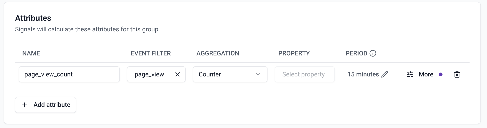

### Add the most recent browser

The second attribute is the last seen browser name. The calculation uses the [YAUAA enrichment](/docs/pipeline/enrichments/available-enrichments/yauaa-enrichment/index.md): the browser name is a field in the `yauaa_context` entity.

Create an attribute named `most_recent_browser`, select `page_view` as before, and choose the `Last` aggregation.

To set the property:

1. Click the property selection field
2. Choose the **Entities** tab to search through all schemas that have been tracked as entities with your events
3. Search for `yauaa_context`
4. Select the entity `yauaa_context (nl.basjes)`
5. Select the `agentName` property
6. Click **Confirm** to save

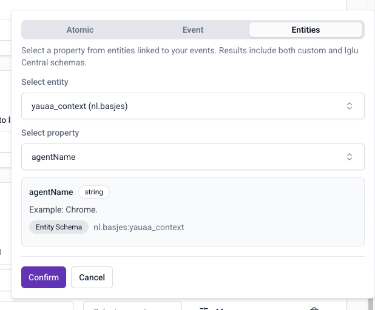

### Add the first referrer

The third attribute stores the first seen referrer host, from the `refr_urlhost` [atomic event property](/docs/fundamentals/canonical-event/index.md#web-specific-fields).

Create an attribute named `first_referrer`, select `page_view` as before, and choose the `First` aggregation.

To set the property:

1. Click the property selection field
2. Stay on the default **Atomic** tab to search through all atomic properties
3. Search for and select `refr_urlhost`
4. Click **Confirm** to save

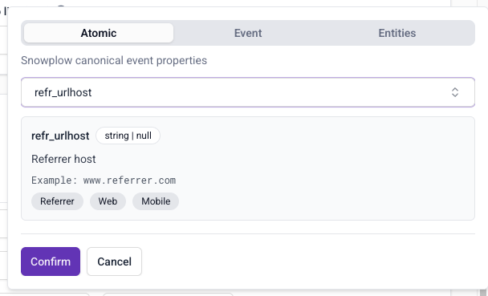

Add a criteria filter so that the attribute only considers events where the referrer isn't an empty string:

1. Click **More**
2. Click **Add criteria**
3. Choose the `page_referrer` atomic property and click **Confirm**
4. Change the operator to `not equals`
5. Leave the value blank
6. Click **Done** to return to the group details page

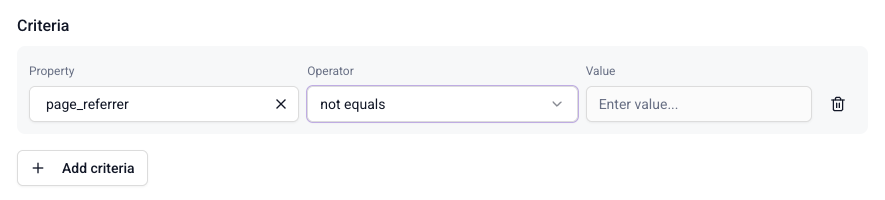

### Preview and publish the attribute group

Click **Run preview** to test your attribute group configuration.

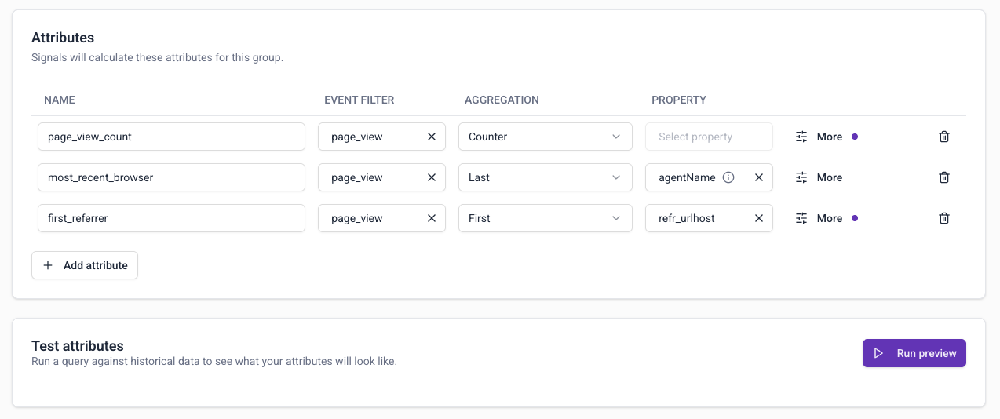

The preview calculates the attributes from your atomic events table, using 10 random events from the last hour. The first column shows the attribute key values, in this case `domain_sessionid`.

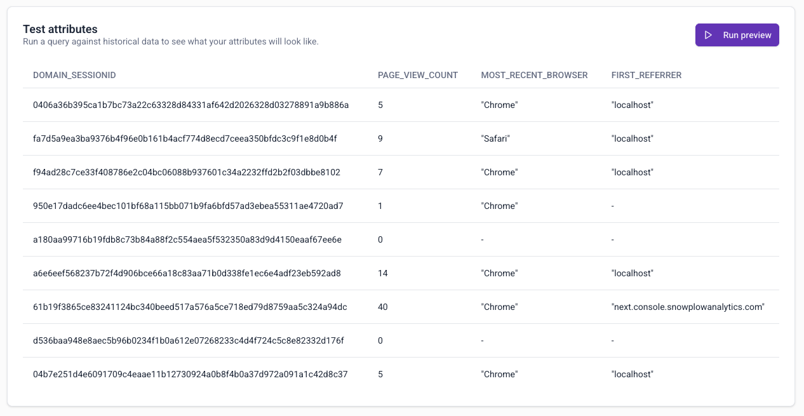

When you're satisfied with the preview results, click **Create attribute group** to save it as a draft.

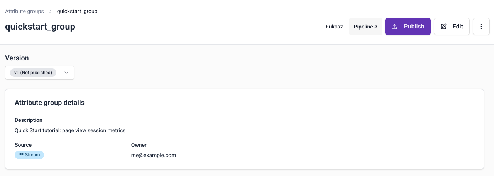

Click **Publish** to push this configuration to Signals and start calculating attributes.

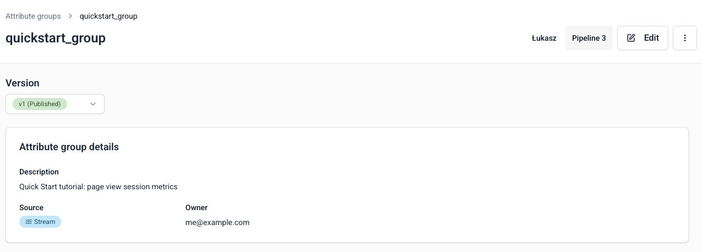

### Create the service

Services group attribute groups together for serving to your applications. Go to **Signals** > **Services** in Console and click **Create service**.

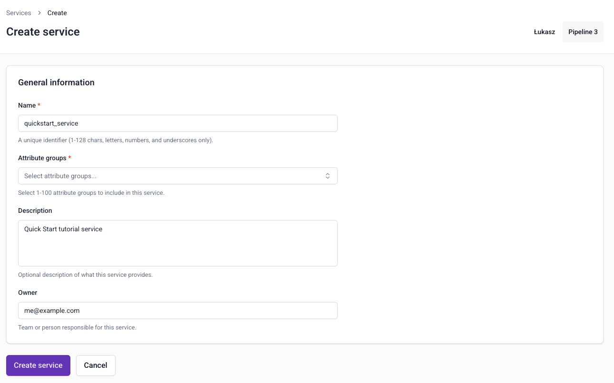

Specify the configuration for your service:

* **Name**: `quickstart_service`
* **Description**: Quick Start tutorial service
* **Owner**: your email address

To add the attribute group, click the attribute group selector, then search for and select `quickstart_group (v1)`. If it isn't listed, check that you published it in the previous step.

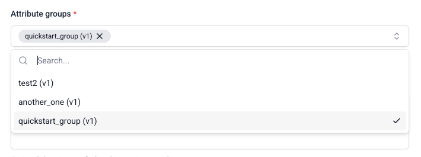

Click **Create service**. Services are published as soon as they're created.

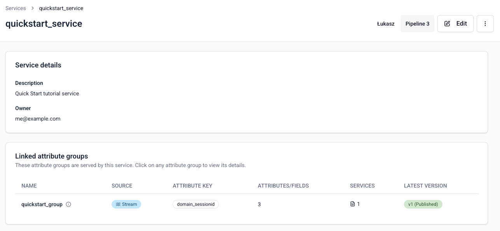

### Find your session ID

Signals calculates the attributes in real time, within the session. To retrieve them, you need the session ID for your own browsing session.

Use the [Snowplow Inspector](/docs/testing/snowplow-inspector/index.md) browser extension on your web application. Click around to generate some page view events, then find the **Domain Session ID** in the Inspector.

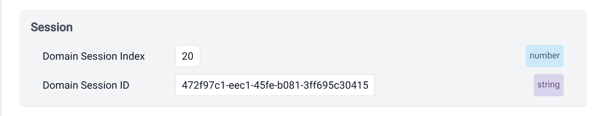

In your application code, read the session ID from the tracker instead, as described in [getting cookie values](/docs/sources/web-trackers/cookies-and-local-storage/getting-cookie-values/index.md).

### Connect with the Python SDK

Go to **Signals** > **Overview** in Console to find your Signals [connection credentials](/docs/signals/connection/reference/index.md#connection-credentials), and add them to your notebook secrets.

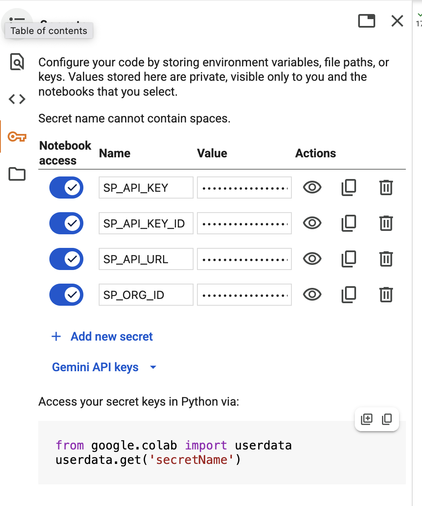

Install the SDK:

```python
%pip install snowplow-signals
```

Connect to Signals:

```python
from snowplow_signals import Signals
from google.colab import userdata

sp_signals = Signals(
    api_url=userdata.get('SP_API_URL'),
    api_key=userdata.get('SP_API_KEY'),
    api_key_id=userdata.get('SP_API_KEY_ID'),
    org_id=userdata.get('SP_ORG_ID'),
)
```

### Retrieve your session attributes

Use your session ID to retrieve the attributes that Signals has calculated for your session:

<Tabs groupId="signals-retrieve" queryString>
<TabItem value="python" label="Python" default>

```python
import pandas as pd

attributes = sp_signals.get_service_attributes(
    name="quickstart_service",
    attribute_key="domain_sessionid",
    identifier="472f97c1-eec1-45fe-b081-3ff695c30415", # UPDATE THIS
)

pd.DataFrame([attributes])
```

</TabItem>
<TabItem value="nodejs" label="Node.js">

To retrieve the attributes from Node.js instead of the notebook, install `@snowplow/signals-node` and create a client from the same credentials, as described in [Connect to Signals](/docs/signals/connection/index.md):

```typescript
import { Signals } from '@snowplow/signals-node';

const signals = new Signals({
  baseUrl: process.env.SIGNALS_API_URL,
  apiKey: process.env.SNOWPLOW_API_KEY,
  apiKeyId: process.env.SNOWPLOW_API_KEY_ID,
  organizationId: process.env.SNOWPLOW_ORG_ID,
});

const attributes = await signals.getServiceAttributes({
  name: "quickstart_service",
  attribute_key: "domain_sessionid",
  identifier: "472f97c1-eec1-45fe-b081-3ff695c30415", // UPDATE THIS
});
console.log(attributes);
```

</TabItem>
</Tabs>

The result looks something like this:

| `page_view_count` | `most_recent_browser` | `first_referrer` |
| ----------------- | --------------------- | ---------------- |
| 2.0               | `Firefox`             | `snowplow.io`    |

To retrieve individual attributes without a service, use the `get_group_attributes()` method:

```python
attributes = sp_signals.get_group_attributes(
    name="quickstart_group",
    version=1,
    attributes=["page_view_count"],
    attribute_key="domain_sessionid",
    identifier="472f97c1-eec1-45fe-b081-3ff695c30415", # UPDATE THIS
)

pd.DataFrame([attributes])
```

If the values are empty, generate a few more page views and try again. Signals only calculates from events received after you published the attribute group.

</Steps>

## Clean up

The tutorial's attribute group keeps calculating attributes while it's published. When you've finished, unpublish and delete `quickstart_service` and `quickstart_group`, in Console or with the Python SDK's `unpublish` and `delete` methods. The [configuration workflow](/docs/signals/attributes/index.md#configuration-workflow) explains how unpublishing and deleting work.

To keep exploring, try calculating the same attributes against `domain_userid` instead of the session, define attributes from other event types, or [retrieve attributes in your application](/docs/signals/applications/retrieve-attributes/index.md). The [interventions tutorial](/tutorials/signals-interventions/start) and the [prospect scoring tutorial](/tutorials/signals-ml-prospect-scoring/intro) build on these steps.
