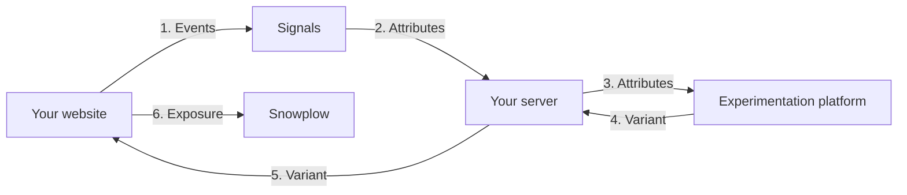
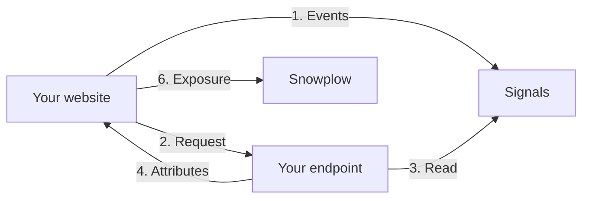

```mdx-code-block
import Tabs from '@theme/Tabs';
import TabItem from '@theme/TabItem';
```

Experimentation platforms, the A/B testing and feature flag tools such as Optimizely, GrowthBook, LaunchDarkly, and Conductrics, decide which variant each user sees. They make that decision using the attributes your application passes in. Signals gives them attributes that describe what the user is doing right now, so your experiments can target and learn from behavior in the current session.

Your experimentation platform still assigns variants, holds out a control group, and calculates results. Signals provides the attributes, and Snowplow records which variant each user saw.

This page covers the pattern every platform shares. Each platform page shows the code for that platform:

| Platform | How it takes Signals attributes |
| --- | --- |
| [Conductrics](/docs/signals/integrations/experimentation-platforms/conductrics/index.md) | Traits on the selection API call |
| [GrowthBook](/docs/signals/integrations/experimentation-platforms/growthbook/index.md) | Attributes on a scoped SDK instance |
| [LaunchDarkly](/docs/signals/integrations/experimentation-platforms/launchdarkly/index.md) | Attributes in the evaluation context |
| [Optimizely](/docs/signals/integrations/experimentation-platforms/optimizely/index.md) | Attributes on the user context |

Other platforms follow the same pattern. For example, Kameleoon calls user attributes custom data.

## Why use Signals with an experimentation platform

Experimentation platforms usually target on what they can see on the page, or on audiences synced from another system. Synced audiences arrive minutes or hours later, so they describe a past session rather than the current one.

Passing Signals attributes at assignment lets you:

* Target on in-session behavior: show a variant to users who are comparing prices, hesitating at checkout, or returning for the third time today
* Give bandits better context: contextual bandits and predictive targeting learn from the attributes they receive at each decision
* Use one definition everywhere: the attribute you target on is the same attribute you segment results by, so "high intent" means the same thing in targeting and in analysis
* Analyze results in your own warehouse: exposures are part of your Snowplow data, so you can join them to every other event a user generated
* Start an experiment at the right moment: assign a variant when a user meets a condition, using [interventions](/docs/signals/interventions/index.md)

## How it works

Reading attributes from Signals needs an API key, so the read always happens on your server. The experimentation decision can happen on your server or in the browser. Use the setup that matches where your platform's SDK already runs:

| | On your server | In the browser |
| --- | --- | --- |
| Use it when | Your server renders pages, or already calls the platform's server-side SDK | Your site is a single-page app or a static site, or the platform runs only in the browser |
| How attributes reach the SDK | Your server reads them and passes them to the SDK | The browser calls an endpoint on your server, which reads them and returns them |
| What the user sees | The page arrives with the variant already applied | The page waits for the attributes before it shows the variant |

Both setups read attributes the same way. In these examples, `checkout_intent` is a Signals service and `domainUserId` is the user's Snowplow ID. Create the `Signals` client once when your server starts, as described in [Connect to Signals](/docs/signals/connection/index.md), and reuse it for every request.

<Tabs groupId="signals-language" queryString>
<TabItem value="nodejs" label="Node.js" default>

```typescript
const attributes = await signals.getServiceAttributes({
  name: 'checkout_intent',
  attribute_key: 'domain_userid',
  identifier: domainUserId,
});
```

</TabItem>
<TabItem value="python" label="Python">

```python
attributes = sp_signals.get_service_attributes(
    name="checkout_intent",
    attribute_key="domain_userid",
    identifier=domain_user_id,
)
```

</TabItem>
</Tabs>

Signals returns the service's attributes for that user, for example:

```json
{
  "cart_value": 120,
  "product_views_last_10_min": 6,
  "is_returning_customer": true
}
```

Your platform then applies a rule such as "show the offer when `product_views_last_10_min` is at least 5".

### On your server

Your request handler reads the attributes. A request handler is the server code that runs when a browser requests a page or calls your API, for example an Express route, a Next.js route handler or server component, or a Django view. It passes the attributes to the platform's server-side SDK before the page is rendered.



In order:

1. Your website sends events to Snowplow, and Signals updates the user's attributes
2. When the user requests a page, your server reads their attributes from a Signals [service](/docs/signals/applications/services/index.md)
3. Your server passes the attributes to the experimentation SDK
4. The SDK applies your targeting rules and assigns a variant
5. Your server renders the variant
6. Your website tracks which variant the user saw, as part of the page view

### In the browser

You add one endpoint to your server that reads the current user's attributes and returns them as JSON. The browser calls it and passes the attributes to the platform's browser SDK.



In order:

1. Your website sends events to Snowplow, and Signals updates the user's attributes
2. When the page loads, the browser calls your endpoint
3. The endpoint reads the user's attributes from the Signals service
4. The endpoint returns the attributes the browser is allowed to see
5. The browser SDK applies your targeting rules and assigns a variant
6. Your website shows the variant, and tracks which variant the user saw as part of the page view

The user waits for the endpoint before the variant appears, so keep its timeout short. Most platforms' browser snippets already hide the page until they assign a variant.

## Choose the user key

The user key is the identifier the experimentation platform uses to assign a variant. Use `domain_userid` by default, so experiment exposures, Signals attributes, and Snowplow events all join on the same ID. Don't let the platform create its own anonymous ID as well.

Use `domain_sessionid` only for experiments where the outcome happens in the same session, because a new session would assign the user again. Use `user_id` only if your platform keeps assignments the same across login.

The JavaScript tracker stores `domain_userid` as the first value in its `_sp_id` cookie, as described in [Getting cookie values](/docs/sources/web-trackers/cookies-and-local-storage/getting-cookie-values/index.md). The cookie's full name is `_sp_id.` followed by a hash. This helper reads it from a cookie header on your server, or from `document.cookie` in the browser:

<Tabs groupId="signals-language" queryString>
<TabItem value="nodejs" label="Node.js" default>

```typescript
export function getDomainUserId(cookies: string): string | undefined {
  return cookies.match(/(?:^|;\s*)_sp_id\.[^=]+=([^.;]+)/)?.[1];
}
```

</TabItem>
<TabItem value="python" label="Python">

```python
def get_domain_user_id(cookies: dict) -> str | None:
    for name, value in cookies.items():
        if name.startswith("_sp_id."):
            return value.split(".")[0]
    return None
```

</TabItem>
</Tabs>

If you've changed the tracker's `cookieName`, change the `_sp_id` prefix to match. On a user's first page view, your server may not receive the cookie yet, so experiments that target in-session behavior should assign on a later request.

## Handle slow or missing attributes

Assignment shouldn't depend on Signals. If a read is slow or fails, assign without Signals attributes rather than delay the page. The platform pages call this helper in place of the direct read. It does two things:

* Returns an empty set of attributes if Signals doesn't reply within your timeout, or returns an error
* Drops `null` values, because experimentation platforms skip targeting conditions on missing or wrongly typed values

<Tabs groupId="signals-language" queryString>
<TabItem value="nodejs" label="Node.js" default>

```typescript
type Scalar = string | number | boolean;

export async function readSignals(
  service: string,
  domainUserId: string,
  timeoutMs: number,
): Promise<Record<string, Scalar>> {
  const timeout = new Promise<Record<string, unknown>>((resolve) =>
    setTimeout(() => resolve({}), timeoutMs),
  );
  try {
    const values = await Promise.race([
      signals.getServiceAttributes({
        name: service,
        attribute_key: 'domain_userid',
        identifier: domainUserId,
      }),
      timeout,
    ]);
    return Object.fromEntries(
      Object.entries(values ?? {}).filter(([, v]) =>
        ['string', 'number', 'boolean'].includes(typeof v),
      ),
    ) as Record<string, Scalar>;
  } catch {
    return {};
  }
}
```

</TabItem>
<TabItem value="python" label="Python">

The Python SDK call is synchronous, so this helper runs it in a thread pool to apply a timeout.

```python
from concurrent.futures import ThreadPoolExecutor

executor = ThreadPoolExecutor(max_workers=8)

def read_signals(service: str, domain_user_id: str, timeout_s: float) -> dict:
    future = executor.submit(
        sp_signals.get_service_attributes,
        name=service,
        attribute_key="domain_userid",
        identifier=domain_user_id,
    )
    try:
        values = future.result(timeout=timeout_s)
    except Exception:  # Includes the timeout
        return {}
    return {k: v for k, v in (values or {}).items() if isinstance(v, (str, int, float, bool))}
```

</TabItem>
</Tabs>

Users without Signals attributes, because the read timed out or because they're new, don't match conditions built on Signals attributes, and see the default variant. Keep this in mind when you report results.

### Serve attributes to the browser

For the browser setup, add an endpoint that calls the helper and returns the result. Two rules keep it safe:

* Read the user's ID from their own cookie, never from a query parameter, so a visitor can only fetch their own attributes
* Return only the attributes the browser needs, because the user can see anything you return

This example uses Express in Node.js, or Flask in Python:

<Tabs groupId="signals-language" queryString>
<TabItem value="nodejs" label="Node.js" default>

```typescript
const BROWSER_ATTRIBUTES = ['product_views_last_10_min', 'is_returning_customer'];

app.get('/api/signals-attributes', async (req, res) => {
  const domainUserId = getDomainUserId(req.headers.cookie ?? '');
  const attributes = domainUserId
    ? await readSignals('checkout_intent', domainUserId, TIMEOUT_MS)
    : {};
  res.set('Cache-Control', 'private, no-store');
  res.json(
    Object.fromEntries(
      Object.entries(attributes).filter(([name]) => BROWSER_ATTRIBUTES.includes(name)),
    ),
  );
});
```

</TabItem>
<TabItem value="python" label="Python">

```python
BROWSER_ATTRIBUTES = {"product_views_last_10_min", "is_returning_customer"}

@app.get("/api/signals-attributes")
def signals_attributes():
    domain_user_id = get_domain_user_id(request.cookies)
    attributes = read_signals("checkout_intent", domain_user_id, TIMEOUT_S) if domain_user_id else {}
    response = jsonify({k: v for k, v in attributes.items() if k in BROWSER_ATTRIBUTES})
    response.headers["Cache-Control"] = "private, no-store"
    return response
```

</TabItem>
</Tabs>

In the browser, call the endpoint with its own timeout, and fall back to no attributes if it's slow or fails. The platform pages call this helper:

```typescript
export async function fetchSignalsAttributes(
  timeoutMs: number,
): Promise<Record<string, string | number | boolean>> {
  try {
    const response = await fetch('/api/signals-attributes', {
      signal: AbortSignal.timeout(timeoutMs),
    });
    return response.ok ? await response.json() : {};
  } catch {
    return {};
  }
}
```

## Track exposures in Snowplow

Track which variant each user saw as part of your Snowplow data. You can then analyze experiment results in your warehouse alongside the rest of your behavioral data.

Define an [entity](/docs/fundamentals/entities/index.md) for exposures in [Event Studio](/docs/event-studio/data-structures/index.md). A useful exposure entity includes:

| Field | Description |
| --- | --- |
| `vendor` | The platform that assigned the variant, for example `optimizely` |
| `experiment_id` | The experiment or flag key |
| `variation_id` | The variant the user was assigned |
| `signals_attributes_used` | The names of the Signals attributes passed to the platform, not their values |

Each platform page shows how to build the exposures from the SDK's result. In the server setup, return them with the page. In the browser setup, build them in the browser, and assign the variant before you track the page view. Either way, attach them to the page view. The JavaScript tracker adds `domain_userid` and `domain_sessionid` to the event, so the exposure joins to the user's other events.

```javascript
window.snowplow('trackPageView', {
  context: exposures.map((data) => ({
    schema: 'iglu:com.example/experiment_exposure/jsonschema/1-0-0',
    data,
  })),
});
```

Record attribute names rather than values. The values stay in Signals, and you can join them back in the warehouse if you need them.

To assign a variant at the moment a user meets a condition rather than on the next page load, subscribe to [interventions](/docs/signals/applications/subscribe/index.md) with the browser plugin. The intervention payload includes the user's attributes, so the handler can pass them to the platform's browser SDK. The intervention subscription endpoint doesn't authenticate subscribers, so don't include personal or sensitive attributes in interventions.

```mdx-code-block
import SignalsFreeTier from "@site/docs/reusable/signals-free-tier/_index.md"

<SignalsFreeTier/>
```
