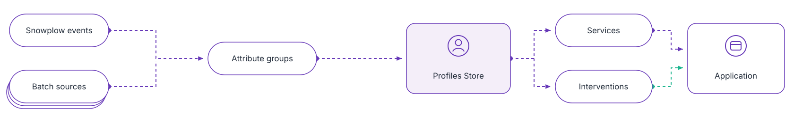

Snowplow Signals computes user attributes from your behavioral data in real time, and serves them to your applications over an API. Attributes are calculated from your Snowplow event stream as events arrive, or synced from tables in Snowflake, BigQuery, or Databricks.

Use Signals to:
* Personalize content, recommendations, and pricing based on what the user is doing in their current session
* Give chatbots and AI agents context about the user they're interacting with
* Trigger actions automatically when users meet criteria you define, such as offering a discount when a high-value cart is abandoned
* Serve up-to-date behavioral features to ML models, for use cases like lead scoring

```mdx-code-block
import SignalsFreeTier from "@site/docs/reusable/signals-free-tier/_index.md"

<SignalsFreeTier/>
```

To try Signals on your own web app, follow the [quickstart](/docs/signals/quickstart/index.md), where a coding agent adds the tracking and configuration for you, or the [step-by-step quickstart](/docs/signals/get-started/quickstart-tutorial/index.md) to do the same steps in Console.

## Why teams use Signals

Signals handles collection, calculation, and serving:

* **Collection is built in**: your Snowplow pipeline tracks and validates events, so you don't build a separate event pipeline, stream processor, or online store.
* **Attributes are short definitions, not code**: choose the events, an aggregation, and a time period, such as "product pages viewed in the last 10 minutes".
* **Values update in the session**: attributes update as each event arrives, so your application reads current values while the session is still in progress.
* **One read combines live and historical data**: a service returns stream attributes alongside warehouse-synced values.
* **One definition serves real time and training**: the same attributes build point-in-time datasets for ML models.
* **Your systems decide**: Signals serves the values, and your application, model, or agent decides what to do with them.

### Why teams choose Signals over other tools

| Instead of | Why teams choose Signals |
| --- | --- |
| A feature store | A feature store serves data you already collect and process. Signals collects and processes the events too, so you don't build ingestion. |
| A customer data platform (CDP) | CDPs update profiles and audiences in batches for marketing tools. Signals updates attributes as each event arrives, for use in the current session. |
| Building it in-house | You don't build or run your own collection, stream processing, low-latency store, or API. |

Many teams keep their CDP or feature store alongside Signals. For named vendor comparisons, see [Evaluate Signals](https://signals.snowplow.io/evaluate?utm_source=docs.snowplow.io&utm_medium=referral).

## How Signals works

Signals calculates attributes from your events and stores the latest values in the Profiles Store, where your applications and agents read them.



1. A Snowplow tracker sends events to your pipeline.
2. Signals updates the values of your **attribute groups** as each event arrives, or syncs them from warehouse tables.
3. Applications read the values through a **service**. Agents read the user's recent events through an **agentic context**, or attribute values through the Signals MCP server.
4. When values meet an **intervention**'s criteria, Signals pushes the intervention to subscribed applications.

The components you configure:

* **Attribute group**: a versioned set of attributes, such as `product_view_count_last_10_min`, calculated for one attribute key.
* **Attribute key**: who or what attributes describe, such as `domain_userid` for a user or `domain_sessionid` for a session.
* **Service**: attribute groups pinned to specific versions, for applications to read.
* **Intervention**: an if-then rule on attribute values. The first time a user meets the rule, Signals pushes the intervention to subscribed applications, such as the browser plugin.
* **Agentic context**: the user's most recent events in the current session, up to 100 events and no older than 1 hour, as JSON or a narrative for an agent.

See [How Signals works](/docs/signals/concepts/index.md) for detail on each.

## Find the right page

| I want to | Page |
| --- | --- |
| Try Signals on my own web app | [Quickstart](/docs/signals/quickstart/index.md) |
| Enable Signals on an existing Snowplow CDI account | [Set up Signals](/docs/signals/setup/index.md) |
| Send events for Signals to calculate from | [Send events to Signals](/docs/signals/data-sources/events/index.md) |
| Calculate attributes from events or warehouse tables | [Define attributes](/docs/signals/attributes/index.md) |
| Read attributes in my application | [Services](/docs/signals/applications/services/index.md), then [retrieve attributes](/docs/signals/applications/retrieve-attributes/index.md) |
| Ground an AI agent in the user's current session | [Define agentic contexts](/docs/signals/agentic-contexts/index.md) |
| Let an agent read Signals data as tools | [Signals MCP server](/docs/signals/applications/mcp-server/index.md) |
| React when a user meets criteria | [Define interventions](/docs/signals/interventions/index.md), then [subscribe to them](/docs/signals/applications/subscribe/index.md) |
| Build training data for an ML model | [Create ML training datasets](/docs/signals/ml-training-datasets/index.md) |

To manage Signals from a chat instead, connect your assistant to the [Snowplow MCP server](/docs/ai/snowplow-mcp/index.md), or use the [Snowplow Assistant](/docs/ai/console-agent/index.md) in Console.

## Try a tutorial

Each tutorial builds a working demo on top of Signals. [See all tutorials](/tutorials), or visit the [Developer Hub](https://snowplow.io/developer-hub/) for videos, blog posts, and workshops.

<CardGrid cols={3} breakout>
  <Card
    title="Build a personalized travel agent"
    description="Set up a demo travel site, and personalize content and chatbot responses based on user behavior."
    href="/tutorials/signals-personalize-travel/intro/"
  />
  <Card
    title="Train and serve a purchase propensity model"
    description="Build a training dataset from Signals attributes, train a model, and score live sessions."
    href="/tutorials/signals-ml-purchase-propensity/introduction/"
  />
  <Card
    title="Implement real-time interventions"
    description="Explore Signals interventions in a demo ecommerce app."
    href="/tutorials/signals-interventions/start/"
  />
</CardGrid>
