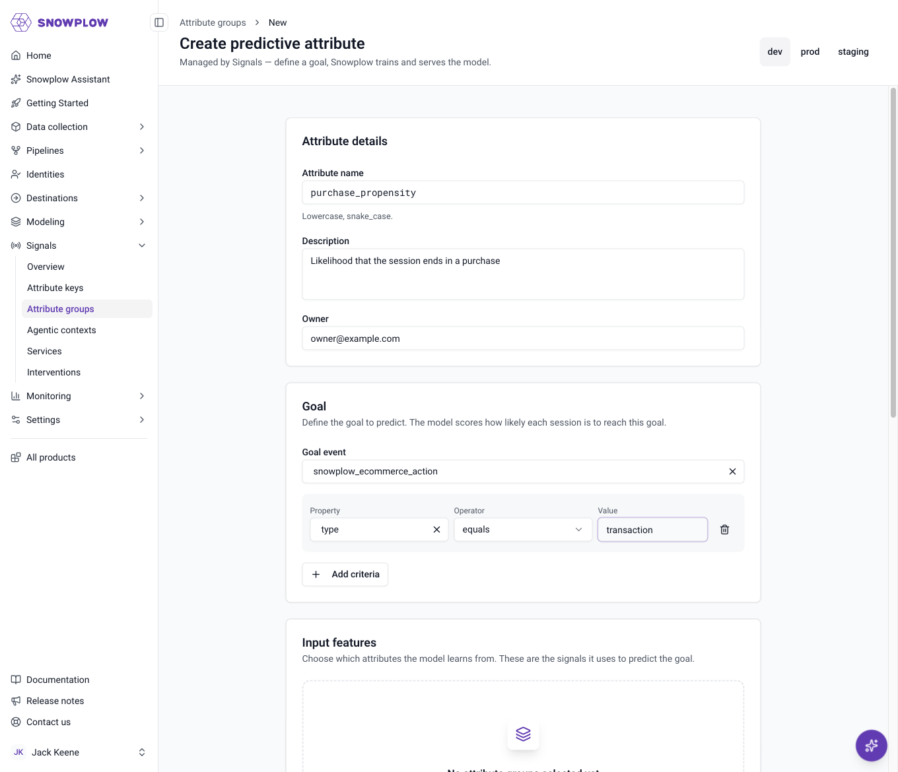
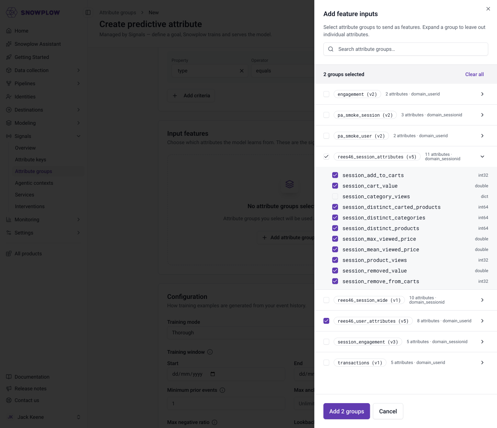
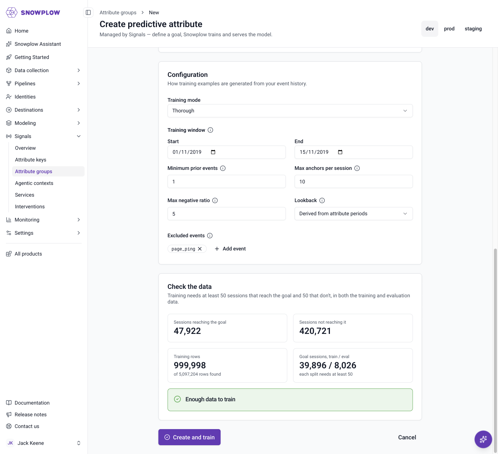
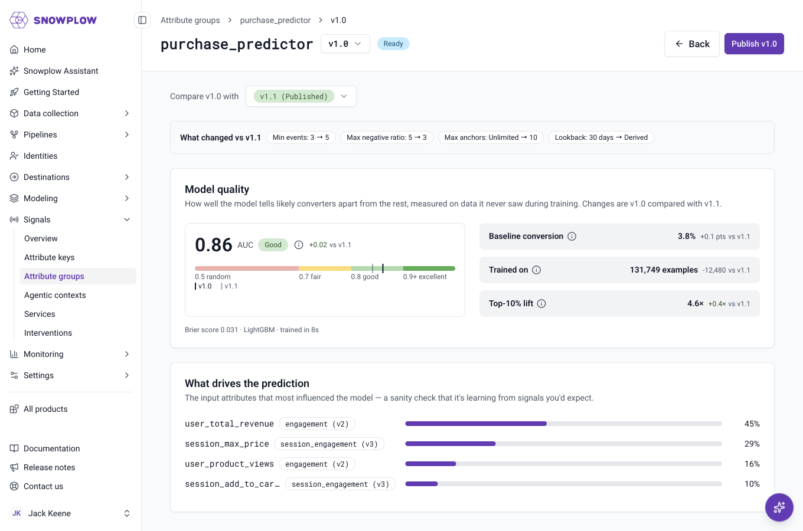
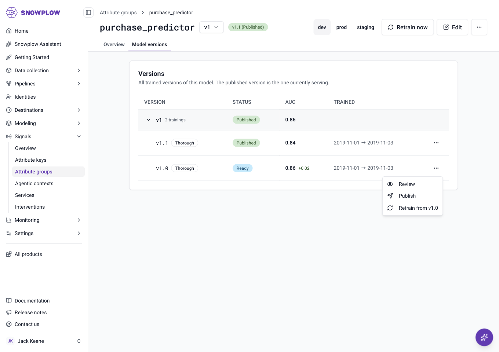

```mdx-code-block
import Tabs from '@theme/Tabs';
import TabItem from '@theme/TabItem';
```

A predictive attribute predicts how likely a session is to reach a goal you define, such as a purchase or a sign-up. Signals trains a model on your own stream [attribute](/docs/signals/attributes/index.md) definitions, then returns a score between 0 and 1 each time your application requests one.

Use a predictive attribute when you want a propensity score in production without building the pipeline around it. A propensity model usually needs labeled training data, a feature pipeline, a way to serve the model, and features in production that match the ones the model trained on. Signals builds the training data and serves the model from your attribute definitions, using the same definitions for both.

For example, use a predictive attribute to:
* Show a discount only to sessions unlikely to convert on their own
* Route high-intent sessions to live chat first
* Decide whether to include a returning user in a campaign

Setting up a predictive attribute takes three steps:
1. Define the goal and the input attributes
2. Train a model
3. Request scores from your application

Signals calculates the score and serves it to your application through the Signals SDKs or API. Your application decides what to do with it.

Before you start, you'll need:
* A Snowflake warehouse connected to Signals, as described in [warehouse configuration](/docs/signals/attributes/warehouse-config/index.md). Predictive attribute training supports Snowflake.
* At least one published [stream attribute group](/docs/signals/attributes/attribute-groups/index.md#stream) whose attributes describe the behavior you want the model to learn from
* Enough history in your warehouse: at least 50 sessions that reach the goal and 50 that don't, in both the training and evaluation data

There are two methods for defining predictive attributes in Signals:
* Snowplow Console UI
* Signals Python SDK

Once published, [retrieve a predictive attribute score](/docs/signals/applications/predictive-attributes/index.md) in your application.

## Understand how training works

Signals turns your event history into training examples, then trains a binary classifier on them. Understanding how the examples are built helps you choose the training settings.

Events in a session that come before the session's first goal event become training examples, called anchors. For each anchor, Signals calculates the value each attribute had at that moment, using only events before the anchor. The label is `1` if the session went on to reach the goal, and `0` if it didn't. The model learns from the same partial view of a session that it sees when it scores a live session. The [training options](#train-the-model) control which events become anchors.

Signals builds the examples with queries in your Snowflake warehouse, and balances them so that sessions that don't reach the goal don't dominate. It holds out the most recent 20% of sessions to measure the model's quality, and trains the model on the rest. Scores are adjusted to account for the balancing, so they're on the scale of your real goal rate. Training runs in a separate Signals service from attribute calculation, so it doesn't slow down your stream attributes.

Each training keeps its dataset as a table in the output database and schema of your [Signals warehouse connection](/docs/signals/setup/index.md), so you can inspect the data the model learned from. Signals doesn't delete these tables.

## Create a predictive attribute

A predictive attribute defines what to predict, and which attributes to predict it from. The training settings are separate, so you can retrain the same definition with different settings.

<Tabs groupId="signals-impl" queryString>
<TabItem value="console" label="Console" default>

To create a predictive attribute using the UI, go to **Signals** > **Attribute groups** in Snowplow Console, click **Create attribute group**, and select **Start** under **Predictive attribute**. Predictive attributes are listed alongside your attribute groups.

The form has four sections:
* **Attribute details**: a unique name in lowercase snake case, and an optional description and owner
* **Goal**: the goal event, and optional criteria the event must meet
* **Input features**: the stream attribute groups the model learns from. Expand a group to leave out individual attributes.
* **Configuration**: the [training settings](#train-the-model)



Click **Add attribute groups** to choose the input features.



</TabItem>
<TabItem value="sdk" label="Python SDK">

Start by [connecting to Signals](/docs/signals/connection/index.md) to create a `Signals` object.

This example predicts whether a session will include a `transaction`, using two session-level attributes and one user-level attribute. Use `attribute_reference()` on a published attribute group to point at each input attribute:

```python
from snowplow_signals import (
    Attribute, Criteria, Criterion, Event, EventProperty,
    PredictiveAttribute, StreamAttributeGroup,
    domain_sessionid, domain_userid,
)

ecom_event = Event(
    vendor="com.snowplowanalytics.snowplow.ecommerce",
    name="snowplow_ecommerce_action",
    version="1-0-0",
)
ecom_type = EventProperty(
    vendor="com.snowplowanalytics.snowplow.ecommerce",
    name="snowplow_ecommerce_action",
    major_version=1,
    path="type",
)

session_group = StreamAttributeGroup(
    name="ecommerce_session",
    version=1,
    attribute_key=domain_sessionid,
    owner="owner@example.com",
    attributes=[
        Attribute(
            name="product_view_count", type="int32", events=[ecom_event], aggregation="counter",
            criteria=Criteria(all=[Criterion.eq(ecom_type, "product_view")]),
        ),
        Attribute(
            name="add_to_cart_count", type="int32", events=[ecom_event], aggregation="counter",
            criteria=Criteria(all=[Criterion.eq(ecom_type, "add_to_cart")]),
        ),
    ],
)
user_group = StreamAttributeGroup(
    name="ecommerce_user",
    version=1,
    attribute_key=domain_userid,
    owner="owner@example.com",
    attributes=[
        Attribute(
            name="transaction_count", type="int32", events=[ecom_event], aggregation="counter",
            criteria=Criteria(all=[Criterion.eq(ecom_type, "transaction")]),
        ),
    ],
)

purchase_propensity = PredictiveAttribute(
    name="purchase_propensity",
    version=1,
    owner="owner@example.com",
    description="Likelihood that the session ends in a purchase",
    input_attributes=[
        session_group.attribute_reference("product_view_count"),
        session_group.attribute_reference("add_to_cart_count"),
        user_group.attribute_reference("transaction_count"),
    ],
    goal_criteria=Criteria(all=[Criterion.eq(ecom_type, "transaction")]),
)

# The connection object has been created as sp_signals
sp_signals.publish([session_group, user_group])
sp_signals.create_predictive_attribute(purchase_propensity)
```

The table below lists the fields of a predictive attribute.

| Field              | Description                                                                                 | Required? |
| ------------------ | ------------------------------------------------------------------------------------------- | --------- |
| `name`             | The unique name of the predictive attribute. Letters, numbers, and underscores only          | ✅         |
| `version`          | The version of the predictive attribute. Defaults to `1`                                   |           |
| `owner`            | The email of the primary maintainer                                                         | ✅         |
| `input_attributes` | The stream attributes the model learns from, built with `attribute_reference()`              | ✅         |
| `goal_criteria`    | The [criteria](/docs/signals/attributes/attributes/index.md#filter-with-criteria) an event must meet to count as reaching the goal | ✅         |
| `excluded_events`  | Events that never become anchors. Defaults to `page_ping`                                   |           |
| `description`      | A human-readable description                                                                |           |

`create_predictive_attribute()` is safe to call again with the same definition: it updates the description and owner. Changing anything else in an existing version raises an error, so increase `version` instead.

</TabItem>
</Tabs>

### Choose input attributes

The input attributes are the model's features: everything it knows about a session. Choose attributes that describe behavior leading up to the goal, such as counts of product views, time since the last search, or the most frequent category viewed.

Input attributes follow these rules:
* They come from stream attribute groups
* Each attribute group is pinned to one version, and that version must be published before you publish the predictive attribute
* For time-based inputs, use a `time_since_last` or `time_since_first` aggregation. Timestamp values can't be used as inputs.

Inputs can come from attribute groups with different [attribute keys](/docs/signals/attributes/attribute-keys/index.md). Combining session-level and user-level attributes lets the model compare what the user does in the current session with what they've done before. Include some session-level attributes where you can, because they describe the current session.

Signals converts each input into model features based on its aggregation, so you don't need to encode values yourself. Numeric aggregations such as `counter`, `sum`, and `mean` are used as they are. Categorical values, such as from `most_frequent` or `unique_list`, become one column per common value, up to 50 values for single values and 100 for lists. Values that appear fewer than five times in the training data are ignored. Each column uses part of the training capacity, so prefer a few focused categorical inputs over many broad ones.

### Define the goal

The goal is the event that counts as success, for example a `transaction` or a `sign_up`. The model scores how likely each session is to reach it. Define the goal with the same [criteria](/docs/signals/attributes/attributes/index.md#filter-with-criteria) syntax as attribute filters, using `all` or `any` conditions on atomic, event, or entity properties.

The goal is a single event that matches the criteria, later in the same session. Choose an outcome that the session's own activity leads to, such as a purchase, a sign-up, or a form submission. A goal reached in a later session, such as a renewal days afterward, doesn't count as reaching the goal.

The goal, inputs, and excluded events are fixed once you create a version. To predict something different or change the inputs, create a new version.

## Train the model

Training builds a dataset from a window of your event history, trains a model on it, and records its quality metrics. Each training creates a new numbered training of the same version, so you can compare several before you publish one.

Before training, check that the window has enough data. The check counts the examples your settings would produce without training anything, and can take up to five minutes. If it takes longer, shorten the training window. Training fails if any of these minimums isn't met:
* 50 sessions that reach the goal, in both the training and evaluation splits
* 50 sessions that don't reach the goal, in both the training and evaluation splits
* 1,000 examples in total

Signals uses up to one million examples, keeping whole sessions together.

Only the training window is required. Every other option has a default, so start with the defaults and adjust them once you've reviewed the first training.

<Tabs groupId="signals-impl" queryString>
<TabItem value="console" label="Console" default>

Set the training options in the **Configuration** section, then click **Check data**. The check shows how many sessions reach the goal, and whether there's enough data to train. You can't save until the check passes. Click **Create and train** to save the predictive attribute and start the first training.



To train again, open the predictive attribute and click **Retrain now**. To start from a specific training's settings, go to the **Model versions** tab, click the `⋯` button on that training's row, and select **Retrain from**. Only one training can run at a time for each version.

</TabItem>
<TabItem value="sdk" label="Python SDK">

Use `test_predictive_attribute()` to check the data, `train_predictive_attribute()` to start training, and `wait_for_predictive_attribute_training()` to wait for it to finish. Training runs in the background, and the wait raises an error if training fails.

```python
from datetime import datetime, timedelta
from snowplow_signals import TrainingSpan

span = TrainingSpan(start_time=datetime(2026, 9, 1), end_time=datetime(2026, 10, 1))

check = sp_signals.test_predictive_attribute(
    purchase_propensity, training_span=span, min_events=3, max_anchors_per_session=10
)
if not check.has_enough_data:
    for shortfall in check.shortfalls:
        print(shortfall.message)

training = sp_signals.train_predictive_attribute(
    purchase_propensity,
    training_span=span,
    preset="thorough",
    min_events=3,
    max_anchors_per_session=10,
)
training = sp_signals.wait_for_predictive_attribute_training(
    purchase_propensity, training, timeout=timedelta(minutes=30)
)
print(training.metrics.auc, training.metrics.lift_top_decile)
```

Use timezone-naive `datetime` values, in UTC, for the training span.

</TabItem>
</Tabs>

The table below lists the training options. The Python SDK argument names are shown.

| Option                    | Description                                                                                                         | Default             |
| ------------------------- | ------------------------------------------------------------------------------------------------------------------- | ------------------- |
| `training_span`           | The window of events to build examples from. Required                                                               |                     |
| `preset`                  | `fast` stops training after 30 seconds, for trying out inputs. `thorough` allows up to 10 minutes, for production | `fast` in the SDK, `thorough` in Console |
| `min_events`              | Minimum number of earlier events in the session before an event can be an anchor                                    | `1`                 |
| `max_anchors_per_session` | Maximum number of anchors from each session, taken from the first eligible events, so that long sessions don't dominate the dataset | No limit            |
| `max_negative_ratio`      | Maximum ratio of negative to positive examples. `1.0` gives a balanced dataset                                      | `5.0`               |
| `max_lookback_days`       | How many days of events before each anchor to read when calculating attribute values                               | The longest [period](/docs/signals/attributes/attributes/index.md#set-the-period) of the input attributes, or at least 30 days if any are lifetime attributes. Lifetime attributes only include this many days of history in training, but their full history when scored |

### Review the training results

Each successful training records quality metrics, measured on the evaluation split. Use them to decide whether to publish a training, and to compare trainings.

| Metric               | Description                                                                                                  |
| -------------------- | ------------------------------------------------------------------------------------------------------------ |
| `auc`                | How often the model scores an example from a session that reaches the goal above one from a session that doesn't. `0.5` is random, `1.0` is perfect |
| `lift_top_decile`    | How much more often the 10% highest-scored examples reach the goal, compared to the baseline rate             |
| `baseline_rate`      | The share of examples in the evaluation split that reach the goal, before negative examples are reduced       |
| `brier_score`        | The mean squared error of the scores. `0` is perfect                                                          |
| `rows_used`          | The number of examples the model was trained on, excluding the evaluation data                                |
| `feature_importance` | How much each input attribute contributed to the model, highest first                                         |

In Console, go to the **Model versions** tab, click the `⋯` button on a training's row, and select **Review**. The review page rates AUC from **Poor** to **Excellent**, shows how much each input attribute contributed, and compares the training with another one, such as the published training. In the SDK, the metrics are in the `metrics` field of the training.



If an input attribute contributes almost nothing, consider removing it in a new version. If AUC is close to `0.5`, the inputs don't describe the behavior that leads to the goal, and adding different attributes will help more than changing the training options.

## Publish a predictive attribute

Publishing loads a training's model into Signals so your application can request scores. Only one version of each predictive attribute is published at a time, so publishing a version unpublishes the one that was live. The input attribute groups must be published first. Publishing takes effect within a few seconds.

Predictive attributes have two levels of version:
* The version, such as `2`, changes when you create a new definition with different inputs, goal, or excluded events
* The training, shown in Console as the minor version, such as `v2.1`, changes every time you retrain

Retraining doesn't affect the published model. It keeps serving until you publish the new training. To roll back, publish an earlier training.

You decide when to retrain. To keep a model current as user behavior changes, retrain it on a more recent training window, compare the metrics with the live training, and publish the new training if it performs better.

<Tabs groupId="signals-impl" queryString>
<TabItem value="console" label="Console" default>

To publish, open the predictive attribute's **Model versions** tab, click the `⋯` button on the training's row, and select **Publish**. You can also click **Publish** on a training's review page.



To unpublish, click the `⋯` button on the top right of the details page and select **Unpublish**. Once the version is unpublished, the same menu shows **Delete version**.

</TabItem>
<TabItem value="sdk" label="Python SDK">

Use `publish_predictive_attribute()` to publish a training. Without a `training` argument, it publishes the most recent successful training.

```python
# Publish a specific training
sp_signals.publish_predictive_attribute(purchase_propensity, training)

# Unpublish
sp_signals.unpublish_predictive_attribute(purchase_propensity)
```

The generic `publish()`, `unpublish()`, and `delete()` methods also accept predictive attributes, alongside the attribute groups they depend on. `publish()` publishes the most recent successful training only if the predictive attribute isn't already published. If it is, the live training stays in place.

```python
sp_signals.publish([session_group, user_group, purchase_propensity])

# Delete permanently (must unpublish first)
sp_signals.unpublish([purchase_propensity])
sp_signals.delete([purchase_propensity])
```

</TabItem>
</Tabs>

You can't delete a predictive attribute version while it's published. Deleting a version removes all its trainings.

A predictive attribute also protects its inputs. You can't delete an attribute group version that a predictive attribute uses, or unpublish one that a published predictive attribute uses.

```mdx-code-block
import SignalsFreeTier from "@site/docs/reusable/signals-free-tier/_index.md"

<SignalsFreeTier/>
```
