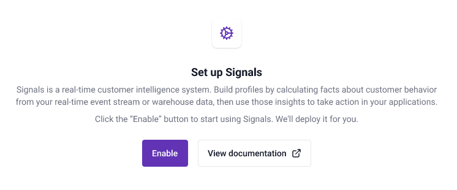
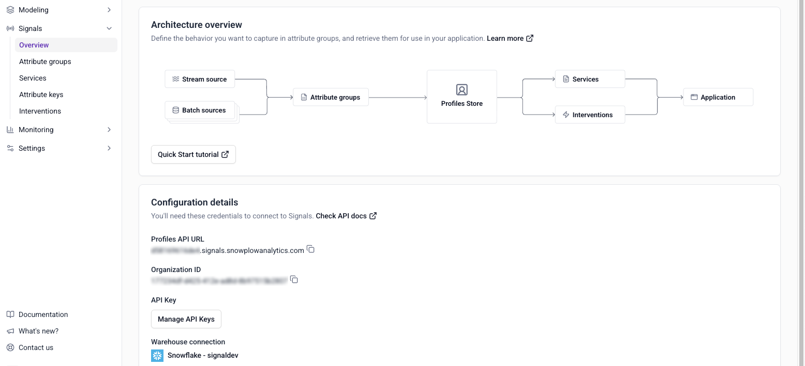

Before you can define attributes or interventions, you need a Signals environment. How you get one depends on whether you already use Snowplow. Setup is a one-time task, done in [Snowplow Console](https://console.snowplowanalytics.com).

```mdx-code-block
import SignalsFreeTier from "@site/docs/reusable/signals-free-tier/_index.md"

<SignalsFreeTier/>
```

## Choose your starting point

Pick the path that matches your account. Both end with Signals ready to configure in Console.

### Start on the Signals free tier

Sign up at [signals.snowplow.io/start](https://signals.snowplow.io/start?utm_source=docs.snowplow.io&utm_medium=referral). The free tier is provisioned with a pipeline and with Signals already enabled, so you don't need to click **Enable**.

To connect from code later, find your Signals API URL and organization ID in Console > **Signals** > **Overview**, as listed in [connection credentials](/docs/signals/connection/reference/index.md#connection-credentials).

To point a tracker at your pipeline, find your Collector URL in Console > **Pipelines** > select your pipeline > **Configuration** > **Collector Domains**.

### Add Signals to an existing Snowplow account

Log in to Console and navigate to the **Signals** section. Click **Enable** to start setting up Signals.



:::note[Warehouse connection]
A warehouse connection is optional. You need one to [test attribute definitions](/docs/signals/attributes/attribute-groups/index.md#test-attribute-definitions), [backfill stream attributes](/docs/signals/attributes/attribute-groups/index.md#backfill-attributes), and [sync warehouse tables](/docs/signals/attributes/warehouse-config/index.md). Snowflake, BigQuery, and Databricks are supported.
:::

To connect a warehouse:
* Select which warehouse to use
* Specify your warehouse account details
* Specify your Snowplow atomic events table
* Run the provided script

Click **Test and create connection** to trigger the Signals deployment. You'll be able to start using Signals as soon as the infrastructure is ready.

## Next steps

Once the infrastructure is ready, navigate to the **Signals** section to manage Signals in the UI. Use the configuration interface to define [attribute groups](/docs/signals/attributes/attribute-groups/index.md), [services](/docs/signals/applications/services/index.md), and [interventions](/docs/signals/interventions/index.md).



To work with Signals programmatically, using the SDKs or API instead of (or alongside) Console, see [Connect to Signals](/docs/signals/connection/index.md).

For deployment options and how Signals is metered, see [pricing](https://signals.snowplow.io/pricing?utm_source=docs.snowplow.io&utm_medium=referral) on the Signals site.
