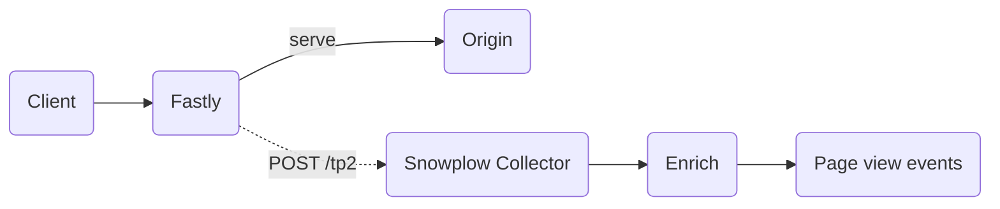

If your website is served through Fastly, you can stream request logs to Snowplow to capture page views from bots, AI agents, and other clients that don't execute JavaScript. Snowplow processes each log entry as a [page view event](/docs/fundamentals/events/index.md), which appears alongside your existing web analytics events.

See [CDN trackers](/docs/sources/cdn-trackers/index.md) for background on how CDN-level tracking compares to client-side web tracking.

:::note[Availability]

This integration requires [Collector](/docs/pipeline/collector/index.md) 3.9.0 or newer. Earlier versions don't respond to the Fastly endpoint ownership challenge, so Fastly can't send logs to them.

:::

## How it works

This integration uses Fastly [HTTPS log streaming](https://www.fastly.com/documentation/guides/integrations/logging-endpoints/log-streaming-https/). You configure an HTTPS logging endpoint on your Fastly service with a log format that produces a Snowplow tracker payload, and Fastly sends it directly to the Snowplow Collector.



Before Fastly sends any logs, it verifies that you control the endpoint by sending a request to `/.well-known/fastly/logging/challenge` on the Collector domain. The Collector responds to this challenge automatically, so you don't need to configure anything for it.

Logging happens after Fastly serves the response, so it doesn't add latency for the client.

## Configure the HTTPS logging endpoint

You need a Fastly service for your website, permission to edit its configuration, and your Snowplow Collector domain.

Follow the Fastly documentation to [create an HTTPS logging endpoint](https://www.fastly.com/documentation/guides/integrations/logging-endpoints/log-streaming-https/#adding-https-as-a-logging-endpoint):

1. In the Fastly control panel, select your service and click **Edit configuration** to clone the active version.
2. Click **Logging**, then create an endpoint for **HTTPS**.
3. Attach a condition to prevent duplicate events and limit which requests are logged. See [filter events before ingestion](#filter-events-before-ingestion).
4. Fill in the endpoint settings described below.
5. Click **Create**, then **Activate** to deploy the new service version.

### Endpoint settings

Configure the endpoint with the following settings:

| Setting | Value |
|---|---|
| Name | A descriptive name, such as `Snowplow` |
| Log format | The [log format](#log-format) below |
| URL | `https://<collector-domain>/com.snowplowanalytics.snowplow/tp2` |
| Maximum logs | `0` (default) |
| Maximum bytes | `0` (default) |

Expand **Advanced options** and set the following:

| Setting | Value |
|---|---|
| Content type | `application/json` |
| Custom header name | `sp-anonymous` |
| Custom header value | `*` |
| Method | `POST` (default) |
| Select a log line format | Blank (default) |
| Compression | None |

The `sp-anonymous` header prevents the Collector from recording the user or agent IP address. Snowplow recommends anonymous tracking for two reasons:

* There is no mechanism for the user to opt out, since the IP address is collected upon the very first visit.
* With a focus on bot and agent traffic, the IP address is not very relevant.

Leave the remaining settings at their defaults.

### Log format

Use the following log format. Replace `my-app-id` with an app ID that identifies these events in your data.

```json
{
  "schema": "iglu:com.snowplowanalytics.snowplow/payload_data/jsonschema/1-0-4",
  "data": [
    {
      "e": "pv",
      "p": "srv",
      "tv": "fastly-1.0.0",
      // highlight-next-line
      "aid": "my-app-id",
      "url": "%{if(req.is_ssl, "https", "http")}V://%{json.escape(req.http.host)}V%{json.escape(req.url)}V",
      "ua": "%{json.escape(if(req.http.User-Agent, req.http.User-Agent, ""))}V",
      "dtm": "%{time.start.msec}V"
    }
  ]
}
```

Fastly replaces each `%{...}V` placeholder with the value of the corresponding [VCL variable](https://www.fastly.com/documentation/reference/vcl/variables/) for the request.

## Filter events before ingestion

Without filtering, Fastly sends a Snowplow event for every request, including images, fonts, JavaScript files, and other static assets. This produces a much higher event volume than necessary, which increases cost and Collector load.

To filter requests and prevent duplicate events, attach a [condition](https://www.fastly.com/documentation/guides/full-site-delivery/conditions/using-conditions/) to the logging endpoint. Fastly only sends a log entry when the condition evaluates to true.

At the top of the endpoint form, click **attach a condition**. Enter a name, such as `Track agent page views`, and an **Apply if** expression. Then click **Save and apply to this** to return to the endpoint form.

The following expression combines three checks:

```text
req.http.User-Agent ~ "(?i)(claude|chatgpt|gptbot|openai|gemini|perplexity|copilot)"
&& (req.url.path !~ "\.[^/]*$" || req.url.path ~ "llms\.txt$")
&& fastly.ff.visits_this_service == 0
```

1. **User agent filtering**: retains only requests from known AI agents, based on a case-insensitive regular expression applied to the `User-Agent` header. Add more alternatives to the expression to match additional agents.
2. **URI filtering**: drops requests for static assets. It treats any path whose last segment contains a file extension as an asset, except for specific content files like `/llms.txt`. Paths without an extension, such as `/about` or `/api/users`, pass through as page views.
3. **Deduplication**: if your service uses [shielding](https://www.fastly.com/documentation/guides/getting-started/hosts/shielding/), a request can pass through more than one Fastly POP. The `fastly.ff.visits_this_service == 0` check ensures that only the first POP sends a log entry.

A request must pass all checks to be tracked. You can remove or adjust the user agent and URI checks, but always keep the deduplication check. For example, to track all requests without any filtering, use only:

```text
fastly.ff.visits_this_service == 0
```

## Event fields

Each log entry produces a page view event with the following fields (as well as all relevant fields added by enrichments, e.g., `page_urlpath`, `page_urlquery`):

| Field | Value | Description |
|-------|-------|-------------|
| `event` | `page_view` | Event type |
| `platform` | `srv` | Server-side, to distinguish from browser events |
| `app_id` | Your app ID | Application identifier, so you can filter these events in your data |
| `v_tracker` | `fastly-1.0.0` | Tracker version |
| `useragent` | From the original request | The visitor's `User-Agent` header |
| `page_url` | From the original request | The URL of the requested page |
| `dvce_created_tstamp` | From `time.start.msec` | The time Fastly started processing the request |
