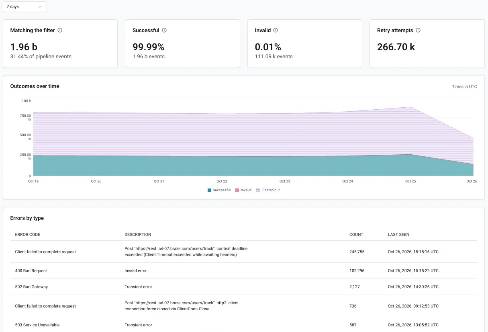
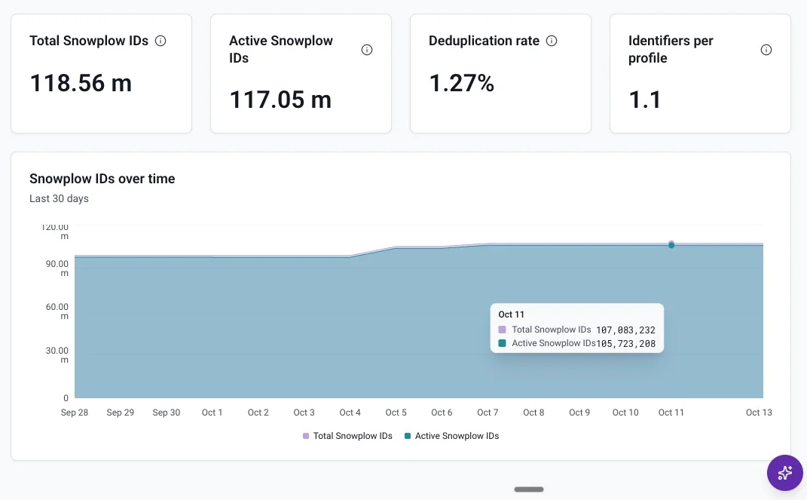

Console now includes dashboards for [event forwarding](/docs/destinations/forwarding-events/) and [Identities](/docs/identities/), so you can check how reliably your forwarders deliver events and how your identity graph is growing.

## Event forwarder metrics

Each event forwarder has a dashboard. To open it, go to **Destinations** > **Event forwarding** and click the forwarder's name. The dashboard shows these figures:

- **Matching the filter**: events that matched the forwarder's filter and finished processing, and their share of all pipeline events
- **Successful**: events delivered to the destination
- **Invalid**: events that failed permanently, for example because of a transformation error or oversized data, or because they exceeded the retry limit
- **Retry attempts**: retries caused by transient issues, such as connection failures or timeouts. An event being retried is counted as **Successful** or **Invalid** once it's delivered or fails permanently.

A chart breaks down successful, invalid, and filtered-out events over time, and an **Errors by type** table lists each error code encountered, with its description, count, and when it was last seen.

You can view the last seven days, six hours, or one hour. The one-hour view is useful for checking the effect of a configuration change or confirming that a destination issue is resolved.

See [Monitor and troubleshoot event forwarders](/docs/destinations/forwarding-events/event-forwarding-monitoring-and-troubleshooting/#console-metrics) for details.

## Identities overview

The **Identities** page has a new **Overview** tab with four headline figures:

- **Total Snowplow IDs**: every Snowplow ID created in the graph, including ones since merged into another
- **Active Snowplow IDs**: Snowplow IDs that haven't been merged
- **Deduplication rate**: the share of Snowplow IDs that have been merged into another Snowplow ID
- **Identifiers per profile**: the average number of identifiers the graph links to each active Snowplow ID

A chart shows total and active Snowplow IDs over the last 30 days.

See [Monitor your identity graph](/docs/identities/monitoring/) for details.
