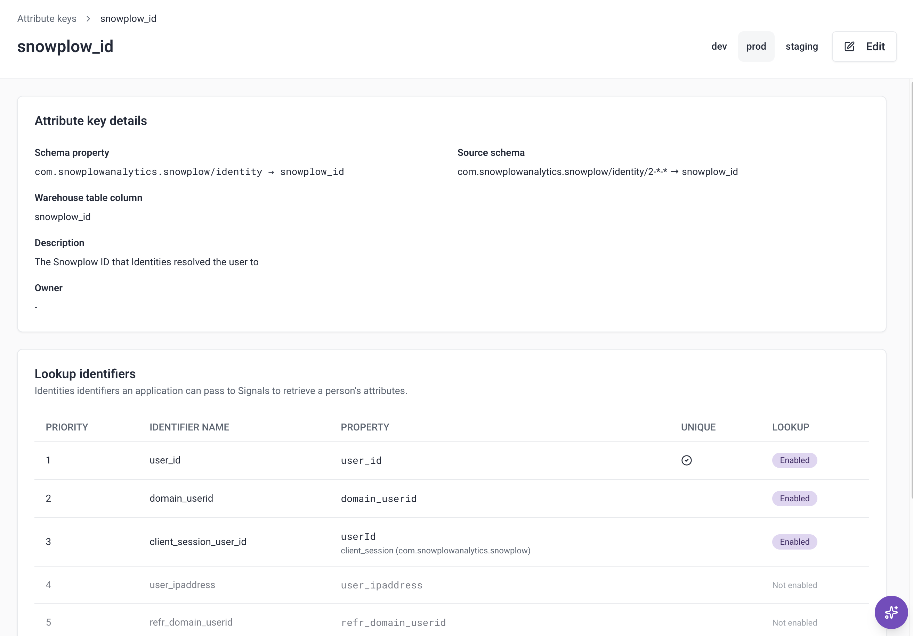

{/* TODO: set the date to the release day, and fill in the minimum signals-api and snowplow-signals versions below. Merge only once console-agent #352 (AISP-1794) is in production. */}

The same person often reaches you through more than one identifier. They browse anonymously with a `domain_userid` cookie, log in with a `user_id`, and come back on their phone. Until now, Signals attributes were keyed on one of those identifiers, so each one built a separate profile of the same person.

If you use [Identities](/docs/identities/), Signals can now calculate attributes against the Snowplow ID that Identities assigns to each person. Activity from every identifier Identities links to that person counts toward one profile.

Your application doesn't need to know the Snowplow ID. Instead, you select up to three lookup identifiers to read attributes by. Each read uses one identifier, so selecting several lets each part of your application read the same person with the identifier it has. For example, your website can read by the `domain_userid` cookie, and your backend by the `user_id` of a logged-in user. Signals returns the attributes of the person that identifier was most recently seen with.

Each lookup identifier linked to a person returns that person's attributes. In this release, an identifier picks up a change to its person, such as a merge, from the next event that carries it. Identifiers on nearly every event, such as `domain_userid`, stay the most up to date. See [Decide which identifiers to use](/docs/signals/attributes/identity-resolution/#decide-which-identifiers-to-use) for how each kind of identifier behaves.

## What you can do with it

Personalize a page with what a user did before they logged in. When a user signs up after browsing anonymously, Identities links their new `user_id` to the Snowplow ID their device already has. Their browsing and their account activity count toward that one Snowplow ID, so a read by their `user_id` includes the products they viewed beforehand. Logging in to an existing account from a new device is [partly supported](#whats-not-supported-yet) in this release, with full support coming soon. See [Anonymous to known](/docs/signals/attributes/identity-resolution/#anonymous-to-known) for what each identifier returns.

Keep a profile across your sites. With cross-domain tracking enabled in Identities, a user who follows a link from one of your domains to another keeps one profile, even though each site sets its own cookie. See [Cross-domain](/docs/signals/attributes/identity-resolution/#cross-domain) for how returning visitors are handled.

If people share a device, mark `user_id` as a [unique identifier](/docs/identities/concepts/unique-identifiers/) in Identities, so that each person who logs in on it keeps their own Snowplow ID. See [Shared device](/docs/signals/attributes/identity-resolution/#shared-device).

## What's not supported yet

This is the first release of identity resolution in Signals, and some use cases are only partly supported:

* When Identities merges two Snowplow IDs, for example when a user logs in on a new phone, activity from before the merge stays with the Snowplow ID that isn't kept. Combining the two is coming soon.
* Attributes keyed on `snowplow_id` include only events processed after you set them up. Signals doesn't backfill them from your warehouse.
* Attribute groups keyed on `snowplow_id` must be stream attribute groups.
* Interventions can't target `snowplow_id`. Use a target your application has, such as `domain_userid`.

The [supported use cases](/docs/signals/attributes/identity-resolution/#supported-use-cases) table shows what a read returns in each case.

## How to set it up

You'll need Identities configured on the same pipeline as your Signals deployment.

In Console, open the built-in `snowplow_id` attribute key under **Signals** > **Attribute keys**, select your lookup identifiers, and create stream attribute groups keyed on `snowplow_id`.

In the Python SDK, publish `AttributeKey(name="snowplow_id", lookup_identifiers=[...])`. Upgrade to `snowplow-signals` version 0.4.11 or later to use it from the SDK. You can also ask the [Snowplow Assistant](/docs/ai/console-agent/) or an agent connected to the [Snowplow MCP server](/docs/ai/snowplow-mcp/) to select the lookup identifiers for you.

To read attributes, call your service or attribute group as before, with the lookup identifier as the attribute key. The Node.js SDK needs no upgrade.

See [Calculate attributes per person with identity resolution](/docs/signals/attributes/identity-resolution/) for how to choose lookup identifiers, what each one returns, and the full list of limitations.
