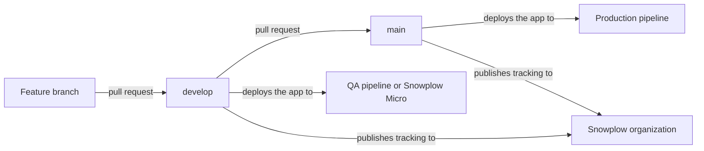

This tutorial shows you how to manage your tracking from your application's own repository. The [data structures](/docs/fundamentals/schemas/) and the [tracking plan](/docs/event-studio/tracking-plans/) live as files next to the code that sends the events. [Snowtype](/docs/event-studio/implement-tracking/) generates the tracking code from those files, and [Snowplow CLI](/docs/api-reference/snowplow-cli/) checks every change and publishes it to Console from GitHub Actions.

Managing tracking this way gives every change to your tracking a pull request, a review, and a history, in the same place as the code change that needs it. The checks catch a tracking definition and its generated code drifting apart, and an event specification version that doesn't match the version Console assigns, before anything reaches Console.

This tutorial is for developers who already track events with the [JavaScript tracker](/docs/sources/web-trackers/) and want their tracking definitions under version control. You'll work in your own terminal and in a GitHub repository. You need a Snowplow account with Console.

## What you'll build

In about 45 minutes, you'll set up one repository that holds the tracking for a TypeScript web app, and the workflows that check and publish it. The example tracks one [self-describing event](/docs/fundamentals/events/#self-describing-events), `docs_capture_signup`, with one [entity](/docs/fundamentals/entities/), `docs_capture_plan`, through one event specification, `docs-capture signup`.

The repository uses two long-lived branches, in one Snowplow organization:

The same flow, as steps:

1. You change the tracking definitions and the code on a feature branch, regenerate the tracking code with Snowtype, and check the versions locally without credentials.
2. A pull request into `develop` runs the checks that need no credentials, and the checks against Console with an API key held in the repository's secrets.
3. Merging into `develop` publishes the data structures to the organization's development and production registries, then syncs and releases the tracking plan. Your application's `develop` deployment sends events to a QA pipeline or to [Snowplow Micro](/docs/testing/snowplow-micro/).
4. A pull request from `develop` into `main` runs the checks against Console. Merging it publishes the same files again, and your application's `main` deployment sends events to the production pipeline of the same organization.

The tracking plan belongs to the organization, not to a pipeline, so both branches publish the same tracking plan.

## Requirements

To follow this tutorial, you need:

* A Snowplow account, with permission to create API keys in Console, so that the workflows can authenticate
* A GitHub repository for your application, with a `develop` branch and a `main` branch, and GitHub Actions enabled
* A TypeScript web app that uses the [JavaScript tracker](/docs/sources/web-trackers/) (`@snowplow/browser-tracker`), with Node.js and npm installed
* [Snowplow CLI](/docs/api-reference/snowplow-cli/) installed
* [Snowtype](/docs/event-studio/implement-tracking/install-snowtype/) installed in the app as a development dependency
* Familiarity with [Git](https://git-scm.com/) and [GitHub Actions](https://docs.github.com/en/actions/writing-workflows)

Snowplow CLI must be a version that checks event specification versions, and Snowtype a version that generates code from local tracking plans and has the `check` command:

<AppliesTo feature="snowplow-cli-event-specification-versions" />

<AppliesTo feature="snowtype-local-tracking-plans" />
