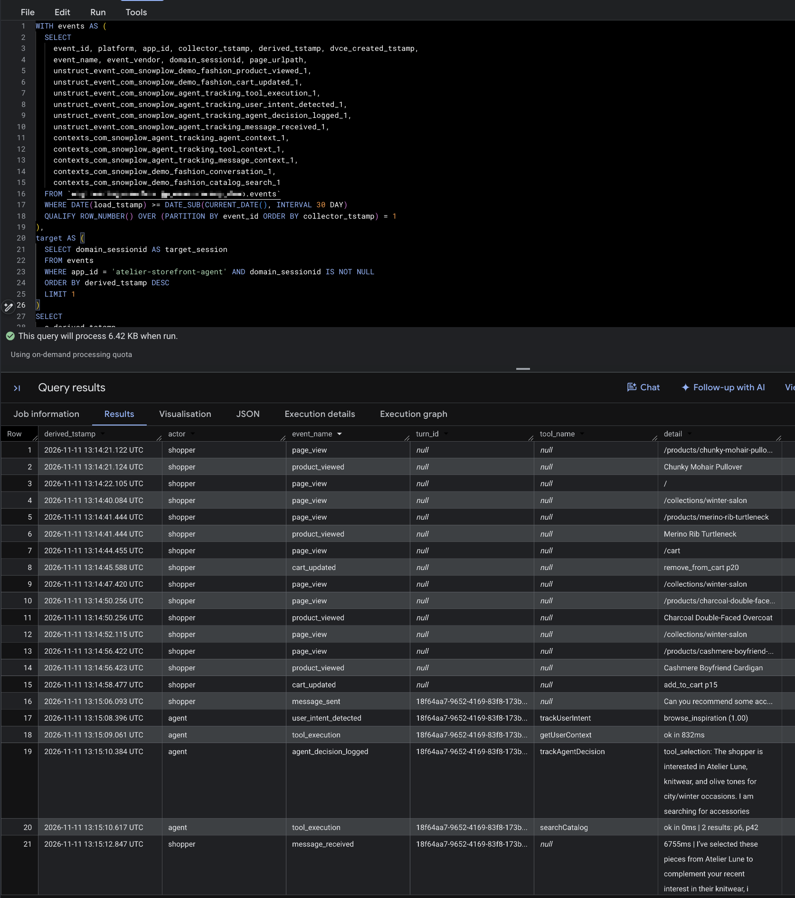

Every turn of the conversation now produces Snowplow events from the browser and the storefront server. On this page, you'll see how the agent decides when to track its own reasoning, then query the agent's events in BigQuery alongside the shopper's browsing.

The events use the generic agent tracking schemas from Iglu Central. The [agentic self-tracking accelerator](/tutorials/agentic-self-tracking/introduction) explains how those schemas are designed, and how to add your own domain-specific entities.

## Understand the self-tracking protocol

In a code-first agent framework, you can track agent events from your own code. In CX Agent Studio, the agent decides when to call tools, so the rules for self-tracking live in the agent's instructions instead. The three self-tracking tools exist only to record what the agent understood and decided:

| Tool                       | Event                   | When the agent calls it                                                                 |
| -------------------------- | ----------------------- | --------------------------------------------------------------------------------------- |
| `trackUserIntent`          | `user_intent_detected`  | Once per turn, after reading the shopper's context, when the shopper's goal is clear     |
| `trackAgentDecision`       | `agent_decision_logged` | Once per turn, in the same step as the `searchCatalog` call it explains                  |
| `trackConstraintViolation` | `constraint_violation`  | When the shopper asks for something the catalog can't provide, such as a budget or a designer |

The full protocol is in the "Self-tracking protocol" section of `agent/instructions.md`. Its main rules are:

- Call each self-tracking tool at most once per turn for the same purpose
- Call the tracking tools at the same time as the business tools, so tracking never delays the reply
- Never call a tracking tool in the same step as a product widget
- Never mention tracking to the shopper

The widget rule comes from testing on a live agent. When the instructions asked the agent to log a decision and then show a widget, the model issued both as parallel function calls in one step. A step made only of function calls has no text, so the shopper got product cards with no message. Moving the decision call into the `searchCatalog` step fixed it.

Every call to a business tool also produces a `tool_execution` event from the endpoint, without the agent doing anything. Each of these has an entity describing the call: `context_lookup` for `getUserContext`, with the number of attributes returned and the Signals response time, and `catalog_search` for `searchCatalog`, with the filters the agent chose and the product IDs returned.

## Query agent behavior in BigQuery

The repository's `analytics/agent-self-tracking.sql` file contains BigQuery queries over the atomic events table. Before you run them, replace the `PROJECT.DATASET.` placeholder with the dataset your BigQuery Loader writes to. From the repository root:

```bash
sed -i 's/PROJECT\.DATASET\./<your-project>.<your-dataset>./g' analytics/*.sql
```

On macOS, use `sed -i ''` instead of `sed -i`.

Each query is self-contained, so you can copy one into the BigQuery console. The BigQuery Loader only creates a column for a schema after it loads the first event using it, so a `Field name ... does not exist` error means no events of that type have loaded yet.

### View one session's events

Send a message or two to the concierge on your deployed storefront, then run query 7c, "One session's full timeline", from `analytics/agent-self-tracking.sql`. With no changes, it selects the most recent session that has agent events, and returns every event in that session in order: the shopper's browsing, their messages, and the agent's tool calls.

Server-side agent events have the app ID `atelier-storefront-agent` and the platform `srv`. The shopper's browser events have the app ID `atelier-storefront` and the platform `web`.

For one turn, you should see:

- A `message_sent` event from the browser
- A `tool_execution` event for each business tool call
- A `user_intent_detected` event, and an `agent_decision_logged` event if the agent searched the catalog
- A `message_received` event from the browser

All of these events share the same value in the query's `turn_id` column. On server events, the query reads it from `invocation_id` in the `agent_context` entity. On browser events, it reads it from `turn_id` in the `conversation` entity. That shared ID is how you group every event from one turn.



### Explore the other queries

The queries are grouped by the questions they answer:

| Section                      | Example questions                                                                       |
| ---------------------------- | --------------------------------------------------------------------------------------- |
| Tool usage                   | How often does each tool succeed? How long do tool calls take?                          |
| Intents and decisions        | What do shoppers ask the concierge for? How confident is the agent?                     |
| Agent split                  | How do metrics differ by model or agent version? Does each turn follow the protocol?    |
| Constraint violations        | What does the catalog fail to provide, and what did the agent recommend instead?        |
| What the agent recommends    | Which products and designers does the agent show, compared with what shoppers browse?   |
| Recommendation follow-through | Do shoppers click on and buy the products the agent recommended?                      |
| User journey                 | How do agent-assisted sessions differ from others? What happened in one session or turn? |

This query from the tool usage section shows how often the agent had Signals context:

```sql title="analytics/agent-self-tracking.sql"
WITH events AS (
  SELECT *
  FROM `PROJECT.DATASET.events`
  WHERE DATE(load_tstamp) >= DATE_SUB(CURRENT_DATE(), INTERVAL 30 DAY)
  QUALIFY ROW_NUMBER() OVER (PARTITION BY event_id ORDER BY collector_tstamp) = 1
)
SELECT
  cl.degraded_reason,
  cl.profile_returned,
  cl.activity_returned,
  COUNT(*)                                                     AS lookups,
  ROUND(AVG(cl.profile_attribute_count), 1)                    AS avg_profile_attributes,
  ROUND(AVG(cl.activity_event_count), 1)                       AS avg_activity_events,
  APPROX_QUANTILES(cl.signals_round_trip_ms, 100)[OFFSET(50)]  AS signals_p50_ms,
  APPROX_QUANTILES(cl.signals_round_trip_ms, 100)[OFFSET(95)]  AS signals_p95_ms
FROM events e
JOIN UNNEST(e.contexts_com_snowplow_demo_fashion_context_lookup_1) AS cl
WHERE e.event_name = 'tool_execution'
GROUP BY 1, 2, 3
ORDER BY lookups DESC;
```

A high share of `missing_session` lookups suggests the widget isn't passing session IDs to the agent, or that many shoppers open the chat before browsing. The `signals_p95_ms` column shows how much time the Signals lookup adds to each turn.

### Join agent events to shopper behavior

The server sets the shopper's `domain_sessionid` and `domain_userid` on every agent event, so agent events and browsing events share the same atomic columns. You can join them on `domain_sessionid` with no lookup table.

The constraint violations section shows what you can learn from this. This query lists what the catalog couldn't provide, with recent examples of what the shopper asked for and what the agent recommended instead:

```sql title="analytics/agent-self-tracking.sql"
WITH events AS (
  SELECT *
  FROM `PROJECT.DATASET.events`
  WHERE DATE(load_tstamp) >= DATE_SUB(CURRENT_DATE(), INTERVAL 30 DAY)
  QUALIFY ROW_NUMBER() OVER (PARTITION BY event_id ORDER BY collector_tstamp) = 1
),
violations AS (
  SELECT
    e.derived_tstamp,
    e.domain_sessionid,
    e.unstruct_event_com_snowplow_agent_tracking_constraint_violation_1 AS cv,
    ac.session_id AS chat_session_id
  FROM events e
  LEFT JOIN UNNEST(e.contexts_com_snowplow_agent_tracking_agent_context_1) AS ac
  WHERE e.event_name = 'constraint_violation'
)
SELECT
  cv.constraint_type,
  COUNT(*)                                                          AS violations,
  COUNT(DISTINCT chat_session_id)                                   AS chat_sessions,
  ROUND(SAFE_DIVIDE(COUNTIF(cv.recommendation IS NOT NULL), COUNT(*)), 3)
                                                                    AS share_with_alternative_recommended,
  ROUND(AVG(ARRAY_LENGTH(cv.alternatives_considered)), 1)           AS avg_alternatives_considered,
  ARRAY_AGG(STRUCT(cv.user_requirement, cv.reason_not_met, cv.recommendation)
            ORDER BY derived_tstamp DESC LIMIT 5)                    AS recent_examples
FROM violations
GROUP BY 1
ORDER BY violations DESC;
```

A merchandising team could use these results to find gaps in the catalog, such as a designer that shoppers keep asking for.

The recommendation follow-through section goes further. It follows each product from the agent's `catalog_search` results to a click on the product card, a product page view, an add to cart, and a checkout, all within the same `domain_sessionid` and after the recommendation.
