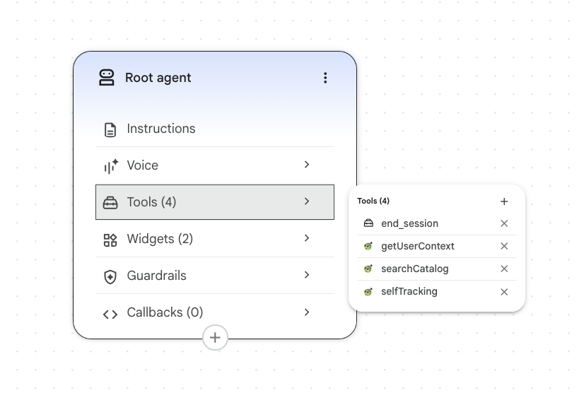

On this page, you'll build the concierge agent in CX Agent Studio. You'll import the tool schemas from the repository's `agent/` directory, add the agent's instructions, and configure session variables so that each tool call includes the shopper's Snowplow session ID.

The files in `agent/` are the source of truth for the agent. You'll paste or import them into the console, rather than writing the configuration by hand. If you'd rather create the agent as code, see the [Terraform section of the conclusion](/tutorials/signals-google-cx-agent-studio/conclusion#create-the-agent-with-terraform).



## Create the agent and import the tools

In your Google Cloud project, open CX Agent Studio and create a new agent. If the console doesn't offer agent creation, check that Gemini Enterprise for CX is available in your project's region, and enable any APIs the console asks for.

The OpenAPI files in `agent/tools/` use a placeholder server URL, `https://your-storefront.example.com`. Make local copies with your deployed storefront URL. From the repository root, run:

```bash
mkdir -p /tmp/atelier-tools
for f in agent/tools/*.openapi.yaml; do
  sed "s#https://your-storefront.example.com#https://<your-storefront-url>#" "$f" > "/tmp/atelier-tools/$(basename "$f")"
done
```

In the agent, create an OpenAPI tool for each file, and upload your local copy. Use exactly these names, because the agent's instructions refer to the tools by name:

| Tool name        | File                            | Operations                                                         |
| ---------------- | ------------------------------- | ------------------------------------------------------------------ |
| `getUserContext` | `get-user-context.openapi.yaml` | `getUserContext`                                                   |
| `searchCatalog`  | `search-catalog.openapi.yaml`   | `searchCatalog`                                                    |
| `selfTracking`   | `self-tracking.openapi.yaml`    | `trackUserIntent`, `trackAgentDecision`, `trackConstraintViolation` |

The first two files each define one operation. The self-tracking file defines three operations, so importing it creates a toolset. In the instructions, CX Agent Studio refers to each operation by toolset and operation name, such as `getUserContext_getUserContext` or `selfTracking_trackUserIntent`.

The agent shows product recommendations as cards. From the console's widget templates, add a widget tool named `productCarousel` with the widget type `PRODUCT_CAROUSEL`, and another named `productDetails` with the widget type `PRODUCT_DETAILS`. The template fills in each widget's parameter schema, so there's nothing to import. The files `agent/tools/*.widget.json` are copies of those schemas, kept in the repository for reference.

### Configure API key authentication

Every tool endpoint requires the shared secret in the `x-agent-api-key` header. For each of the three OpenAPI tools, select **API key** authentication and set:

- Header name: `x-agent-api-key`
- Value: the production `AGENT_SHARED_SECRET` you set in Vercel

CX Agent Studio stores API key values in Secret Manager, and the Customer Engagement Suite service agent needs permission to read the secret. If testing a tool fails with `Failed to get secret`, grant the service agent access to that secret. Use your project number, not the project ID, in the member:

```bash
gcloud secrets add-iam-policy-binding <secret-name> \
  --project=<project-id> \
  --member="serviceAccount:service-<project-number>@gcp-sa-ces.iam.gserviceaccount.com" \
  --role="roles/secretmanager.secretAccessor"
```

## Add the agent instructions

The repository has three versions of the instructions:

- `agent/instructions.md` is the human-readable version, with explanations of each rule
- `agent/instructions.console.widgets.txt` is the version you'll paste into the console, in CX Agent Studio's structured format
- `agent/instructions.console.txt` is a text-only version without the widget tools

The console version also contains the placeholder URL, which the agent uses to build product links. Replace it in a local copy:

```bash
sed "s#https://your-storefront.example.com#https://<your-storefront-url>#" \
  agent/instructions.console.widgets.txt > /tmp/atelier-tools/instructions.txt
```

Open the **Root agent** node on the agent canvas, and paste the contents of your copy into its instructions field. Don't paste them into **Settings** > **Advanced**. That field sets the app-wide global instruction, which would apply the concierge persona to any agent you add to the app later.

The instructions tell the agent to:

- Call `getUserContext` once per turn before replying, and use both the attributes and the activity summary
- Ground every product recommendation in a `searchCatalog` result, and never invent products, prices, or links
- Show recommendations as `productCarousel` or `productDetails` widgets, always with some text before the widget
- Call the self-tracking tools according to a set of rules, which you'll see on the analytics page
- Treat an empty context payload as a new customer, without mentioning that anything is missing
- Never mention tools, tracking, Signals, or Snowplow to the shopper

The instructions refer to tools with `{@TOOL: ...}` and `{@Widget: ...}` references. If the editor shows a reference as not found, delete it and insert it again with the editor's `@` picker. Check that all the `selfTracking_*` references resolve.

:::note[Edit instructions in the repository first]
If you change the agent's behavior, edit `agent/instructions.md` first, then make the same change in both console versions. This keeps the repository as the source of truth.
:::

## Pass the shopper's identity to the tools

Every tool call needs the shopper's Snowplow `domain_sessionid`. The context endpoint uses it to read Signals, and every endpoint uses it to join agent events to the shopper's browsing.

CX Agent Studio has no console setting for this. Instead, you declare session variables on the agent, and the OpenAPI schemas bind them to request parameters with the `x-ces-session-context` extension.

In the agent's **Variables** section, declare three variables, each with the type **Text**:

| Variable              | Value                                        |
| --------------------- | -------------------------------------------- |
| `snowplow_session_id` | The shopper's `domain_sessionid`             |
| `snowplow_user_id`    | The shopper's `domain_userid`                |
| `snowplow_turn_id`    | A per-turn ID that the storefront creates    |

:::warning[Don't set default values]
Leave every variable without a default value. If the storefront fails to send a session ID, a default value would make the agent read another session's context, and show one shopper's browsing to another. Without a default, the agent gets an empty payload and falls back to a generic greeting.
:::

The OpenAPI schemas you imported already contain the bindings. For example, this is how `get-user-context.openapi.yaml` binds the session ID to a request header:

```yaml title="agent/tools/get-user-context.openapi.yaml"
SnowplowSessionIdHeader:
  name: x-snowplow-session-id
  in: header
  required: false
  schema:
    type: string
  x-ces-session-context: $context.variables.snowplow_session_id
```

When a parameter has `x-ces-session-context`, CX Agent Studio fills in its value from the session at call time. The model doesn't see the parameter and can't change it. Every operation declares four of these headers: `x-snowplow-session-id`, `x-snowplow-user-id`, and `x-snowplow-turn-id` from your variables, plus `x-ces-session-id` from the built-in `$context.session_id`. The context operation also binds a `session_id` query parameter to `snowplow_session_id`.

Don't bind the session ID to the built-in `$context.session_id`. That's CX Agent Studio's own conversation ID, not the Snowplow `domain_sessionid`. Signals has no data for it, so every lookup would return an empty payload.

Don't let the model pass the session ID as a regular tool argument either, for example by including it in the instructions. That gives the model control over which session the tool reads. A model can copy an ID incorrectly, and a shopper could use prompt injection to make the agent request another shopper's session.

### Handle unknown and cookieless visitors

Some shoppers open the chat before the storefront has a session ID for them, for example if they're a brand-new visitor or browsing without cookies. In that case, the storefront leaves `snowplow_session_id` unset, rather than sending an empty value.

With no session ID, the context endpoint returns the empty payload with a `200` status and tracks `degraded_reason: missing_session`. The instructions tell the agent what to do:

```txt title="agent/instructions.md"
If getUserContext returns an empty profile, empty recent_activity, and empty
agent_instructions (unknown session, or the shopper just arrived and hasn't
browsed anything meaningful yet), do not mention that anything is missing,
unknown, or broken. Fall back to generic, warm concierge behaviour: greet the
shopper, ask what they're looking for or what occasion they're shopping for,
and use searchCatalog once they've given you enough to filter on.
```

The same path handles a session ID that Signals doesn't recognize, and Signals being unreachable. The shopper never sees an error, and you can measure how often each case happens.
