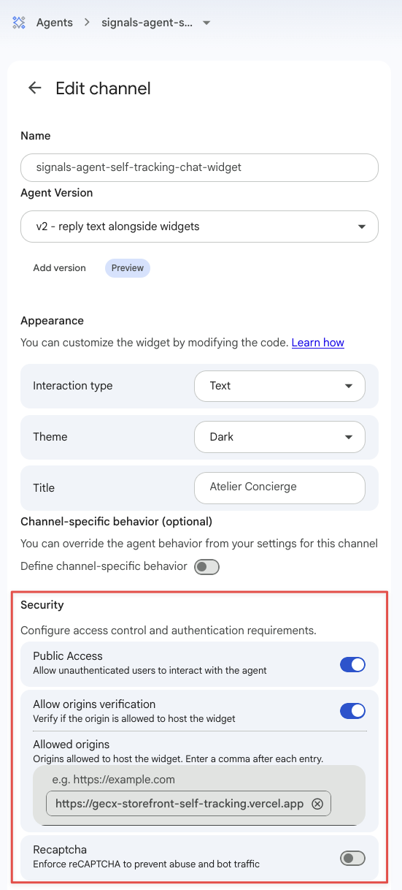

On this page, you'll test the agent in the CX Agent Studio simulator, then embed it in the storefront as a chat widget. Once the widget is live, the storefront passes the shopper's Snowplow IDs to the agent without the shopper doing anything.

## Test the agent in the simulator

In the simulator, there's no storefront to send the shopper's session ID, so you'll set it by hand:

1. Browse your deployed storefront, add a product to the cart, and copy your `domain_sessionid` from the debug panel.
2. In the simulator, set the `snowplow_session_id` variable to that session ID, using the **Set a default value at the start of the conversation** option.
3. Start a conversation. The agent's first reply should mention what you browsed or added to your cart, without you telling it.
4. Open the execution trace for the `getUserContext` call, and check that the **Output** contains a profile that matches what you browsed. The **Input** shows `{}`, because CX Agent Studio injects the session ID from the variable at call time, so the trace doesn't display it.
5. Ask for a recommendation. Any product the agent suggests should be a real catalog item.
6. Check the execution trace for the self-tracking calls. Each turn should have a `selfTracking_trackUserIntent` call, plus a `selfTracking_trackAgentDecision` call in the same step as each `searchCatalog` call.

Then test the fallback for unknown visitors. Change the variable to a made-up value, or clear it, and start a new conversation. The agent should greet you as a new customer, without mentioning errors or missing data.

When you've finished testing, clear the **Set a default value** option. A leftover default would make the widget read your test session's context for every shopper.

:::note[The tool tester doesn't inject variables]
The console's tool tester only sends parameters that the model would produce. It doesn't fill in `x-ces-session-context` parameters, so the context tool always returns the empty payload in the tester. Use the simulator to test session variables.
:::


## Publish an app version

The web widget doesn't serve your draft agent. It serves a published app version that you pin to the deployment. Create a new app version now, and do the same after every change you make in the console. If the simulator and the widget behave differently, check that the widget's pinned version includes your latest changes.

## Create the web widget deployment

On the agent, create a **Web Widget** deployment and configure it:

- Turn on public access
- Turn on origin checking, and add your storefront's exact origin, `https://<your-storefront-url>`, to the allowed origins
- Turn reCAPTCHA off
- Select the managed token broker
- Pin the app version you just published

The storefront uses the open-source [`ces-messenger`](https://github.com/GoogleCloudPlatform/ces-messenger) web component, which doesn't support reCAPTCHA. With reCAPTCHA on, every chat session fails with `400 INVALID_ARGUMENT: "Recaptcha token is missing."` For this demo, public access with origin checking is the protection level.

Copy the deployment's full resource name. It has the format `projects/<project>/locations/<location>/apps/<app>/deployments/<deployment>`.



In the Vercel dashboard, add the resource name as a production environment variable:

| Variable                        | Value                              | Exposed to the browser |
| ------------------------------- | ---------------------------------- | ---------------------- |
| `NEXT_PUBLIC_CES_DEPLOYMENT_ID` | The deployment's resource name     | Yes                    |

Redeploy from the `storefront/` directory:

```bash
vercel --prod
```

Run the deployment check again. It now also checks that the homepage includes the widget script and element:

```bash
AGENT_SHARED_SECRET=<your-shared-secret> npm run verify:deploy -- https://<your-storefront-url>
```

## Understand how the widget passes the shopper's identity

The widget is rendered by `storefront/src/components/Widget/CesMessengerWidget.tsx`, and only appears when `NEXT_PUBLIC_CES_DEPLOYMENT_ID` is set. It's equivalent to this markup:

```html
<script src="https://www.gstatic.com/ces-console/fast/ces-messenger/ces-messenger.js"></script>
<ces-messenger
  deployment-id="<NEXT_PUBLIC_CES_DEPLOYMENT_ID>"
  chat-title="Atelier Concierge"
  token-broker-url="MANAGED"
  theme-id="dark"
  audio-input-mode="NONE"
  audio-output-mode="DISABLED"
></ces-messenger>
```

The audio attributes turn off voice input and output. The component turns both on by default, and the deployment's text-only setting in the console doesn't override them.

Google also publishes a hosted `chat-messenger` component. The storefront uses `ces-messenger` because it has a `setQueryParameters()` method. Each key you pass becomes available in the agent session as `$context.variables.<key>`, which is what the `x-ces-session-context` bindings read.

When the widget has loaded, the component reads the shopper's IDs from the Snowplow browser tracker and passes them to the agent:

```javascript
const sessionId = getDomainSessionId(); // from @snowplow/browser-tracker 4.9.0 or later
const userId = getDomainUserId();
const params = {};
if (sessionId) params.snowplow_session_id = sessionId;
if (userId) params.snowplow_user_id = userId;
if (Object.keys(params).length > 0) {
  // setQueryParameters replaces all variables, so send them in one call
  document.querySelector("ces-messenger").setQueryParameters(params);
}
```

For a new or cookieless visitor, `getDomainSessionId()` returns `undefined`, and the component leaves the variable unset, so the agent falls back to a generic greeting.

The widget dispatches its `ces-messenger-loaded` event on `window`, not on the element. If you write your own embed, listen on `window`, otherwise the IDs never reach the agent.

The per-turn ID needs more care. The widget only fires its send event after the request has gone, so a turn ID set at that point would travel with the next turn instead. The storefront's `useWidgetConversationTracking.ts` hook creates the next turn's ID ahead of time: once when the widget mounts, then again right after every send. Because `setQueryParameters` replaces all variables, the storefront resends the session ID and user ID with every new turn ID.

The same hook tracks `message_sent` and `message_received` events in the browser, each with the turn ID in a `conversation` entity. By default, these events include the first 100 characters of each message. Set `NEXT_PUBLIC_WIDGET_MESSAGE_PREVIEWS_ENABLED` to `false` to track only the message length.

The stock `ces-messenger` component prints widget references such as `{@Widget: productCarousel}` as raw text. The storefront's `useWidgetTokenRenderer.ts` hook replaces them with product cards, and tracks clicks on those cards.

## Test the integration on the storefront

Open your deployed storefront and test the full flow:

1. Browse a couple of products and add one to the cart.
2. Open the chat. Check the browser console for the `[Signals Demo] Passed Snowplow identity variables to ces-messenger` message, with your session ID.
3. Send a message. The reply should refer to your browsing and cart without you mentioning them.
4. Browse another product, then within a few seconds ask the agent about it. The reply should include the product you just viewed.
5. Open a private browsing window, and open the chat before browsing anything. The agent should greet you as a new customer.

If the agent describes a different shopper's browsing, the agent isn't receiving your session ID. Check that the browser console message appears, that the `snowplow_session_id` variable has no default value, and that the deployment's pinned app version includes your latest changes.

If the widget loads but never connects, check that your storefront's exact origin is in the deployment's allowed origins.


