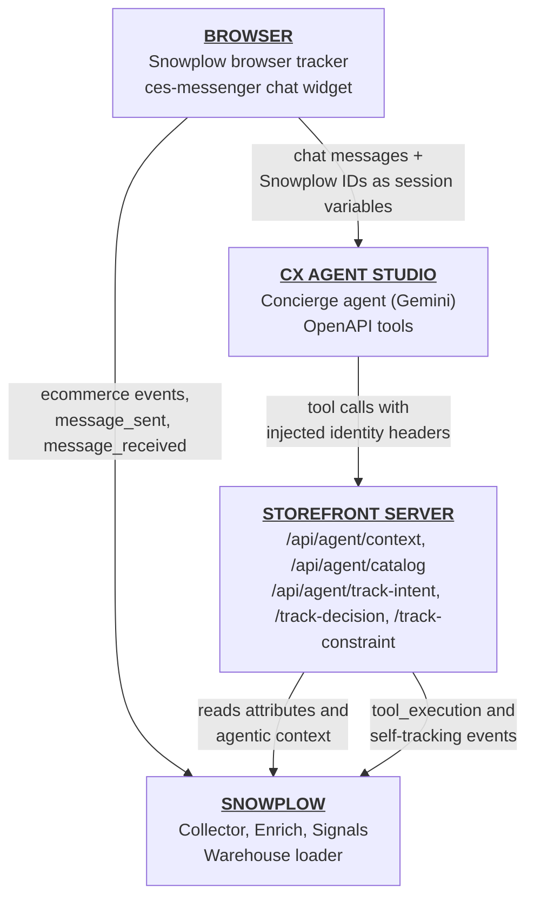

A customer-facing agent usually knows only what the user types into the chat. A shopper might spend ten minutes browsing evening wear and add a blazer to their cart, but when they open the chat, an agent without behavioral context still asks them what they're looking for.

In this accelerator, you'll connect a concierge agent built in Google Gemini Enterprise for CX to [Snowplow Signals](/docs/signals/), so the agent reads the shopper's live browsing session before it replies. You'll also track the agent's own behavior back into your Snowplow pipeline: which tools it called, what intent it detected, what it decided, and when the catalog couldn't satisfy a request.

Here's the difference for a shopper who added a blazer to their cart and then viewed a silk dress:

```txt
Shopper: "Hi, I'm looking for something to finish an evening look"

// Without Signals context
Concierge: "I'd be happy to help. What's the occasion, and do you have a
            particular style or budget in mind?"

// With Signals context
Concierge: "The blazer in your bag and the silk dress you were just looking
            at would make a lovely base for the evening. Here are two pieces
            that would finish the look."
            [product carousel with two jewelry pieces]
```

The shopper didn't mention the blazer or the dress. The agent read them from Signals, using the shopper's Snowplow session cookie as the lookup key. The shopper didn't need to create an account or log in.

Gemini Enterprise for CX agents are built in CX Agent Studio, a managed agent platform that you configure in the Google Cloud console. With a code-first framework such as Google ADK, you control the agent runtime and can add context in a callback, as shown in the [Google ADK accelerator](/tutorials/signals-google-adk-agent/introduction). CX Agent Studio doesn't give you access to the runtime. Your integration points are OpenAPI tool schemas, the agent's instructions, and session variables, and this accelerator uses only those three.

:::note[Snowplow account required]
This accelerator runs on a live Snowplow pipeline with Signals, because Signals calculates the agent's context from real browsing events. If you don't have a Snowplow environment, start a [Snowplow free trial](https://snowplow.io/get-started/snowplow-free-trial?utm_source=docs.snowplow.io&utm_medium=referral) before you begin. The 14-day trial includes a hosted pipeline, Signals, and one warehouse or lake destination. See [Snowplow free trial](/docs/get-started/free-trial/) for what the trial includes.
:::

:::warning[Reference integration]
The companion repository is a reference integration for demos and evaluation. It runs against demo data, protects the agent tool endpoints with a single shared secret, and includes an unauthenticated attributes endpoint for its on-page debug panel. Don't deploy it against production data or traffic. The [conclusion](/tutorials/signals-google-cx-agent-studio/conclusion) lists what you'd change for production.
:::

## Explore the demo application

The [companion repository](https://github.com/snowplow-industry-solutions/signals-google-cx-agent-studio) contains Atelier Signals, a fictional luxury fashion storefront built with Next.js, and everything the CX Agent Studio agent needs:

| Directory     | Contents                                                                                                                                   |
| ------------- | ------------------------------------------------------------------------------------------------------------------------------------------ |
| `storefront/` | The Next.js storefront: Snowplow tracking, the Signals configuration, the agent tool endpoints, and the chat widget embed                  |
| `agent/`      | The agent's instructions and the OpenAPI tool schemas you'll import into CX Agent Studio                                                  |
| `analytics/`  | BigQuery queries over the agent's events                                                                                                   |
| `terraform/`  | Optional Terraform configuration that creates the same agent, tools, and deployment as code                                               |
| `scripts/`    | An interactive setup script, a script that prints what Signals holds for one session, and verification checks for a live deployment       |

The integration has two parts:

- Agentic personalization: the agent calls a `getUserContext` tool at the start of every turn. The tool returns the shopper's Signals attributes, such as their favorite designer and cart contents, plus a plain-language summary of their recent activity. The agent uses that context to personalize its reply, and a `searchCatalog` tool to ground recommendations in real products.
- Agentic analytics: every tool call emits a Snowplow event from the server. Three self-tracking tools let the agent record the intent it detected, the decisions it made, and requests the catalog couldn't satisfy. The chat widget tracks each message the shopper sends and receives.

You won't write any code in this accelerator. Most of the build happens in the CX Agent Studio console, and the repository already contains all the code. Each page explains the code that makes one part of the integration work, then walks you through deploying or configuring it.

By the end of this accelerator, you'll have:

- A storefront that tracks ecommerce [events](/docs/fundamentals/events/) into your Snowplow pipeline
- A Signals attribute group and agentic context that describe each shopper's session in real time
- A CX Agent Studio concierge agent that greets shoppers with their browsing context, and falls back to a generic greeting for new or cookieless visitors
- Agent events in your pipeline that you can join to the shopper's browsing events

## Understand the architecture

The storefront hosts both the shopper-facing site and the API endpoints the agent calls as tools:



A single conversation turn works like this:

1. The shopper browses the storefront. The Snowplow browser tracker sends ecommerce events, such as `product_viewed` and `cart_updated`, to your Collector.
2. Signals calculates session attributes, such as `favorite_designer` and `high_intent_product_ids`, from those events in real time. It also keeps the last hour of activity as an agentic context.
3. The shopper opens the chat widget. The storefront passes the shopper's Snowplow session ID, user ID, and a per-turn ID to the agent's session as session variables.
4. The agent calls `getUserContext`. CX Agent Studio adds the session variables to the request as headers, and the endpoint reads that session's attributes and activity from Signals.
5. The agent calls `searchCatalog` to find products, and calls the self-tracking tools to record its intent and decisions.
6. Each endpoint emits a Snowplow event as it handles the request. The chat widget tracks the shopper's message and the agent's reply from the browser.

### Follow the identifiers

Four identifiers connect the shopper's browsing, the conversation, and the agent's events:

| Identifier         | Created by                       | Reaches the tool endpoints as                              | Used for                                                                    |
| ------------------ | -------------------------------- | ---------------------------------------------------------- | --------------------------------------------------------------------------- |
| `domain_sessionid` | Snowplow browser tracker cookie  | `snowplow_session_id` variable, `x-snowplow-session-id` header | Signals lookup key, and joining agent events to browsing events             |
| `domain_userid`    | Snowplow browser tracker cookie  | `snowplow_user_id` variable, `x-snowplow-user-id` header       | The `domain_userid` field on agent events                                   |
| Turn ID            | Storefront, once per chat turn   | `snowplow_turn_id` variable, `x-snowplow-turn-id` header       | Grouping every event from one turn                                          |
| Chat session ID    | CX Agent Studio                  | Built-in session context, `x-ces-session-id` header            | Grouping every event from one conversation                                 |

A single shopper message produces events from both the browser and the server, all linked through these IDs:

```txt
domain_sessionid (Snowplow session cookie)
  ├→ product_viewed, cart_updated (browser)
  └→ chat session ID (CX Agent Studio conversation)
       └→ turn ID (minted by the storefront for each turn)
            ├→ message_sent (browser) ──────────────── message_context + conversation
            ├→ tool_execution: getUserContext (server) ─ agent_context + tool_context + context_lookup
            ├→ user_intent_detected (server) ────────── agent_context + tool_context
            ├→ agent_decision_logged (server) ───────── agent_context + tool_context
            ├→ tool_execution: searchCatalog (server) ── agent_context + tool_context + catalog_search
            ├→ constraint_violation (server) ────────── agent_context + tool_context
            └→ message_received (browser) ──────────── message_context + conversation
```

The agent events use the generic agent tracking schemas from [Iglu Central](https://iglucentral.com/), the same ones used in the [agentic self-tracking accelerator](/tutorials/agentic-self-tracking/introduction). The `conversation`, `context_lookup`, and `catalog_search` [entities](/docs/fundamentals/entities/) are custom to this demo.

## Prerequisites

You'll need:

- A Snowplow account with Signals enabled. If you don't have one, start a [Snowplow free trial](https://snowplow.io/get-started/snowplow-free-trial?utm_source=docs.snowplow.io&utm_medium=referral). Signals stops calculating attributes when the 14-day trial ends, so plan to finish the accelerator within that time.
- A Google Cloud project where Gemini Enterprise for CX (CX Agent Studio) is available, with permission to create agents, Secret Manager secrets, and IAM bindings
- The [Google Cloud CLI](https://docs.cloud.google.com/sdk/docs/install) (`gcloud`)
- A [Vercel](https://vercel.com/) account and the Vercel CLI
- Node.js 20.9 or later, and npm
- Python 3.11 or later
- The [Snowplow CLI](/docs/api-reference/snowplow-cli/)
- Git and `openssl`
- Optional: a data warehouse destination for your Snowplow pipeline. Snowplow Console doesn't show the event trace for a conversation, so you need a warehouse to view the events the storefront and agent send. This accelerator uses BigQuery, but any [warehouse that Snowplow supports](/docs/destinations/warehouses-lakes/), such as Snowflake, Databricks, or Redshift, works. The companion repository's queries are written in BigQuery SQL, so for another warehouse you'd need to edit them yourself. The free trial includes one warehouse or lake destination.
