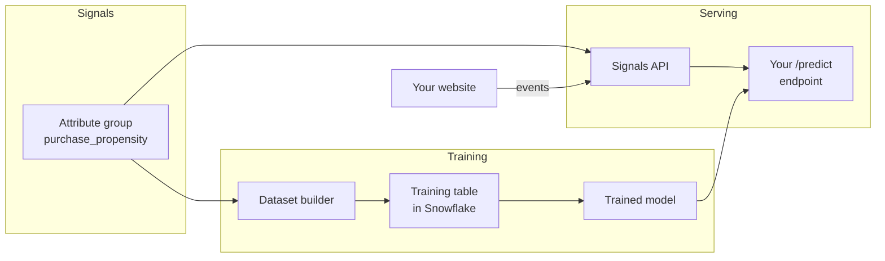

In this tutorial you'll build a model that predicts whether an ecommerce session will end in a purchase, and score live sessions with it while the user is still browsing.

The hard part of a real-time model is usually not the model. It's making sure that the features it trains on are computed the same way as the features it sees in production. If you write a SQL pipeline for training and separate code for serving, the two drift apart, and the model quietly gets worse. Signals avoids this by using one definition for both:

* The [dataset builder](/docs/signals/ml-training-datasets/) turns an [attribute group](/docs/signals/attributes/attribute-groups/) into a training table in your warehouse, computing each attribute as it was at each moment in the past
* The same attribute group, once published, is computed in real time from your event stream and served through the [Signals API](/docs/signals/applications/retrieve-attributes/)

By the end you'll have:

* A published attribute group with in-session shopping behavior, such as product views, cart additions, and checkout steps
* A labeled training dataset in Snowflake, built by Signals from your historical events
* A gradient-boosted model trained and evaluated on that dataset
* A `/predict` endpoint that fetches a session's live attributes from Signals and returns a purchase score

This tutorial is for data scientists and engineers who already have Snowplow ecommerce events in Snowflake. You'll write and run the code in your own Python environment, for example a Jupyter notebook. To create the attribute group, you can use either the Python SDK or an AI assistant: the [Snowplow Assistant](/docs/ai/console-agent/) in Console, or your own assistant connected to the [Snowplow MCP server](/docs/ai/snowplow-mcp/). It should take around an hour, most of which is waiting for the dataset to build.

## How the pieces fit together

The model runs in your own service. Signals provides the features, both historical and live:



Each row in the training table is a moment in a past session, called an anchor. The row has the attribute values as they were at that moment, and a label that says whether the session went on to buy. At serving time, the live attribute values for a session describe the same moment: "now". The model sees the same columns in both cases.

## Prerequisites

This tutorial assumes that you have:

* [Signals enabled](/docs/signals/setup/) with a Snowflake warehouse connection, because the dataset builder runs its queries in your Snowflake account
* [Snowplow ecommerce](/docs/sources/web-trackers/tracking-events/ecommerce/) events from a website in your Snowflake `atomic.events` table, including `product_view`, `add_to_cart`, and `transaction` actions, so the model has purchases to learn from: you'll check whether you have enough in [Build the dataset](../build-training-dataset/)
* A website that sends those events to your pipeline now, so you can watch scores for a live session
* Python 3.10 or later, and basic familiarity with pandas and scikit-learn
* Snowflake credentials that can read the schema Signals writes to, to load the training table

:::note[A full pipeline is required]
Signals computes the live attributes from events flowing through your pipeline, and the dataset builder reads your historical events from Snowflake. You can't complete this tutorial with [Snowplow Micro](/docs/testing/snowplow-micro/) or the Signals sandbox.
:::

Install the Python packages you'll use:

```bash
pip install "snowplow-signals>=0.4.9" "snowflake-connector-python[pandas]" scikit-learn joblib fastapi uvicorn
```
