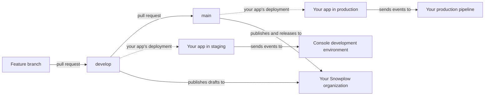

This tutorial shows you how to manage your tracking from your application's own repository. The [data structures](/docs/fundamentals/schemas/) and the [tracking plan](/docs/event-studio/tracking-plans/) live as files next to the code that sends the events. [Snowtype](/docs/event-studio/implement-tracking/) generates the tracking code from those files, and [Snowplow CLI](/docs/api-reference/snowplow-cli/) checks every change and publishes it to Console from GitHub Actions.

Managing tracking this way gives every change to your tracking a pull request, a review, and a history, in the same place as the code change that needs it. The checks catch a tracking definition and its generated code drifting apart, and an event specification version that doesn't match the version Console assigns, before anything reaches Console.

Most of the work runs on your machine and in pull request checks that need no Console access: you write the definitions, generate the code, and check the versions offline. Console only comes in when GitHub Actions checks a pull request against Console and publishes the merged tracking.

This tutorial is for developers who already track events with the [JavaScript tracker](/docs/sources/web-trackers/) and want their tracking definitions under version control. You'll work in your own terminal and in a GitHub repository.

## What you'll build

You'll set up one repository that holds the tracking for a TypeScript web app, and the workflows that check and publish it. The example tracks one [self-describing event](/docs/fundamentals/events/#self-describing-events), `signup`, with one [entity](/docs/fundamentals/entities/), `plan`, through one event specification, `Signup`, in a tracking plan called `Signup flow`.

This tutorial follows one example path, with a `develop` and a `main` branch. Adapt the branch names to your own workflow:

The same flow, as steps:

1. You change the tracking definitions and the code on a feature branch, regenerate the tracking code with Snowtype, and check the versions locally without credentials.
2. A pull request into `develop` runs the checks that need no credentials, and the checks against Console.
3. Merging into `develop` publishes the data structures to the development registry and syncs the tracking plan, so a changed event specification gets a new draft version. Your application, deployed from `develop` to its staging environment, sends events to a [Console development environment](/docs/testing/snowplow-micro/console/), which validates them against the draft.
4. A pull request from `develop` into `main` runs the checks against Console. Merging it publishes the data structures to the production registry and releases the event specifications. Your application, deployed from `main` to production, sends events to your production pipeline.

Nothing reaches the production registry or the production pipeline until it merges into `main`. The tracking plan belongs to your organization, not to a pipeline, so both branches publish the same tracking plan: `develop` leaves new versions in draft, and `main` releases them.

## Requirements

To follow this tutorial, you need:

* A GitHub repository for your application, with a `develop` branch and a `main` branch, and GitHub Actions enabled
* A TypeScript web app that uses the [JavaScript tracker](/docs/sources/web-trackers/) (`@snowplow/browser-tracker`), with Node.js and npm installed
* [Snowplow CLI](/docs/api-reference/snowplow-cli/) installed
* [Snowtype](/docs/event-studio/implement-tracking/install-snowtype/) installed in the app as a development dependency
* A Snowplow account with Console and a development environment, for the checks against Console and the publishing
* Familiarity with [Git](https://git-scm.com/) and [GitHub Actions](https://docs.github.com/en/actions/writing-workflows)

Snowplow CLI must be a version that checks event specification versions, and Snowtype a version that generates code from local tracking plans and has the `check` command:

<AppliesTo feature="snowplow-cli-event-specification-versions" />

<AppliesTo feature="snowtype-local-tracking-plans" />
